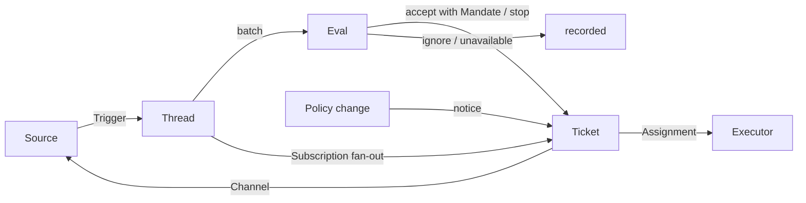

# 001 领域模型

[English](001-domain.md)

本文档为 dsh-superagent 的概念命名，并说明每个概念所遵循的规则。代码、智能体调用的工具、面板以及其他文档都使用这些术语，不使用其他说法。遵循 [000 理念](000-philosophy.zh-CN.md) / [English](000-philosophy.md)，该模型只保留工作实际需要的概念，而每项业务需求都会成为其中某个概念的属性。

## 流程

工作从 Trigger（触发）流向 Eval（评估），再进入执行阶段。Source（来源）产生 Trigger。一个 Trigger 会作为上下文，扇出到订阅了其 Thread（线程）的所有 Ticket（工单）。如果某个人的消息通过这种方式到达某个 Ticket，该消息会继续归属于这个 Ticket；其他所有 Trigger 都进入 Eval，由 Eval 判断它是否提出了新工作。Eval 接受后，会创建一个带有 Mandate（授权）的 Ticket。Assignment（派工）把 Ticket 交给 Executor（执行器），结果则通过 Channel（渠道）返回 Source。

## 概念

Source、Thread、Eval、Mandate 和 Subscription（订阅）构成核心领域；其余概念为它们提供支持。

| 概念 | 定义 | 它维护的规则 | 存在原因 |
| --- | --- | --- | --- |
| Source（来源） | 事件流。Source kind（来源类型）是一份可复用的实现；Source instance（来源实例）则是某一类型的一项配置：它是否运行，以及它监听什么 | 保存自己的读取位置和自己的机器人身份。定义什么算作事件，包括只有经过一段时间才成立的条件。在事件进入领域之前，丢弃机器人自身的消息，以及不在其监听范围内的 Trigger。把每个 Trigger 转换为它所属的 Thread，以及用于回复的 Channel 地址 | 重启不得重放事件 |
| Trigger（触发） | 一个不可变事件，包含 Source 自己提供的元数据，例如事件的 actor（行为者） | 属于一个或多个 Thread。重复接受同一个 Trigger 只会创建一个 Ticket | 审计与幂等性的基本单元 |
| Thread（线程） | 按时间顺序排列的 Trigger；由 Source 定义哪些 Trigger 构成同一个 Thread | 同一时间至多在其上运行一个 Eval。它可以有多个 Ticket。它保存自己的 Subscription、正在运行的 Eval 和 Decision（决定）历史 | 为 Eval 提供一致的视图及其上下文 |
| Correlation（关联） | 一个 Trigger 所属的各个 Thread 之间的关系 | 增加上下文；绝不负责路由 | 让 Eval 能够跟进相关证据 |
| Channel（渠道） | Thread 的写入侧；由 Source 定义其地址 | 一个 Thread 可以有多个 Channel；一个 Ticket 保存一组 Channel | 确认、回复、拉取请求以及已解决的评审意见都属于写入操作 |
| Policy（策略） | 有版本的研判规则，以及每个 Source 所对应的部分：谁可以通过该 Source 发起工作（使用该 Source 自己的身份体系）、名单如何同步，以及哪些机器人可以生成候选项 | Policy version（策略版本）覆盖规则、接受模式和各 Source 部分。凡是会影响某个活动 Ticket 的变更，例如它被接受时所依据的规则发生变化，都会送达其 Assignment；变更不会撤销 Mandate。不同 Source 上的身份绝不相互映射 | 规则变化时，必须丢弃正在运行的 Eval |
| Eval（评估） | 对一批 Trigger 作出的判断，分为 gate（准入）与 assessment（研判）两层 | 输入：该批 Trigger、Thread 快照、该 Thread 上的每个 Ticket（包括已结束的 Ticket），以及当前 Policy。输出：一个 Decision。不保存状态 | 决定新工作是启动、继续还是停止 |
| Mandate（授权） | 一次 accept（接单）所授予的内容：Policy version、scope（范围）、strength（强度）、匹配的规则、发送者在该 Source 上的身份，以及 Source 如何接收到该 Trigger | 不可变；扩大范围意味着创建一个新 Ticket。Ticket 结束并不终止 Mandate：只有某个人的 stop（停止）才会撤回它，而不再支持该 Mandate 的 Policy 会撤销它。已结束的 Ticket 恢复前，必须用当前 Policy 重新验证 Mandate | 说明为何可以执行这项工作，以及可以做到什么程度 |
| Ticket（工单） | 一个已获授权的工作单元 | 只能由 Eval 创建。引用自己的 Mandate；保存自己的 Channel 和 Input（输入）。状态从 open → ended；当某个人在其某个 Thread 上发送消息时恢复为 open，除非某个人曾停止该 Ticket。Ticket 定义自己的状态，而不跟随 Executor 的状态 | 拥有该次执行及其 Report（报告） |
| Assignment（派工） | Ticket 与某个 Executor 实例的绑定关系 | 一个 Ticket 随时间推移可以有多个 Assignment。Assignment 独立于 Ticket，依次经历 pending → running → ended。只有它的最终 Report 才能从 Executor 一侧结束 Ticket | Executor 位于领域之外，但“由谁执行”必须处于领域之内 |
| Subscription（订阅） | Ticket 与 Thread 之间的多对多关系，由 Thread 保存 | 匹配的 Trigger 会扇出到每个仍有效的已订阅 Ticket，不检查是谁发送了它；某个人的消息以这种方式到达 Ticket 时，不进入 Eval。Executor 为获取上下文而关注的 Thread 也以同样方式到达其 Ticket，但不会借给 Ticket 任何权限，也不会恢复 Ticket。已结束的 Ticket 会保留自己的 Subscription，包括已经关闭或合并的拉取请求对应的 Subscription：某个人的消息会在相同 Mandate 下恢复它，不经过 Eval，也不产生 Decision；机器人和 CI 的消息不会到达它，因为 Ticket 恢复时，其 Executor 会重新读取各个 Thread。被某个人停止的 Ticket 不接收任何内容。只有当消息明确指向某个现有 Ticket 时，Main Session（主 Session）才会把 Thread 附加到该 Ticket。某个人可以移除某个 Thread 上的全部 Subscription；Executor 只能移除其自身 Ticket 对它认为不相关的 Thread 的 Subscription，但 Ticket 最初所在的 Thread，以及由 Source 要求其关注的 Thread（例如其拉取请求对应的 Thread）除外 | 之后的讨论无需任何人再次提及智能体，就能到达 Executor |

“人”不是一个领域概念。Trigger 携带的 actor 标识符就是 Source 提供给它的标识符。允许名单是 Policy 中某个 Source 对应的部分，使用该 Source 的身份体系。同一个人在多个 Source 上拥有账户这一事实，是智能体在需要时读取的提示词文本。

Executor 及其 Session 和目录位于领域之外，通过 Assignment 与领域连接。

聚合：Source 保存自己的读取位置。Thread 保存自己的 Subscription、正在运行的 Eval（串行运行，并把期间到达的 Trigger 合并到下一批中）以及 Decision 历史。Ticket 保存自己的 Assignment、Channel 和 Input，并通过 id 引用 Decision。

## 被拒绝的概念

| 被拒绝的概念 | 原因 |
| --- | --- |
| 把 Principal 或 Membership 作为实体，或者映射不同 Source 上的身份 | “人”是 Trigger 的元数据；允许名单是 Policy 中某个 Source 对应的部分；跨 Source 映射属于提示词文本 |
| 由 Eval 调度自身的延迟 Trigger | 需要等待的条件就是一个普通 Source，因此 Eval 永远不会反向依赖 Source |
| waiting 或 revoked Eval 状态 | 等待属于 Source；超时的 Eval 会重新排队其 Trigger，或者以 `unavailable` 结束 |
| 每个 Thread 至多有一个活动 Ticket | 一个 Thread 可以承载多项彼此独立的工作；assessment 会根据 Ticket 列表避免重复 |
| “追加到 Ticket”的 Decision | 追加由 Subscription 扇出完成，不需要 Eval |
| 对 Subscription 做准入检查 | Subscription 覆盖整个 Thread；Mandate 将授权与上下文分离 |
| 能够执行路由的 Correlation | Subscription 负责路由；Correlation 只增加上下文 |
| 跟随 DSH Session 状态的 Ticket 状态 | Ticket 可以移交、恢复，或由多个 Executor 执行，因此它定义自己的状态 |
| Executor 声明某个人要求它停止 | 只有 Eval 能决定一次结束的强度 |
| Policy 变化时取消正在运行的 Ticket | 取消会留下未完成的工作；因此改为记录变更并送达 Ticket |
| Executor Session 失败或阻塞时锁定其所有工具 | 这会拒绝一个直接在 Session 中工作的人，也会拒绝恢复后的 Report；暂停自动输入就足够了 |
| 根据 Report 的自由文本推断“正在等待某个人” | 这种分类需要结构化事实；Executor 通过结构化字段提问 |

## 可复用的内容

上述概念及其规则可以复用。Source 实现、Policy 内容、Executor 和 Channel 实现都属于具体部署。每个 Source 在内部保留自己的术语，例如 message、chat 或 notification，并把它们转换为 Trigger。

| 部分 | 在本仓库中的实现 |
| --- | --- |
| Source | 飞书：实时事件、历史恢复、订阅主题的轮询。GitHub：通知、已订阅的 Issue 和拉取请求、CI 变化、拉取请求的合并或关闭；开启相应开关后，还包括仓库中的每个新 Issue、拉取请求和评论，以及默认分支的 CI。定时：按 cron 表达式，以某个账户的名义发出固定的任务说明。企信：轮询已配置的会话与私聊，并通过同一个 CLI 回话 |
| Policy | assessment 规则，以及每个 Source 的允许名单、名单同步、机器人名单和准入表 |
| Executor | 每个 Ticket 对应一个 DSH Executor Session 和一个目录，二者位于某个执行环境中；Executor 和各 Source 会注册该环境的变量 |
| Channel | 飞书话题回复、GitHub 评论和评审线程回复 |

## 术语表

以下是本文档及后续文档所用术语的参考清单，并列出它们的中文名称；后续文档会解释上文尚未介绍的术语。面板一次只显示一种语言；其中的 (?) 按钮会打开这个中英双语术语表。智能体在 GitHub 和飞书上发送给人的消息使用通俗语言，而不使用这些术语。

| 术语 | 中文 | 含义 |
| --- | --- | --- |
| Agent | 智能体 | dsh-superagent 运行的自动化团队成员，通过 GitHub 账户、飞书机器人等身份在 Source 上采取行动 |
| Main Session | 主 Session | 负责评估 Trigger、接受并分派 Ticket 以及回复的 DSH Session；在代码和提示词中称为 `orchestrator` |
| Executor Session | 执行器 Session | Executor 为一个 Ticket 运行的 DSH Session；在代码和提示词中称为 `worker` |
| Source | 来源 | 事件流：由插件提供的一种类型，加上一个实例配置 |
| Trigger | 触发 | 来自 Source 的一个不可变事件 |
| Thread | 线程 | 按时间顺序排列的 Trigger；Eval 在其中逐个运行的基本单元 |
| Correlation | 关联 | 共享同一 Trigger 的各个 Thread 之间的关系；它只增加上下文 |
| Channel | 渠道 | Thread 的写入侧 |
| Policy | 策略 | 接受工作的版本化规则，以及各 Source 对应的部分，例如谁可以在那里请求工作 |
| Policy version | 策略版本 | 一组规则、Source 部分和接受模式组合的标识符；每个 Mandate 都会记录它 |
| Eval | 评估 | 把一批 Trigger 转换为一个 Decision 的过程 |
| Gate | 准入 | Eval 的第一层确定性判断：谁可以发起工作，以及可以用什么强度发起 |
| Assessment | 研判 | Eval 过程中模型作出的判断 |
| Decision | 决定 | Eval 的结果 |
| Mandate | 授权 | accept 所授予的内容：强度、范围以及所依据的 Policy version |
| Ticket | 工单 | 一个已获授权的工作单元 |
| Assignment | 派工 | Ticket 与某个 Executor 实例之间的绑定关系 |
| Subscription | 订阅 | Ticket 与 Thread 之间的关系 |
| Fan-out | 扇出 | 把已订阅 Thread 的 Trigger 作为上下文送达 Ticket |
| Executor | 执行器 | 运行 Assignment 的端口：每个 Ticket 对应一个 Executor Session 和一个目录 |
| Execution environment | 执行环境 | Executor Session 与 prepare 命令的运行位置：Executor 与各 Source 在其中注册变量，每个变量都有键、值和说明 |
| Report | 报告 | Assignment 向其 Ticket 报告的状态 |
| Attention | 待人工决定 | Ticket 上等待某个人回答的问题 |
| Disposition | 去向 | Trigger 被过滤、评估或扇出的记录 |
| Input | 输入 | 送达 Ticket 的上下文：扇出的 Trigger、Policy 变化、恢复和文本 |
| Scope | 范围 | Mandate 所允许的工作 |
| Strength | 强度 | Mandate 或 Eval 的依据有多强 |

| 分组 | 取值 |
| --- | --- |
| Decision | accept 接单 · stop 停止 · ignore 忽略 · unavailable 未完成 |
| Strength | explicit 明确 · inferred 推断 |
| Assignment | pending 待启动 · running 执行中 · ended 已结束 |
| Report | progress 进展 · waiting 等待 · ready 就绪 · blocked 受阻 · failed 失败 · dropped 无需处理 |
