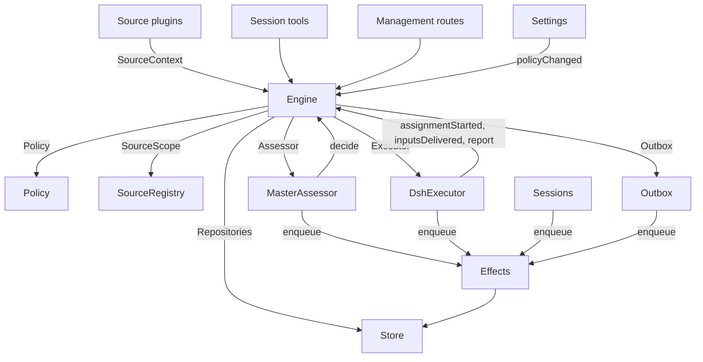

# 007 架构

[English](007-architecture.md)

本文是面向开发者的实现指南。它把从 [001 领域模型](001-domain.zh-CN.md) / [English](001-domain.md) 到 [006 部署](006-deployment.zh-CN.md) / [English](006-deployment.md) 中的概念映射到类、接口和文件。请先从 Runtime 和 Engine 入手，再把模块表和测试表作为代码索引使用。

## 核心类与胶水层

核心类负责领域概念，并把外部边界封装在小型接口之后。胶水层把工具参数、HTTP 请求、Source 载荷和 DeepSeek Harness 事件转换为对这些类的调用，再把结果转换为卡片、视图和消息。

`Runtime`（`src/app/runtime.ts`）负责构造应用、提供依赖并管理启动和关闭。`Engine` 自行构造其内部组成部分。Executor 和 Assessor 会回调 Engine，因此 Runtime 向它们提供 getter，而不要求按循环顺序构造对象。

### Runtime（运行时）

`Runtime` 是组合根（composition root）；它不包含领域规则。其构造函数会锁定状态目录、打开 Store，并构建各个组件。如果构造失败，它会关闭 Store 并释放锁。

启动时会注册管理路由并运行 Setup。Setup 完成后，它会安装 Session 和 Executor 钩子，确保主 Session 存在，启动 Policy 同步，恢复被中断的 Assignments，并启动 passes 和 effects。`ready` 表示启动已经完成。

关闭时会取消 turn，等待 passes、effects 和 agents，恢复进程环境，关闭 Store 并释放锁。Source 插件通过精简的 `SourceHost` 接口，把 Runtime 作为 `orchestrator` 服务注入。

| 部分 | 模块 | 作用 |
| --- | --- | --- |
| Setup | `src/app/setup.ts` | 以 worker shell 实际运行 CLI 的方式探测这些 CLI，从而解析仓库和账号；写入并应用 worker 的环境与命令 shim，并保留 setup 问题；Settings 通过它检查已变更的账号，也通过它重启，而重启会再次运行 setup |
| Passes | `src/app/passes.ts` | 每次只运行一个 pass；每两秒运行一次，也在命令请求时运行：先处理到期的 effects，再调用 `Engine.evaluateDue`；Source 的 Trigger 通过它到达 Engine |
| Outbox | `src/app/outbox.ts` | Engine 的 `Outbox` 端口，也是 receipt 的唯一写入者：`send` 在一个事务中保存消息的 receipt，并将其 `reply` effect 加入队列；effect 的处理器通过 `SourceRegistry.send` 发送消息；Source 关闭时消息会等待，会话消失或不再被监听时消息会被丢弃 |
| Notices | `src/app/notices.ts` | 把领域事件和 worker 活动转换为主 Session 消息。`eventNotice` 处理领域通知；`reportRelay` 立即转发问题，把普通进展保留在所属 Ticket 上，并转发其他报告；`followupRelay` 指明哪些 Tickets 负责某个人工 follow-up。turn 期间到达的 relay 会通过 DeepSeek Harness inbox，在其下一步一并交付 |

### Engine（引擎）

`Engine`（`src/core/engine.ts`）是 Triggers、Threads、Decisions、Tickets 和 Assignments 的唯一写入者。它接收 `src/core/ports.ts` 中的这些端口：`Repositories`、当前 Policy 的 getter、`SourceScope`、`Assessor`、`Executor` 和 `Outbox`。可选依赖包括 `prepareTicket`、`now` 和 `emit`。

所有 Engine 方法都是同步的。每个命令都在一个事务中修改其聚合。`evaluateDue` 会为它修改的每个 Eval 或 Ticket 使用单独的事务。端口在事务内部将外部工作加入队列；适配器在提交后执行这些工作。无效请求会抛出 `UserError`。

Engine 暴露一个入口点，并把工作委派给五个内部部分。它负责每个命令的事务。横跨多个部分的命令（如 `attach`、`evaluateDue` 和 `policyChanged`）会依次调用这些部分。

每个部分都继承 `EnginePart`（`src/core/part.ts`），后者提供选项和共享读取能力。各部分之间的依赖单向流动：

| 部分 | 职责 | 依赖 |
| --- | --- | --- |
| `Intake` | 处理 Source 的 Trigger：只保存一次及其 disposition，把它记录到其 Threads 及相互关联中，扇出到已订阅的 Tickets；除非它是一条已经到达某个 Ticket 的人工消息，否则把它放入其主 Thread 的 Eval 队列 | Tickets |
| `Evals` | 处理 Threads 的 Evals：批处理；gate 的强度、actor 和 basis，以及提供这些信息的 Trigger（`primary`）；从 candidate 交付时起算的截止时间及暂停导致的顺延；过期 Eval 的重新入队；candidates、replays 和 hand-backs；Policy 变更时重新入队；以及每个 Eval 最终产生的 Decision：accept、stop、ignore 或 unavailable | Tickets |
| `Tickets` | Ticket 生命周期：从 accept 创建 Ticket 及其 Mandate、Subscriptions 和首个 Assignment；它关注的 Threads 及其关闭状态（`followsDone`）；附加的 Threads 和只为上下文而关注的 Threads；Inputs 和 notes；恢复以及恢复时拒绝的消息；retry、restart、stop 和 end；移除的 Subscriptions；以及把 Policy 变更通知给受其影响的 Tickets | Replies |
| `Assignments` | Executor 及其 workers 报告的事实：Assignment 已启动、Inputs 已送达或送达失败、restart 中断了它，以及 worker 的 Report 和其中向人提出的问题 | Tickets、Replies |
| `Replies` | 通过 `Outbox` 写入 Channel：acknowledgement、answer、result 和 attention 消息，各自遵循允许发送它的规则 | 无 |

命令使用祈使式名称，如 `stopTicket`；适配器报告的事实使用过去时名称，如 `assignmentStarted`。查询 `candidate` 使用名词。

调用方只能获得与其角色对应的 Engine `Pick`：`EngineForSources`、`EngineForMainSession`、`EngineForPeople`、`EngineForSettings` 或 `EngineForExecutor`。

| 角色 | 方法 | 效果 |
| --- | --- | --- |
| Sources | `receive(trigger)` | 只保存一次 Trigger；没有 Source 接收时，返回 `stored`、`duplicate` 或 `filtered`；把它扇出到订阅其 Threads 的 Tickets。人工消息会立即恢复它到达的已结束 Ticket，除非处理处于暂停状态；同时把它加入其主 Thread 的 Eval 队列，除非这条人工消息已到达某个 Ticket，此时它只属于该 Ticket |
| Sources | `bindThread(ticketId, thread, own)` | 让一个开放 Ticket 关注 Source 的某个 Thread（例如 pull request 的 Thread）；当该 Thread 由 Ticket 打开时，`own` 为真；再次绑定已关闭的 Thread 会重新打开它。结束 Ticket 的是 Threads 的关闭，而不是 `ready` Report |
| Sources | `threadClosed(thread, outcome, at)` | 某个 Thread 已关闭：关注它的每个开放 Ticket 都会记录这次关闭；Ticket 在完成其所关注的 Threads（`followsDone`）后结束：它打开的 Thread 均不再开放；如果它没有打开任何 Thread，则它关注的所有 Thread 均已关闭。Ticket 以最近一次关闭的结果结束为 `merged` 或 `closed`，但以下情况除外：关闭后恢复的工作尚未报告 `ready`；或者 Executor 在 Ticket 最近一个非 `progress` Report 之后、或其上一个 turn 结束之后，通过 acknowledgement 或 answer 接手了其判定的一条人工 follow-up；此后一个 `dropped` Report 会让 Ticket 按 Thread 关闭的结果结束 |
| Main Session | `candidate(triggerId)` | 返回持有该 Trigger 的 Eval，内容与 assessor 所见一致 |
| Main Session | `candidateDelivered(evalId)` | Eval 的 candidate 已到达主 Session：其截止时间从现在开始计算 |
| Main Session | `decide(triggerId, outcome)` | 记录 Eval Decision；对于显式请求则记录直接 Decision。Accept 会原子化创建 Ticket、Mandate、Assignment、Subscriptions 和 acknowledgement。从卡片忽略 inferred candidate 时，会在给定原因之前记录 `ignoredFromCard`。只要 `followupOwners` 仍负责某个人工 follow-up，就只允许 stop |
| Main Session | `attach(ticketId, triggerId, note?)` | 把 Trigger 路由给它所指向的 Ticket，由该 Ticket 的 Executor 将其作为 follow-up 判定；同时结束持有它的 Eval，其余 Triggers 等待新的 Eval；已结束的 Ticket 会立刻在其 Mandate 下恢复，除非处理处于暂停状态。Executor 仍在判定的 follow-up 会被拒绝；被路由回曾将其 hand back 的 Ticket 也会被拒绝 |
| Main Session | `requestStatus(ticketId)` | 向处于等待状态的 Executor Session 请求状态，并返回是否已发出请求 |
| Main Session | `note(ticketId, text)` | 把其他工作的事实作为文本 Input 提供给 Ticket 的 Executor；它不授予任何权限 |
| Main Session、Executor | `reply(request)` | 为其 purpose 指定的 Channel 将消息加入队列：`acknowledgement`、`answer`、`result` 或 `attention` |
| People | `stopTicket(ticketId, reason?)` | 人员发起 stop，撤销 Mandate |
| People | `retryTicket(ticketId)` | 结束 Ticket 中停滞的 Assignment，并启动一个新 Assignment；该 Ticket 要么在 `failed` 或 `blocked` Report 后等待人员处理，要么其 Input 交付失败（`canRetry`） |
| People | `reevaluate(triggerId)` | 把已存储的 Trigger 加入新的 Eval 队列 |
| People | `unsubscribe(thread)` | 移除 Thread 上的所有 Subscription，关注该 Thread 的 Tickets 也不再关注它；每个 Ticket 仍继续判定它在其中收到的 follow-ups |
| People | `dismiss(decisionId)` | 关闭 `unavailable` Decision 显示的问题，并把这一操作记录到 Decision 中 |
| Executor | `assignmentStarted(ticketId, assignmentId)` | Assignment 开始运行；其等待中的 Inputs 被发出 |
| Executor | `inputsDelivered(ticketId, assignmentId, inputIds)` | Inputs 已到达 Assignment 的 Executor Session；每个 Input 都在那里等待某个 step 接收 |
| Executor | `inputsRead(ticketId, inputIds)` | Executor Session 已把承载这些 Inputs 的消息纳入其历史（一次 `user/message` Session 事件），从而让模型获得这些内容；此前某个 step 虽已认领但在完成前被取消或失败，不算已读。Report 或 turn 结束后，每个 Input 计为已读一次，即使发生 restart 也是如此；Ticket 结束并不会释放它；在记录读取之前交付的 Input，只要其交付后出现 Report 或 turn 结束，也计为已读 |
| Executor | `turnEnded(ticketId, assignmentId)` | Executor Session 的一次 turn 已结束；在 Report 之后也会触发，前提是没有后台任务仍在运行，也没有正在 hand off 给人员。该 step 此前取得的内容会计为已读（`inputsRead`） |
| Executor | `deliveryFailed(ticketId, assignmentId, error)` | Inputs 交付失败；Ticket 会一直显示该问题，直到某次交付成功、新 Assignment 启动或 Ticket 结束 |
| Executor | `report(ticketId, report)` | 记录 Report 及其向人员提出的问题；`dropped` 会结束 Ticket；`ready` 会完成一个不关注任何 Thread 的 Ticket，也会结束一个已完成其关注 Threads 的 Ticket，并沿用这些 Threads 的结束结果 |
| Executor | `markUnrelated(ticketId, thread, reason)` | 只移除该 Ticket 对某个被判定为无关的附加 Thread 的 Subscription，并把该 Ticket 在那里判定的 follow-ups 连同原因 hand back |
| Executor | `followForContext(ticketId, thread)` | 让开放 Ticket 订阅一个相关 Thread 以获取上下文：其消息会到达 Ticket，但不会提供 follow-up 强度，也不会恢复 Ticket |
| Executor | `handback(ticketId, triggerId, reason)` | 记录 Ticket 将到达它的 Trigger 连同 candidate 携带的原因交回；当没有其他 Ticket 判定该 Trigger 时，如果当前 Ticket 曾判定它，则将其加入新的 Eval 队列；返回它是否已入队。每个 Ticket 对每个 Trigger 只能 hand back 一次，并保留其 Subscription |
| Executor | `assignmentInterrupted(ticketId, assignmentId)` | 主机停止时某个 Assignment 正在运行：对于工作中途被中断的 Assignment，或在最近 Report 后收到 Input 的 Assignment，会像 retry 一样，带恢复说明和已交付但 Executor Session 尚未接收的 Inputs 重新启动；若最近已报告过，则保留其 Session。DshExecutor 在启动时逐个报告（`resume`），最旧的 Ticket 优先，并把仍在等待的 launch 再次入队 |
| Passes | `evaluateDue()` | 处理未暂停时的工作：启动那些存在排队 Triggers 的 Threads 的 Evals，每个 Thread 一个 Eval，并把期间新排队的 Triggers 作为一个批次；将超过截止时间的 Eval 的 Triggers 重新入队，连续两次，第三次则记录为 `unavailable`；恢复暂停期间收到人工消息的已结束 Tickets，前提是其 Mandates 仍然有效。candidate 尚未到达主 Session 的 Eval 不会过期。处理暂停期间，任何 Eval 都不会过期；恢复后，每个截止时间都会按暂停时长向后顺延 |
| Settings | `policyChanged(from, to, effects)` | 告知每个仍存续且受变更影响的 Ticket 变更如何影响它（`src/policy.ts` 中的 `policyEffects`：它获准依据的规则发生变化或不再适用、其 requester 可能不再允许启动工作，或者 proactive work 不再被接受），并在新版本下重启进行中的 Evals |

Engine 将批处理、授权、扇出、恢复和 attention 生命周期规则保持为私有。多个共享谓词确保这些规则一致：

- `waitsForPerson`（`src/core/model.ts`）：最近一个 Assignment 报告了 `blocked` 或 `failed`，且之后没有人工消息到达。在此条件为真期间，自动 Inputs 和失败的 launches 会继续保持等待。
- `followupOwners`：仍负责在自己 Threads 上收到的人工 follow-up 的 Tickets。Ticket 可以处于存续状态，也可以是在没有人工 stop 的情况下已结束并等待恢复。hand back 该消息会结束这项负责关系。
- `settled`：某个 Decision 已解决请求；stop、unavailable、routed 和 refused-stop Decisions 不计入。
- `ticketStage`（`src/core/stage.ts`）：实现 [003 执行](003-execution.zh-CN.md) / [English](003-execution.md) 中的阶段表。

当 Ticket 结束时，未读 follow-ups 会返回 Eval，除非仍由另一个 Ticket 负责，或其他 disposition 已解决它们。已经 acknowledgement、answer 或 handed-back 的消息会被排除。对于没有 acknowledgement dispositions 的旧记录，outbox receipt 会提供这一事实。最终 Report 也覆盖 Assignment 开始时仍在等待的消息，包括恢复该 Assignment 的消息。停止 Ticket 的消息不会自动重新评估。

变更后，Engine 会发出 `src/core/ports.ts` 中 `DomainEvents` 的一个事件：

`trigger.received`、`eval.started`、`decision.recorded`、`ticket.created`、`ticket.resumed`、`ticket.ended`、`assignment.started`、`assignment.ended`、`thread.subscribed`、`thread.unsubscribed`、`trigger.requeued` 或 `policy.changed`。

Runtime 会把 `ticket.ended`、`trigger.requeued` 和 `thread.unsubscribed` 转换为通知。送达 Tickets 的人工 `trigger.received` 会变成 follow-up relay。当 Ticket 以 merged 或 closed 结束时，`pullEndNotices` 会使用稳定 id 发送一条聊天通知。其他事件目前没有消费者。

### Model（模型）

`src/core/model.ts` 保存领域类型，`src/core/stage.ts` 保存 Ticket 阶段。Decision 以 `reason` 记录原因，它是一个 `Reason`（`src/core/reasons.ts`）列表：每项包含 `code` 和 `values`；若原因属于某个批次中的单一 Trigger，还包含其 `triggerId`。

core 的代码（如 `timeout`、`policyChanged`、`routed` 和 `startedTicket`）定义在 `REASONS` 中，并通过 `reasonText` 提供 agents 阅读的英文；gate 或 Source scope 会提供自己的代码（如 `not_a_member`）；`said` 则携带 assessor 或人员写下的文字。panel 通过 `reason.<code>` 表述每个代码；被 Source 过滤的 Trigger 也会以相同方式记录 Source 的代码。

Ticket 对每项事实只保存一次。只要它没有 `ended` 就是开放状态；该字段记录结束时间、结束者、原因和结果；它最近一次所说的内容是最新 Assignment Report（`latestReport`）；其 Executor Session 以它命名（`src/executor/dsh.ts` 中的 `workerSessionId`）。

它的字段是有类型的：`origin` 表示为其 Eval 批次提供强度的 admissible Trigger 以及该批次本身（`triggerId`、`triggerIds`）；`execution` 表示 Executor 的选择（`name`、`directory` 和 `assignment`）；`delivery` 表示最近一次 Input 交付失败（`error`、`at`），直到交付成功、新 Assignment 启动或 Ticket 结束；`follows` 表示 Source 让它关注的 Threads，每项为 `{thread, own, closed?}`：Ticket 打开该 Thread 时 `own` 为真，Thread 关闭后 `closed` 包含 `at` 和 `outcome`。只有 Tickets 写入 `follows`；GitHub Source 通过 `pullsOf` 和 `pullOf`（`src/sources/github-pull.ts`）读取其 pull requests。

承载 Trigger 的 Input 会记录它是否由人员写入，供 `waitsForPerson` 读取。Thread 还会在 `context` 中列出只为上下文而关注它的已订阅 Tickets，并在 `expired` 中统计其排队 Triggers 连续过期的 Evals 数量；Evaluation 会记录其 `primary` Trigger 以及 candidate 的 `delivered` 时间。

Trigger 的 disposition 会记录它到达的 Tickets（通过扇出或附加）、某个人员的 requeue、每个将它 hand back 的 Ticket 及原因，以及其 Executor 对它进行 acknowledgement 或 answer 的每个 Ticket。

Mandate 的 `basis`（`MandateBasis`）记录 gate 以何种方式接纳 Trigger。重新验证会读取接收方的 `source`、`scope` 和 `row`，以及列出的 `sender`、匹配的 `rules` 和 `via`：

| `via` | 接纳依据 |
| --- | --- |
| `addressed` | 获准的 sender 明确提及了 agent |
| `followup` | 消息到达了一个已有 Tickets 的 Thread |
| `admission` | admission-table 单元格；`observation` 表示 inferred candidate |
| `bot` | 列表中的 bot 生成了 inferred candidate |

Trigger 和 Thread 的 `meta` 归 Source 所有。core 不解释它们。

### Policy（策略）

`src/policy.ts` 定义设置 schema、授权和评估规则。`settingsPolicy(settings, scope)` 每次使用时都会返回一个全新的无状态 `Policy`：

- `version`、`paused` 和 `evalTimeoutMs` 描述其当前状态。
- `gate(trigger, thread, tickets)` 返回接纳强度和依据。
- `revalidate(mandate)` 检查现有 Mandate 是否仍然有效。
- `admitsInferred(rules)` 仅在 auto 模式且存在已启用的匹配规则时允许 proactive acceptance。

`assessmentOutcome(assessment, settings, strength)` 把模型的 assessment 转换为 Engine outcome。它要求每条启用的规则都有 judgement、方向已确定、有匹配规则且存在意图证据。在 auto 模式之外，inferred accept 会变成一条“would accept”记录。

`policyEffects(tickets, old, now, scope)` 识别设置变更会影响哪些开放 Tickets，以及影响方式。`Engine.policyChanged` 只通知这些 Tickets。`policyVersion` 对 rules、accept mode 和 Sources 的 Policy 部分（包括 bot lists）做哈希。

### Store（存储）

`Store`（`src/app/store.ts`）拥有一个 SQLite 数据库。Runtime 会在打开它之前获取目录锁，防止第二个进程迁移或写入同一状态。

它的接口按用途分组：

- **领域仓库：** `atomic`，以及 `triggers`、`threads`、`tickets` 和 `decisions`；每个仓库都有 `get`、`save` 和列表查询。带索引的工作集包括 `threads.active()`、`tickets.open()`、`tickets.active()` 和 `read.subscribedThreads`。
- **读取查询：** `read` 通过 `threadTriggers`、`triggerStats`、`search` 和 `droppedReplies` 等方法为 views、tools 和 Source polls 提供服务。这些方法从不写入。
- **Source 元数据：** `threads.describe` 和 `threads.patchMeta` 更新 Source 所拥有的 Thread 元数据。
- **设置：** `settings`、`saveSettings`、`blockRevision` 和 `settingsHistory`。Settings 和 prompts 使用带编号的 `Versions`（`src/app/versions.ts`）。
- **Outbox receipts：** `replyStatus` 和 `receipts`，只由 Outbox 写入。Receipt 操作为 `get`、`waiting`、`behind`、`add`、`settle` 和 `withdraw`。`behind` 检查同一 Ticket 和 conversation 中是否有更早的消息正在等待且失败少于三次。被撤回的消息以 `channelGone` 或 `channelIgnored` settled。读取查询通过 `failingReplies`、`droppedReplies` 和 `droppedSince` 暴露失败和丢弃的 replies。
- **有类型的键值记录：** `get`、`set`、`delete` 和 `keys`，使用 `KV` 中的条目。

`afterCommit` 只在事务提交后运行操作，回滚后绝不会运行。Runtime 按记录的存储形态读取它们；schema 11 migration 会在启动时转换较旧的受支持记录。

### Effects（副作用）

`Effects`（`src/app/effects.ts`）是持久化副作用队列。命令会在其事务内部调用 `enqueue(kind, key, payload)`；执行只会在提交后开始。

每个 kind/key 组合对应一行。对同一个等待中的 key 再次入队时，会替换其 payload 并使其立即到期，但不改变队列顺序。`handle(kind, run, options)` 为每个 kind 注册一个处理器。它按从旧到新的顺序处理到期行，数量不超过并发限制。

失败会按指数退避重试。抛出 `Later` 会延后工作但不计为失败，例如没有可用 worker slot 时。`start` 在 setup 后开始处理，`drain` 在关闭期间停止处理并保留 pending rows，`pending`/`idle` 暴露队列状态。

| Kind | 处理器 | 作用 | 即时并发 | 重试 |
| --- | --- | --- | --- | --- |
| `assessment` | MasterAssessor | 把 Eval 的 candidate card steer 到主 Session 的 turn 中，再告知 Engine 它已交付，从而启动 Eval 的截止计时 | 4；暂停时为 0 | 2 秒起，倍增至 60 秒 |
| `launch` | DshExecutor | 启动 pending Assignment：prepare command、Executor Session、assignment message | 空闲 worker slots 的数量；暂停时为 0 | 模型 provider 或网络的暂时性故障会在 5 秒后重试，倍增至 300 秒，共三次；任何其他故障，以及失败的 prepare command，都会使其 Ticket 失败。因暂停或 worker slots 已满而暂缓的工作会在 5 秒后重试 |
| `delivery` | DshExecutor | 按顺序把 Ticket 等待中的 Inputs 交给运行中的 Assignment | 4；暂停时为 0 | 2 秒起，倍增至 60 秒；等待 worker slot 的工作会在 2 秒后重试 |
| `relay` | Sessions | 把 worker 的 report 或 question、或人员的 follow-up steer 到主 Session 的 turn 中 | 1，按队列顺序 | 2 秒起，倍增至 60 秒 |
| `notice` | Sessions | 把通知注入主 Session，但不唤醒它 | 1，按队列顺序 | 2 秒起，倍增至 60 秒 |
| `reply` | Outbox | 通过 Source 为 Channel 发送消息；需等待同一 Ticket 发往其 conversation 的更早消息，除非更早消息已失败三次；撤回消息会取消它 | 1；暂停时为 0 | 5 秒起，倍增至 300 秒；Source 关闭或排在更早消息之后时，5 秒后重试 |

每个 kind 都有一个以其名称命名的 health entry。当某个 effect 连续失败三次时会报告错误，`delivery` 除外，它的失败显示在 Ticket 上。Relays 保持顺序，notices 也是如此；某一项失败时，会阻挡其同类中后续的项。

### Sources（来源）

Sources 通过 `SourceKind` 扩展 host；该协议定义在 `src/sources/kind.ts` 中。kind 声明其 identity、title、description、配置 `schema` 和 `fields`、派生 `facts`，以及 `health` entries。可选行为包括 `scope`、一个 `channel`（`allowed`、`send`、`link`）、`threadContext`、`find`、`policy`、`environment` 和 `refreshLabels`。

`SourceRegistry`（`registry.ts`）拥有已注册的 kinds 和已存储的 instances，并实现 Engine 的 `SourceScope`。注册时会认领 `HealthBoard` 上的 health entries；重复认领和保留的 `sync:` 名称会被拒绝。SourceContext 只能写入其注册项所认领的 entries，因此注销后的报告不会产生作用。

Registry 的配置方法包括 `kind`、`instances`、`instance`、`validate`、`validatePolicy`、`policyPart`、`channelAllowed`、`declarations`、`environments`、`find` 和 `scope`。`find` 会查询每个支持搜索的 kind。

通用代码通过 registry 访问 Source 行为。`send(message, commands)` 调用该 kind 的 Channel，并返回 `sent`、`gone`，或在 kind 未安装时返回 `waiting`。`link` 解析其 Channel link。`threadContext` 把 kind 的 reader 与其配置配对；若该 kind 没有 reader，则不返回内容。无效的已存储配置会禁用 instance。

插件接收 `SourceHost`：registry 和 `context(kind)`。kind 自身使用更窄的 `SourceContext`，由 `src/app/source-context.ts` 中的 `sourceContextOf` 构建。

该 context 提供 deployment 和 commands、setup 就绪状态（`ready`、`configured`、`problem`）、configuration、`receive`、`atomic` 和有类型的 `state`。它还暴露 Thread 读取和元数据写入、Ticket 读取和绑定/关闭命令、Trigger 读取、通过 Outbox 的 `notify`，以及针对已声明 health entries 的 `report`。

### DshExecutor（DSH 执行器）

`DshExecutor`（`src/executor/dsh.ts`）为每个 Ticket 提供一个 Session 和目录。`start` 和 `deliver` 将 `launch` 和 `delivery` effects 入队。`stop` 通过 `Store.afterCommit` 取消 turn，因此回滚的结束操作不会停止 worker。

`prepare(ticket, outcome)` 提供 Engine 的 `prepareTicket` 钩子：短名称、目录和 `ticketExecution` assignment text。`workerSessionId(ticket.id)` 派生 Session id。

`WorkerSlots` 会在 launch 或唤醒空闲 worker 的 delivery 之前预留容量。一条人工消息可以使用一个超出 `maxWorkers` 的 slot，wake 的优先级高于 launch。`activeCount` 为 panel 提供负载信息。

暂时性的 provider 和网络故障最多重试三次。Launches 使用 effect backoff；失败的 turns 会在 15、30 和 60 秒后收到 continuation messages。`inputMessage` 根据当前 Ticket 状态渲染每个 Input，`mandateInstructions` 为 inferred work 加入匹配规则的限制。

`install` 订阅 Session events；`dispose` 取消订阅。turn 结束时通常会报告 waiting，但 readiness 之后或需要人工操作时除外。错误会报告 failed。启动时，`resume` 通过 `assignmentInterrupted` 报告被中断的 Assignments，并把不等待人员处理的 pending launches 重新入队，最旧 Ticket 优先。

### MasterAssessor（主评估器）

`MasterAssessor`（`src/app/assessment.ts`）让主 Session 评估 proactive candidates。`request` 将 assessment effect 入队；`release` 在 Eval 结束时丢弃缓存状态。

其 `context`、`read` 和 `decide` 方法服务于 `orchestrator_eval`、`orchestrator_eval_read` 和 `orchestrator_eval_decide`。它们通过 `SourceRegistry.threadContext` 提供有界 Thread 上下文、repository context 和 decision submission。没有 context reader 的 kind 只提供 Trigger 和 batch。

`assessmentOutcome` 把模型为 `Engine.decide` 给出的答案进行转换。Evals 会再次依据当前 Policy 检查 inferred acceptance。

### Settings（设置）

`Settings`（`src/app/settings.ts`）读取和写入带 revision 的 settings blocks。`current` 和 `view` 读取它们；`save(block, value, revision, origin)` 验证保存；`pause(paused, origin)` 修改独立的 `paused` 设置。

每次保存都会声明其 origin：`panel`、`tool` 或 `sync`。只有 `panel` 可以更改执行环境或 `SETUP_FIELDS`（`src/deployment.ts`）中列出的字段。

Policy 版本变更时会计算 `policyEffects`，记录哪些 Tickets 收到了通知，并调用 `Engine.policyChanged`。`syncable` 和 `sync(id)` 刷新 Source 的 Policy 部分。`refreshLabels(id)` 刷新显示名称。

### Prompts（提示词）

`Prompts`（`src/app/prompts.ts`）把配置存储为 `Versions`。`current`、`version` 和 `history` 读取它们；`validate`、`preview` 和 `save(value, baseRevision, source)` 检查并保存它们。`compose` 和 `skills` 构建 Session 文本。

`builtInParts` 列出 override keys、roles、default text 和必需的 template placeholders。每个 override 都存储团队的 `text` 和一个 `base`：其原始默认值的 `builtInBase` key。保存时会在 `KV.prompts.builtIn` 下保留该默认值。随后，`defaultChanged` 会报告已变更的默认值、可用时的旧文本，以及已删除的部分。

验证时，被省略的 base 会从已保存的 override 继承；已存在于保存数据中的移除部分会被删除；空白文本或其他未知 key 会被拒绝。这让 save tool 能够无损往返它读取的配置。`environmentSection` 和 `policySection` 只使用自身 keys，一次性替换 template values。没有 overrides 的配置使用默认值。

### Sessions（会话）

`Sessions`（`src/app/sessions.ts`）管理两种角色的 DeepSeek Harness Sessions。`ensure` 用角色对应的 model 创建 Session。`install` 跟随 agent events，并为受管 Sessions 注册 prompts、skills 和 tools。

`prompt` 对每个 request id 只交付一次。`relay` 和 `notify` 将主 Session 消息加入队列，由 `relay` 和 `notice` effects 处理。`src/app/notices.ts` 定义消息内容；`delivery` 检查消息是否已到达。

每个模型请求都会把 Session 绑定到当前 prompt revision。它使用过的 revisions 会持久化存储：`promptVersion` 标识活动版本，`mayRead` 限制 worker 可以检查哪些版本。每个 agent 的 registrations 记录在一张 map 中。

`status` 和 `promptVersion` 为 prompt pages 提供服务。保存操作通过 `Prompts.save`，并通知主 Session。`modelRetry` 暴露 model-budget retry 状态。

### 胶水层

| 胶水层 | 转换内容 |
| --- | --- |
| `src/app/runtime.ts` | 组合根：用各部分所需的接口构建它们、注册 routes 和 Source host，并启动和停止 dsh-superagent |
| `src/app/notices.ts` | 把领域事件和 worker reports 转换为主 Session 的 notices 和 relays |
| `src/app/tools/main.ts`、`src/app/tools/executor.ts` | 把主 Session 和 Executor Sessions 的工具参数转换为对核心类的调用，并把结果转换为 cards |
| `src/app/http.ts`、`src/app/views/`、`src/app/api.ts` | 把 HTTP 请求转换为调用，并把 Store 读取转换为 panel views；`api.ts` 为 panel 的每条 route 提供类型 |
| `src/app/resources.ts`、`src/app/links.ts`、`src/app/cards.ts` | 把 resource names 转换为读取，把 source messages 转换为 links，把 records 转换为供模型使用的紧凑 cards |
| `src/sources/github*.ts`、`src/sources/feishu*.ts`、`src/sources/poll.ts` | 把 GitHub 和 Feishu payloads 转换为 Triggers 和 Thread facts，把 messages 转换为 CLI calls |
| `src/deployment.ts`、`src/setup.ts`、`src/infra/` | Setup probes 和 problems、CLI transport、agent 的 process environment |

## 依赖规则

- **显式且精简的依赖。** 每个类都接收一个只列出其所用内容的接口，主要是其他类的 `Pick` 类型：核心类使用 `ExecutorHost`、`AssessorHost`、`SessionsHost`、`SettingsHost`、`SetupHost`、`PassesHost` 和 `OutboxHost`，胶水层使用 `HttpHost`、`MainToolsHost`、`ExecutorToolsHost`、`ResourceHost`、`LinkHost` 和 `SourceContextDeps`；Engine 则以调用方角色的 `Pick` 提供。Runtime 只在这种接口之后传递自身。Source 插件注入 `orchestrator` 服务，其类型称为 `SourceHost`：registry 和 `context(kind)`；该 kind 的代码只能看到自己的 `SourceContext`。
- **允许的导入方向。** `src/core` 除 Node 的 hashing 外不导入自身之外的任何内容，也不执行 I/O。`src/sources` 不从 `src/app` 导入任何内容。panel 只从 host side 导入类型，并导入 `src/admission.ts`、`src/limits.ts`、`src/setup.ts`、`src/navigation.ts`、`src/sources/host.ts`、`src/core/errors.ts`、`src/core/reasons.ts` 的普通值，以及 `src/app/api.ts` 的 filter lists。
- **每类状态只有一个写入者。** 每类状态都有一个写入者，其他部分读取它，或请求该写入者修改它。

  | 状态 | 写入者 |
  | --- | --- |
  | Triggers、Threads、Decisions、Tickets、Assignments | Engine |
  | Source 的读取位置，以及它保存在其 Threads 上的 meta（`label`、`url`、`facts` 和自己的 keys） | 该 Source，通过 `SourceContext` |
  | Settings 及其历史 | Settings |
  | Prompt versions | Prompts |
  | Effect rows | Effects |
  | Outbox receipts | Outbox：Engine 的消息和 Sources 的 `notify` 都通过其 `send`，其 `reply` effects 会标记这些消息 |
  | health entry | 在 `HealthBoard`（`src/infra/health.ts`）上认领它的部分；HealthBoard 会拒绝第二次认领：Runtime 认领 `runtime`，Passes 通过它报告；Runtime 在每个 pass 后认领 `evals`；Sessions 认领 `models`；Effects 认领每种 effect kind；DshExecutor 认领 `worker`；SourceRegistry 为某个 Source kind 的 Source 认领该 kind 的 entries；Settings 认领 `sync:<id>` |

  Source 只能通过调用 Engine 的 `SourceContext.tickets.bindThread` 和 `threadClosed` 来修改 Ticket。
- **请求与事实。** 请求某项操作的方法以祈使动词和对象命名，如 `stopTicket` 或 `bindThread`，且请求可能被拒绝；记录适配器已完成事实的方法以过去时命名，如 `assignmentStarted` 或 `deliveryFailed`。每个 host 都以自己所需的角色类型接收 Engine。
- **有类型的字段，以及归 Source 管理的 Source 数据。** 代码读取 Tickets 和 Mandates 的有类型字段。Source 不在 Ticket 上存储任何内容：Ticket 关注其哪些 Threads 由 Ticket 的 `follows` 表示；Source 对 Trigger 或 Thread 保存的内容位于它们的 `meta` 中。
- **固定拒绝。** 人员或 agent 可能导致的拒绝，是来自 `src/core/errors.ts` 中 `USER_ERRORS` 的 `UserError(code, values)`。management API 对 `missing` code 返回 404，对其他 code 返回 400；panel 以其当前语言表述每个 code。Setup problems 是 `SetupError` codes（`src/setup.ts`）和固定的 health texts `HealthCode`s（`src/sources/host.ts`），以相同方式表述。

### Source 特定依赖

一些通用模块仍然直接引用 GitHub 或 Feishu：

- Outbox 应用 Feishu 的聊天字数限制。
- `src/app/links.ts` 解析 Feishu 消息 links 和 `repliedTo`。它和 Runtime 都通过 `feishuSettings` 读取 settings。
- `src/app/resources.ts` 读取 `feishu/` 和 `github/` originals；`src/app/cards.ts` 为 Ticket cards 使用 `pullOf`。
- Runtime 为 merged 或 closed Tickets 发送 `pullEndNotices`。
- Executor tools 使用 Runtime 暴露的 GitHub context，通过 `readPull` 和 `claimPull` 绑定已报告的 pull requests。
- MasterAssessor 通过 `readRepositoryPath` 读取 repository files。
- Sessions 和 Prompts 只为 GitHub 和 Feishu 注册 built-in skills。Migration 会转换它们的 schema-10 records。
- Setup 只探测 GitHub 和 Feishu account fields（`SETUP_FIELDS`）。只有这些 Sources 会通过 `SourceContext.problem` 收到 account setup problems。

## 模块

| 路径 | 职责 |
| --- | --- |
| `src/index.ts` | 主插件入口：读取 machine settings，启动 Runtime，并把 Source 账号保存操作所使用的 restart 提供给 Runtime |
| `src/deployment.ts` | 插件的 `Config` 和 `Machine`；`resolveDeployment` 和 `resolveFeishuBot` 从 Source settings 读取仓库和账号，每次 CLI 调用都按 Executor shells 的方式运行；`SETUP_FIELDS` 列出 setup 读取的 Source fields。代码不指名任何人员、账号或组织 |
| `src/setup.ts` | Setup problems：`SetupError`，包括 code、修复位置，以及 log、主 Session 和 panel 共用的英文文本 |
| `src/policy.ts` | Policy：按 block 划分的 settings schemas、Policy version、gate 和 Mandate revalidation |
| `src/admission.ts` | admission table 的 values、每个 cell 的 options 和 defaults，与 panel 共享 |
| `src/limits.ts` | 人员所设置 values 的 limits；settings schemas 会检查它们，panel fields 也会提供它们 |
| `src/kv.ts` | `KV`：每类 `kv` records 及其 key、value type 和 owner，以及 Store 和 `SourceContext.state` 接受的 `Key` 和 `Family` types |
| `src/navigation.ts` | host 的 catalog 列出某个 DeepSeek Harness Session 后，从 panel 打开它 |
| `src/core/model.ts` | 领域 types，其中包括有类型的 Ticket 和 `MandateBasis`，以及 `threadKey`、`ticketOutcome`、`reached`、`followupOwners`、`settled`、`waitsForPerson`、`liveTicket`、`runningAssignment`、`latestAssignment` 和 `latestReport` |
| `src/core/ports.ts` | ports：`Repositories`、`Policy`、`SourceScope`、`Assessor`、`Executor`、`Outbox`，以及 domain events |
| `src/core/engine.ts` | Engine、core 的入口点，以及角色接口 `EngineForSources`、`EngineForMainSession`、`EngineForPeople`、`EngineForSettings` 和 `EngineForExecutor` |
| `src/core/part.ts` | `EnginePart`，即 Engine 各部分的基类，以及 `EngineOptions` |
| `src/core/intake.ts` | `Intake`：从 Sources 接收 Triggers，送往其 Tickets；除非人工消息已到达某个 Ticket，否则送往 Eval |
| `src/core/evals.ts` | `Evals`：Threads 的 Evals 及其 Decisions |
| `src/core/tickets.ts` | `Tickets`：Ticket 生命周期、Ticket 关注的 Threads、Subscriptions 和 Inputs |
| `src/core/assignments.ts` | `Assignments`：Executor 的 facts 及其 workers 的 Reports |
| `src/core/replies.ts` | `Replies`：Engine 的 Channel writes |
| `src/core/stage.ts` | `ticketStage` 和 `canRetry`：[003 执行](003-execution.zh-CN.md) / [English](003-execution.md) 中的 Ticket stages |
| `src/core/errors.ts` | `UserError` 和 `USER_ERRORS` |
| `src/core/reasons.ts` | `Reason`、`REASONS` 和 `reasonText`：core 为何记录 Decision 或把 Trigger 放到一旁，以 code 表示 |
| `src/core/ids.ts` | `key`：从输入派生的 ids，相同输入产生相同 id |
| `src/core/memory.ts` | `MemoryRepositories`：位于内存中的 Store repositories，遵循 Store 的顺序及其嵌套 rollback，用于 domain tests |
| `src/core/index.ts` | core 的 exports |
| `src/app/runtime.ts` | Runtime，即组合根，包含启动和停止 |
| `src/app/setup.ts` | Setup，以及 `setupChanged`，表示某次保存是否改变了 setup 读取的字段 |
| `src/app/passes.ts` | Passes，即 pass scheduler |
| `src/app/outbox.ts` | Outbox：Engine 的 `Outbox` port、receipts 和负责发送它们的 `reply` effects |
| `src/app/notices.ts` | 主 Session 的 notices 和 relays：`eventNotice`、`reportRelay`、`resultRelay` 和 `followupRelay` |
| `src/app/store.ts` | Store，以及 `Receipt`，即 outbox 中的一条消息 |
| `src/app/store-read.ts` | `storeReads`：Store 为 views、tools 和 Sources polls 提供的 read queries，从不写入 |
| `src/app/migration.ts` | schema 11 migration：从 schema 10 迁移的一步，把每个存储记录写成当前形态 |
| `src/app/effects.ts` | Effects |
| `src/app/versions.ts` | `Versions`：以带编号 snapshots 和当前版本指针保存的记录，用于 settings 和 prompts |
| `src/app/cache.ts` | `TextCache`：在大小限制内保存在内存中的 texts，最久未使用的内容最先丢弃 |
| `src/app/settings.ts` | Settings |
| `src/app/settings-history.ts` | `policyHistory`：每个已保存 settings revision，以及相对前一 revision 的改动 |
| `src/app/prompts.ts` | Prompts、`builtInParts`（团队可覆盖的 built-in parts），以及 `promptParts`（某个角色各 prompt sections 的顺序） |
| `src/app/context.ts` | 从 `prompts/` 读取的 built-in prompt text，以及 Sessions 读取的 transcript entries |
| `src/app/skill-files.ts` | Packaged text：`promptFile` 把文件中每行一个句子的内容拼成段落，以及 bundled skills |
| `src/app/sessions.ts` | Sessions |
| `src/app/delivery.ts` | `AgentDelivery`：对每个 request id 只向 DeepSeek Harness agent 交付一次消息，即使 Session 已恢复也是如此 |
| `src/app/retry-health.ts` | `RetryHealth`：哪些 Sessions 正在等待 model budget retry，用于 `models` health entry |
| `src/app/role-models.ts` | 解析 Eval 和 Executor models，并用对应角色的 model 初始化新的 Session |
| `src/app/assessment.ts` | MasterAssessor、assessment schema，以及 `orchestrator_eval` 返回的 window |
| `src/app/execution-environment.ts` | 执行环境：其 variables、Ticket values、directory root 和 prompt section lines；`src/app/prompts.ts` 会把它们填入 template |
| `src/app/source-context.ts` | `sourceContextOf`：每个 Source kind 的 `SourceContext` |
| `src/app/links.ts` | `sourceLink`、Trigger 消息所在的 page，以及 `candidateCard` |
| `src/app/cards.ts` | 供模型使用的 Triggers、Tickets、Threads 和 Decisions 紧凑 cards；ticket card states 的封闭集合 `TICKET_STATES`；以及 `textPage` |
| `src/app/resources.ts` | `RESOURCES` 和 `readResource`：每个角色通过 `orchestrator_read` 读取的内容 |
| `src/app/tools/tool.ts` | `Tool` type、`readTool`、两个角色共用的 `orchestrator_read`，以及 `AcknowledgementSchema` |
| `src/app/tools/main.ts` | 主 Session 的 tools |
| `src/app/tools/executor.ts` | Executor Session 的 tools |
| `src/app/http.ts` | `/orchestrator/api` routes：same-origin check、request limits，以及每类 failure 对应的一种 status |
| `src/app/api.ts` | `Api`：每条 route 及其 parameters、query、body 和 response，以及 lists 的 filters；它只导入 types，因此 panel 可以 bundle 它 |
| `src/app/views/text.ts` | view text 的两种形式：`preview`，位于一行的 plain text；以及不含 HTML 的 `markdown`；另有 `plain` 和 `readable` |
| `src/app/views/records.ts` | views 共用的 rows：Triggers、Tickets、Threads、Decisions 和 Channel links，以及 `ownersOf`，即一次请求读取到的 follow-ups owners |
| `src/app/views/tickets.ts` | 按 stage 划分的 Ticket lists、Ticket page、Mandate basis facts 和 Executor load |
| `src/app/views/threads.ts` | Thread lists、Thread timeline、search 和 Decision list |
| `src/app/views/sources.ts` | Source status：每个 Source instance 的 state、最近一天的 counts，以及该日内被过滤和丢弃的内容 |
| `src/app/views/settings.ts` | settings page 的 view：每个 block 及其 revision、每个 Source 的 settings 及其 kind form，以及 execution environment |
| `src/app/views/overview.ts` | overview：需要人员处理的 Tickets、problems、最近一天的 flow 和 Executor load |
| `src/executor/dsh.ts` | DshExecutor、`WorkerSlots`、`ticketExecution`、`inputMessage` 和 `mandateInstructions` |
| `src/executor/background.ts` | worker 在 DeepSeek Harness 中的 background work、其 Session 拥有的 shell jobs（`ctx.jobs`）和 subagents（`ctx.subagents`）：`runningJobs`、`untilQuiet`、`killJobs`、`collectJobs`、`stopSubagents`、`stopBackground`、`until` 和 `cancelled`；其中最后一项表示 stop 其 subagents 时导致 turn 被取消的 workers |
| `src/infra/commands.ts` | `Commands`，即 CLI transport：`run`；限制到已配置仓库且会验证的 `api` 和 `pages`；作为 bot 的 `lark`；`git`。`CliError` 携带命令输出报告的 code，如 GitHub HTTP status；没有输出的命令会以其结束方式报错，绝不会包含其 arguments；`validItems` 会跳过并统计 list 中格式错误的 items |
| `src/infra/environment.ts` | agent 的 process environment：command shims、git configuration 和 credential helper、`runAsWorker`，以及对 environment 和 Ticket directory 的检查 |
| `src/infra/paths.ts` | package root，即 packaged files 所在位置 |
| `src/infra/text.ts` | Word counts 和 chat message limit、`fill` 和 `sameName` |
| `src/infra/health.ts` | `HealthBoard`，即各部分的 health entry，每项由其唯一写入者认领 |
| `src/sources/kind.ts` | `SourceKind` protocol |
| `src/sources/registry.ts` | `SourceRegistry` |
| `src/sources/host.ts` | `SourceHost`、`SourceContext`、`Health`、`health` 和固定 health texts |
| `src/sources/poll.ts` | GitHub 和 Feishu polling 的共用内容：`POLL_HORIZON_MS`、`polled`、`cursorAt` 和 `pollThreads`；后者会把失败作为 `pollError` 保存在其 Thread 上 |
| `src/sources/github.ts` | GitHub kind 和 plugin entry，导出为 `./github-watch`：轮询一轮 notifications、开放 Tickets 的 pull requests 及其 CI，以及 subscribed Threads |
| `src/sources/github-trigger.ts` | 把 GitHub comments、reviews、Issue bodies 和 CI changes 转换为 Triggers，以及 GitHub addresses |
| `src/sources/github-pull.ts` | pull request rules：Ticket 关注哪些 pull requests（`claimPull`、`observePull`）、向 Engine 报告的关闭事件，以及 `pullEndNotices`，即 merged 或 closed Ticket 的 chat notice |
| `src/sources/github-channel.ts` | GitHub Channel：comments 和 review thread replies，返回 `sent` 或 `gone` |
| `src/sources/github-read.ts` | CI snapshots、repository reads、`github/` resources，以及 `githubThreadContext`：按 page 提供 Issue 或 pull request conversation |
| `src/sources/feishu.ts` | Feishu kind 和 plugin entry，导出为 `./feishu-watch` |
| `src/sources/feishu-trigger.ts` | 通过一套适用于 live events、history pages 和 topic pages 的规则，把 Feishu messages 转换为 Triggers |
| `src/sources/feishu-loops.ts` | Feishu loops：event consumer、history recovery、chat names，以及 subscribed topics polling |
| `src/sources/feishu-channel.ts` | Feishu Channel：topic replies，返回 `sent` 或 `gone` |
| `src/sources/feishu-read.ts` | 对 Trigger message、其 root、parent 和 topic 的 `feishu/` reads，以及 `feishuThreadContext`，后者把这些内容连同 images 提供给 assessments |
| `src/sources/im.ts` | 企信来源及其插件入口，导出为 `./im-watch`：轮询、游标、回话通道与 `runIm` |
| `src/sources/im-trigger.ts` | 企信会话与消息如何变成 Trigger：正文、话题锚点、点名、自身消息 |
| `src/sources/schedule.ts` | 定时来源及其插件入口，导出为 `./schedule-watch`：cron 表达式与固定任务说明如何变成 Trigger、下次触发时间，以及跨重启保留的上次触发 |
| `src/sources/admission-context.ts` | assessment 起始处的有界 window：Trigger Thread 的前几页，通过其 kind 读取；以及 Trigger 周围的 messages |
| `src/sources/feishu-image.ts` | 把 Feishu message 的 image 作为 assessing Session 的 attachment 读取 |
| `src/client/index.tsx` | client plugin entry：DeepSeek Harness Plugin Manager 中的 sidebar entry、main panel 和 page |
| `src/client/app.tsx` | panel：header、search、glossary、tabs 和当前 route 的 page |
| `src/client/provider.tsx` | 每个 page 从 host 读取的内容：copy、calls、navigation、notices、state poll，以及 `restart`；dsh-superagent 重启期间，它会快速读取 state |
| `src/client/api.ts` | management API 的 calls 和 polls，由 `src/app/api.ts` 提供类型，以及 Eval status 的 Decision filters |
| `src/client/route.ts` | tabs、settings groups、`parseRoute` 读取的 typed routes，以及记住最后打开 settings group 的 route memory |
| `src/client/board.tsx` | 我的任务看板：工单按阶段落在五列之一、按来源筛选，以及 `boardColumn` |
| `src/client/overview.tsx` | overview |
| `src/client/source.tsx`、`trigger.tsx`、`eval.tsx`、`execution.tsx` | 每个阶段一个文件：其 status，以及该阶段存在 settings 时对应的 settings |
| `src/client/thread.tsx`、`ticket.tsx` | record pages：包含 timeline 的 Thread，以及包含 authorization、Inputs 和 Assignments 的 Ticket |
| `src/client/settings.tsx` | Settings tab：group navigation 和当前显示的 group |
| `src/client/settings-kit.tsx` | settings blocks 的 building blocks：各 stage groups 共用的 settings、`useBlockDraft`、fields（包括 Source kind 的 fields），以及 saves history |
| `src/client/prompts.tsx` | Prompts settings：page 持有其读取的 view，editor 持有 draft；Edit、Full prompt 和 History tabs 基于它们渲染；built-in part 的 editor 会显示 changed default，并保留或丢弃 override |
| `src/client/prompt-config.ts` | 按 section、team sections、skill names、built-in parts（`part/<key>`，带 `withOverride`）和 prompt views 提供的 part headings 组织 prompt configuration，以及 full prompt 的 line diff；均为 pure functions |
| `src/client/deployment.tsx` | Deployment settings，也显示在 DeepSeek Harness Plugin Manager 中 |
| `src/client/draft.tsx` | Settings drafts：`draftReducer`、draft states 及其与较新 saved revision 的合并、`saveBarText`、save bar line 和 save bar |
| `src/client/controls.tsx` | DeepSeek Harness controls 的本地副本，遵循其 markup、keyboard behaviour 和 design tokens；由于 bundle 不导入 `@deepseek-ai/dsh-client-ui-primitives`，因此使用本地副本；它们不读取 context |
| `src/client/widgets.tsx` | pages 共用并读取 panel context 的小型 components：sections、page heads、load states、times、links、confirmed actions、setup check 和 Markdown |
| `src/client/rows.tsx` | pages 共用的 rows：Ticket、Thread 和 Decision、Thread chip，以及 automated message runs 的折叠 |
| `src/client/markdown.ts` | reports 和 questions 的 Markdown 子集，以及 messages 中的裸地址，解析为 blocks 和 inline parts |
| `src/client/text.ts` | 按 key 存储的 copy，以及 domain values、reasons、senders 和 times 的措辞 |
| `src/client/marks.ts` | views 分类出的各 state 的 marks：Ticket 或 Thread 的 stage、Source state 和 Decision outcome；每项包含 dot、icon、tone 和 label |
| `src/client/locales.ts` | 两种语言的所有 copy，以及 [001 领域模型](001-domain.zh-CN.md) / [English](001-domain.md) 的 glossary |
| `src/client/client.css`、`css.d.ts` | panel stylesheet，以 text 形式加载 |

`src/sources/github.ts` 和 `src/sources/feishu.ts` 也是两个 Source 插件的入口，由 `tsdown.config.ts` 构建，并在 `package.json` 中分别导出为 `./github-watch` 和 `./feishu-watch`。bundle 的 `cordis.patch.yml` 会插入三个插件，其中 Feishu 默认禁用。

## 测试

| 测试 | 覆盖范围 |
| --- | --- |
| `tests/core-engine.spec.ts` | 内存 repositories 上的 domain rules：receive、Eval、fan-out、resume 和 stop、被中断的 Assignments、pause、Policy changes、reports 和 outcomes、attach、replies、failed deliveries 和 dismissed problems |
| `tests/stage.spec.ts` | Ticket stages，逐行覆盖 |
| `tests/policy.spec.ts` | Source scope、gate、admission table、Mandate revalidation、Policy version、settings migrations 和 assessment outcomes |
| `tests/registry.spec.ts` | `SourceRegistry`：instances、validation、Policy parts、Channels 和 Thread context |
| `tests/sources.spec.ts` | `SourceContext` 上的 Feishu 和 GitHub Sources：translation、polls 和 read positions、pull request rules、health |
| `tests/im-replay.spec.ts` | 录制下来的企信历史走真实映射、策略与引擎：哪条消息成为工单、它的派工、确认与回复 |
| `tests/im-rtc.spec.ts` | 企信回复的 RTC 载荷：markdown 正文、隐藏页眉页脚、回复目标 |
| `tests/im-trigger.spec.ts` | 企信消息变成 Trigger：正文、话题、点名、自身消息、每版本一个 id |
| `tests/schedule.spec.ts` | 定时来源：cron 解析、下次触发、一次触发产生的 Trigger，以及它的设置 |
| `tests/commands.spec.ts` | 以 deployment accounts 发出的 CLI calls、Channels 的 answers，以及 repository-scoped GitHub calls |
| `tests/feishu-read.spec.ts`、`tests/github-read.spec.ts` | Feishu 和 GitHub reads |
| `tests/admission-context.spec.ts`、`tests/feishu-image.spec.ts` | assessments 的 Thread window，以及 Feishu image reads |
| `tests/assessment.spec.ts` | MasterAssessor 为每个 Eval 保留的内容，以及何时释放 |
| `tests/background.spec.ts` | 等待 worker shell jobs 和 subagents：由结束事件唤醒的 worker，以及执行 stop 的 host |
| `tests/bundle-patch.spec.ts` | DeepSeek Harness 所读取的 bundle patch，以及它定义的 Executor Sessions agent preset |
| `tests/effects.spec.ts` | effect queue：coalescing、limits、带 backoff 的 retries、health 和 shutdown |
| `tests/passes.spec.ts` | Passes：一次一个 pass；在 pass 期间请求的 passes 会在其后合并为一次运行；以及失败 pass 报告的 runtime health |
| `tests/roles-folder.spec.ts` | 工单工作区目录跟随标题上的角色前缀 |
| `tests/outbox-limits.spec.ts` | 永久性拒收的消息按丢弃结算，聚合失败保留其内部原因 |
| `tests/outbox.spec.ts` | 运行中 Runtime 上的 Outbox：processing 暂停或 Source 未安装时，消息会等待 |
| `tests/cache.spec.ts` | `TextCache` |
| `tests/queue.spec.ts` | Runtime 通过 effect queue 进行的工作，以及早期版本保存的内容 |
| `tests/followups.spec.ts` | Ticket Thread 上的人工 follow-up：给主 Session 的 notice、处理它的 tools、burst 的成本；worker 的 hand-back 和 context follow；以及主 Session 的 note |
| `tests/health.spec.ts` | 每个部分一个 health entry，由该部分自己的下一次成功清除 |
| `tests/delivery.spec.ts` | `AgentDelivery` |
| `tests/retry-health.spec.ts`、`tests/role-models.spec.ts` | Model budget retries，以及两种角色的 models |
| `tests/runtime.spec.ts` | 在模拟 DeepSeek Harness host 上运行的整个应用，覆盖 tools 和 HTTP |
| `tests/tools.spec.ts` | Sessions tools：每个角色通过 `orchestrator_read` 读取的内容，以及其他主 Session tools 的 shapes 和 checks |
| `tests/runtime-concurrency.spec.ts` | 重叠工作：pass 期间到达的 Triggers，以及 deliveries 和 launches 期间发生变化的 Tickets |
| `tests/http.spec.ts` | same-origin 和 loopback checks、每类 failure 的 status、body limit、path parameters 和 queries |
| `tests/settings.spec.ts` | 与 model 或 account check 竞态的 Settings saves；某次 save 超越的 Policy sync；以及 pause、sync 和 block 的 refusals |
| `tests/views.spec.ts` | management views 从 Store 派生的内容，例如 dropped message 所属的 Thread |
| `tests/timeline.spec.ts` | Thread pages 和 Trigger neighbours，先按 time 再按 id；每个 received Trigger 的 time 使用统一形式 |
| `tests/migration.spec.ts` | schema 11 migration：每个 stored record 的当前形态，以及拒绝更旧 schemas |
| `tests/store.spec.ts` | SQLite 与内存中一致的 repositories 及其 working sets；kv area；`KV` 的每个 key 只在 `src/kv.ts` 和 migration 中拼写；settings history 和 queries |
| `tests/prompts.spec.ts` | Prompt validation、assembly 和 versions |
| `tests/cards.spec.ts` | built-in text 必须表述的规则，逐文件覆盖 |
| `tests/model-surface.spec.ts` | 模型读取的一切：tools、prompts、skills 和 inputs；对照 tool schemas、execution environment 和 glossary 检查；每个角色均受 size budget 限制 |
| `tests/deployment.spec.ts`、`tests/environment.spec.ts`、`tests/index.spec.ts` | plugin configuration 和 setup、agent process environment、plugin entry |
| `tests/service-script.spec.ts` | `scripts/dsh-superagent` 对 fake `ps`、`tmux` 和 `dsh` 的行为 |
| `tests/client.spec.tsx`、`tests/navigation.spec.ts`、`tests/controls.spec.tsx` | client plugin 的 registration 和 polling、Session navigation 和 route memory、本地 controls，以及无 cycle 的 panel imports |
| `tests/panel-overview.spec.tsx`、`panel-board.spec.tsx`、`panel-source.spec.tsx`、`panel-trigger.spec.tsx`、`panel-eval.spec.tsx`、`panel-execution.spec.tsx` | panel 的每个 page，对照由 route 响应的 fake management API 测试 |
| `tests/panel-settings.spec.tsx`、`panel-prompts.spec.tsx`、`panel-deployment.spec.tsx`、`panel-panel.spec.tsx` | settings groups、drafts 和 history、prompts、Deployment page，以及 panel 的 search、glossary 和 route memory |
| `tests/draft.spec.ts`、`tests/prompt-config.spec.ts`、`tests/markdown.spec.ts`、`tests/marks.spec.ts` | Draft states、merges 和 save bar line；按 section 组织的 prompt configuration 和 line diff；Markdown 子集及其 links；views 所分类每种 state 的 mark |
| `tests/locales.spec.ts`、`tests/styles.spec.ts` | 两种语言的 copy，以及 stylesheet |
| `tests/class-docs.spec.ts` | `src` 中每个 class 前都有 JSDoc block |
| `tests/docs.spec.ts` | 编号文档只链接到更早的文档；每个本地链接都可解析；文档中不存在 merge conflict markers；本文档的 tables 列出每个 module 和每个 test |

`tests/fixtures/` 保存多个测试共用的内容：`host.ts`，模拟的 DeepSeek Harness host；`panel-server.ts` 和 `panel.tsx`，fake management API 以及包裹 page 的 panel；`deployment.ts`，已解析的 deployment；`git.ts`，测试启动的每个 git 所使用的环境，其中不包含任何 repository 名称；以及 `async.ts`。

## 持久化

使用一个 SQLite 文件 `<stateDir>/orchestrator.sqlite`，只有 Store 会打开它。

| 表 | 保存内容 | 写入者 |
| --- | --- | --- |
| `trigger` | 每个 Trigger 及其时间 `at`；统一使用 `Date#toISOString` 返回的形式，在 Engine 接收时设置，因此时间可以按文本比较 | Engine |
| `disposition` | 每个 Trigger 的去向：带 Source reason code 的 `filtered`；其 Eval 和 Decision；通过扇出或附加到达的 Tickets；它是否被重新入队；将它 hand back 的 Tickets 及原因；以及其 Executor 对它进行 acknowledgement 或 answer 的 Tickets | Engine |
| `trigger_thread` | 每个 Trigger 所在的 Threads、它的时间以及是否由人员写入，让系统无需扫描每个 Trigger 就能读取 Thread 的 Triggers；顺序先按时间再按 id：Thread timeline 的一页从 `<at>|<id>` cursor 继续，因此共享同一时间的 Triggers 不会被跳过 | Store，随每个 Trigger 一起写入 |
| `thread` | Threads：Subscriptions、只为上下文而关注它的 Tickets、排队的 Triggers、进行中的 Eval、其过期次数和 `meta`；generated columns 包括 `active`（Triggers 排队或 Eval 运行期间设置）和 `subscribed`（有 Ticket 订阅时设置为其 Source） | Engine；Sources 写入 `meta` |
| `ticket` | Tickets，包含其 Mandate、origin、execution、Assignments、Channels、Inputs 和所关注的 Threads；generated columns 包括 `open`（尚未结束时设置）和 `active`（Inputs 尚未交付，或最新 Assignment 处于 pending 或 running 时设置） | Engine |
| `decision` | 按 Thread 存储的 Decisions | Engine |
| `effect` | effect queue：按 kind 和 key 存储 payload、顺序、包含最后一个 error 的失败 attempts，以及到期时间 | Effects；schema 11 migration 会把早期版本为主 Session 保存的工作加入队列 |
| `outbox` | 每条发往 Channel 的消息的 receipt，按 id 保存，包含其 Ticket 和 `status`：`pending`、`sent` 或 `dropped`；保留这些 receipt 以确保一个 id 永远不会入队两次。对于 dropped message，包含 generated column `dropped`、时间和 reason code。等待中的消息有一个保存其 attempts 的 `reply` effect | Outbox |
| `kv` | 按 key 保存的所有其他记录 | 为记录命名的部分 |

generated column 根据其所在行的 JSON 计算，不在其集合内时为空；每列都在其集合上建有索引，因此一个 pass 只读取 active work。Store 打开数据库时，会为早于某列的数据库添加该列。

`KV`（`src/kv.ts`）定义每个 key-value record 的 owner、key 和 type。所有 readers 和 writers 都使用这些 entries；只有 migration code 会引用旧 keys。

| 记录 | Keys 或内容 |
| --- | --- |
| Schema | 当前 schema version |
| Settings versions | `settings-revision`、`settings-version:<n>`、`settings-block-revision:<block>`；snapshots 包含 origin、Policy version 和受影响的 Tickets |
| Prompt versions | `prompt-revision`、`prompt-version:<n>` |
| Main Session | `master-id` |
| Session prompt history | `session-prompts:<session id>` |
| Source state | 读取位置，如 `github-cursor:<number>`、PR CI fingerprints 和已见过的 Feishu-topic messages；keys 以 kind 开头，或以 `thread-` 加一个 Thread key 开头 |
| Display names | `source-labels:<source id>` |

Dismissal 存储在其 Decision 上。Input text 在读取时根据 Ticket 渲染，因此两者都不需要单独的 key-value record。

读取缓存使用有界的内存 `TextCache` instances，重启后即丢失。Session 翻页查看 original Source record 或 prompt preview 时，必须在重启后重新从 offset 0 开始读取。intake 后解析的 Feishu links 也以相同方式缓存；基于 link 的 search 只能找到当前进程生命周期内已读取过的 link。

目前不会删除旧记录，因此以下内容会无限增长：`trigger`、`disposition` 和 `decision` rows；已结束的 Tickets 及其 Threads；outbox receipts；以及 `kv` 中的每个已保存 settings revision 和 prompt version、每个 Session 工作时所使用的 prompt revisions，以及 Sources 按 Thread、Issue 或 pull request 保存的记录。

`SCHEMA_VERSION` 只会递增。较新版本的数据库会导致启动被拒绝；`src/app/migration.ts` 会在启动时把 pre-release schema 10 数据库升级一次，并拒绝更旧的版本。

## 面向模型的接口

### 主 Session 工具

主 Session 有 14 个应用工具：

| 用途 | 工具 |
| --- | --- |
| 读取和路由 | `orchestrator_read`、`orchestrator_route` |
| 管理 Tickets | `orchestrator_ticket_retry`、`orchestrator_ticket_request_status`、`orchestrator_ticket_note` |
| 重新评估 | `orchestrator_trigger_requeue` |
| 评估 proactive work | `orchestrator_eval`、`orchestrator_eval_read`、`orchestrator_eval_decide` |
| 通信和取消订阅 | `orchestrator_reply`、`orchestrator_thread_unsubscribe` |
| 配置 | `orchestrator_settings_save`、`orchestrator_policy_sync`、`orchestrator_prompts_save` |

`orchestrator_route` 按顺序接受 1–20 个 decisions。每个 accept、attach、stop 或 ignore 都作为独立的 Engine command 运行。它还允许直接从 card 忽略 inferred candidate。`orchestrator_ticket_note` 将事实作为 context 发送，而不是作为 authority。

Settings saves 可选择 `policy`、`eval`、`executor`、`pause` 或 `source`；最后一项还需指定其 Source id。带 `preview: true` 的 prompt save 只组合文本，不保存。

主 Session 还拥有 DeepSeek Harness 的 `skill`、`bash`、`read`、`read_image`、`job_output`、`job_list` 和 `job_kill`。避免读取代码是一条 prompt rule，而不是 tool restriction。

### Presets 与等待限制

新的主 Sessions 使用 `dsh-superagent-router`（`ROUTER_PRESET`）。Shell commands 和 job waits 会在 5 秒后返回。如果 Web UI 在第一次 turn 前选择了另一个 preset，`Sessions` 会恢复这个 preset；worker 则恢复 `WORKER_PRESET`。

`src/app/sessions.ts` 中的 `noWait` guard 会拒绝满足以下条件的主 Session shell commands：在命令位置调用 `sleep`、shell `timeoutMs` 超过 30 秒、或 `job_output` waits 超过 5 秒。Reports 和 job results 会自动到达，因此等待只会延迟传入的 candidates。

使用 `standard` 的现有主 Sessions 也需要为 foreground commands 和 job waits 显式设置 timeouts；否则该 preset 的默认值会分别把 step 占用 60 秒和 30 秒。host 通过 `presetForSession` 确定当前 preset；若读取失败，则回退到 Session projection 或 header；如果仍无法读取，则假定为 `standard`。

### Executor 工具

每个 Executor 有六个应用工具：

| 工具 | 用途 |
| --- | --- |
| `orchestrator_read` | 读取其自身 Ticket 可用的 resources |
| `orchestrator_ack` | Acknowledge 一个请求 |
| `orchestrator_report` | 报告 progress 或 outcome，并按 pull-request rules 绑定一个 pull request |
| `orchestrator_thread_unrelated` | 移除一个无关的附加 Thread，hand back 其负责的 follow-ups，并告知主 Session 原因 |
| `orchestrator_thread_follow` | 订阅一个相关 Thread 以获取 context，并通知主 Session |
| `orchestrator_trigger_handback` | 将一条消息连同 candidate 携带的原因 hand back 一次 |

如果另一个 Ticket 仍负责该消息，或当前 Ticket 从未负责该消息，hand-back 会返回 `queued: false`。例如，一条 bot message 会独立进入 Eval。

worker preset 在 `cordis.patch.yml` 中定义，并通过 `WORKER_PRESET` 选择。`src/app/sessions.ts` 中的 `WORK_TOOLS` 会保留可用的 file、search、shell、job、web、skill、todo 和 subagent tools。Workers 不会获得以下 tools：向人员提问或展示内容、修改 profile、在 worker slots 之外调度工作、启动其他 Sessions 或向它们发消息、编辑外部文档。Ticket 结束后，tool calls 会被拒绝。

### 结果形态与评估上下文

Routing results 使用 `{decision?, reason, ticket?}`。`orchestrator_route` 返回 `{results}`，保留 item 顺序，并为每个 item 添加其 `trigger_id` 和 `kind`。无效或被拒绝的 items 会返回 `refused` 和一个 reason，但不会中止 batch。

Settings 和 prompt saves 返回已保存的配置。Policy sync 返回 Source、allowed-list size，以及 `added` 和 `removed` names。

`orchestrator_eval` 返回 context 而不是 instructions。Assessment instructions 位于 `runtime/admission`（`prompts/admission.md`），rules 位于 `runtime/policy`。其 context 包括：

- Trigger text，最多 4,000 个字符，包含 image ids 和 batch 中的其他 Triggers。
- 最多八个 `related_tickets`，开放的优先，以及 `tickets_total`。
- Eval 的 `policy_version`。
- 一个 Thread window：前五条消息，以及 Trigger 两侧各五条消息。消息使用 `{id, from, at, text}`，通常限制为 400 个字符；两侧各最近两条限制为 1,200 个字符。截断消息包含 `chars`；image references 使用 `images`。
- 其他已加载消息以 `{id, from, preview}` stub 表示，preview 为 50 个字符。`orchestrator_eval_read` 可按 id 展开它们。

Ticket cards 使用 `src/app/cards.ts` 中封闭的 `TICKET_STATES` 集合：一个开放 stage（如 `person/review` 或 `working/queued`），或一个 ended outcome。无论 acknowledgement 是通过 accept、assessment 还是 `orchestrator_ack` 提交，都限制为 100 words。

### 读取资源

`src/app/resources.ts` 中的 `RESOURCES` 定义 resources，并生成 tool 的 `resource` description。

| Resources | 内容 |
| --- | --- |
| `tickets`、`triggers`、`threads`、`decisions` | 以 `{items, next_offset}` 形式分页的 lists；activity lists 将最新项放在前面 |
| `decision/<id>` | 一个 Decision |
| `thread/<key>` | Label、Tickets、最近的 Decisions 和一页 Triggers |
| `trigger/<id>` | Message text、replied-to Trigger 和 neighbouring messages，不含 CI runs |
| `ticket/<id>` | 相关 ids、source-batch Triggers、Threads，以及 Assignments 和 Inputs 的首页 |
| Ticket subresources | `/assignments`、`/inputs`、`/assignment`、`/result`、`/report/<assignment id>`、`/transcript`、`/message/<n>`、`/input/<id>` |
| `settings`、`settings/<block>` | Revisions 和 summaries，或可直接保存的完整 block |
| `prompts`、`prompts/<revision>`、`prompts/current`、`prompts/defaults`、`prompt-preview/<id>` | Prompt configurations 和 composed text |
| `models`、`models/<provider>` | 可用 models |
| `feishu/<trigger id>/…`、`github/…` | Source skills 中描述的 original Source records |

Ticket Threads 对 context-only follows 标记为 `context`，对 Source bindings 标记为 `bound`。Assignment pages 按从新到旧排列，并包含 report previews。使用 `next_offset` 继续 lists。`/input/<id>` 接受 Input 的 name 或 id。`settings` 会完整包含小型 blocks，并汇总 Policy 和 Source blocks。

Source resources 包括 message neighborhoods、`github/pulls/<n>/thread/<comment id>` 和 `github/commits/<sha>/checks`。

original 中的 messages 以统一的紧凑形态读取：`{id, from, at, text, reply_to?, path?, line?, url?}`，而不是 GitHub 或 Feishu 的原始记录形式。

Executor Session 只能读取其自身 Ticket、其 Threads、到达它或被其 request 持有的 Triggers、它工作时使用的 prompt versions，以及 originals；其 pages 会省略它无权读取的对象 ids、Decisions 和其他 Tickets。

page 显示的每个 id 都可通过这些 resources 之一读取，因此 Session 可以从一个对象遍历到下一个对象；没有读取入口的 hash（如 Eval id 或 Policy version）不会出现在 pages 上。

text page 默认最多 4,000 个 UTF-16 code units，最大 8,000；list 默认 20 items，最大 50。

早期版本的名称 `event/`、`task/` 和 `observation/` 仍可解析。

### 交付给 Sessions 的消息

以下消息会被 steer 到主 Session 的 turn 中：

| 消息 | 内容 |
| --- | --- |
| Candidate | Batch Trigger cards、Thread、`related_tickets`、`tickets_total`、`delivered_to`、从 Issue/PR links 引用的 Tickets、`handed_back` reasons，以及下一步操作 |
| `follow_up` | Executor 所见的一条消息、`replies_to`、接收它的 Tickets，以及提醒：由 Executors 判定它，主 Session 只能停止工作 |
| `worker_report` | Ticket card、originating Trigger、state，以及最多 600 个字符的 summary；截断时带 `chars` 和 read pointer |
| `worker_attention` | 携带问题的 Ticket card |

其他 notices 会在不唤醒主 Session 的情况下被注入：`ticket_ended`、`settings_saved`、prompt saves、Trigger requeues、dropped Subscriptions 和 context follows。settings notice 会列出 block、changed paths 和 `read: settings/<block>`。对于主 Session 自己执行的 save、requeue、unsubscribe 或 attach，它不会收到冗余 notice。

Workers 会以 inline 形式收到 assignments 和 Inputs。第一条消息包含 title、最多 1,500 个字符的 assignment text，以及 source Trigger card。Inputs 携带最多 600 个字符且带 `replies_to` 的 Trigger card，或 plain Input text。只有内容被截断时才会出现 read pointers。

### 仅 Panel 提供的操作

以下操作没有工具：dismiss unavailable Decision、重新运行 setup、刷新 Source display names，或把由 Executor 负责的人工 follow-up 发送到 Eval。最后一项操作会被 `orchestrator_trigger_requeue` 有意拒绝。其他 panel actions 都有等价 tools。

大多数 built-in instructions 位于 `prompts/*.md`，每行一个句子，由 `promptFile` 拼接。Source skills 位于 `skills/dsh-superagent-*/SKILL.md`。Tool descriptions 和固定 notices（如 restart recovery notes）仍保留在 code 中。Assessment instructions 只存在于 `prompts/admission.md`。

`tests/model-surface.spec.ts` 会检查这些 surfaces 是否发生 drift。[004 提示词](004-prompts.zh-CN.md) / [English](004-prompts.md) 解释团队可编辑的部分。

## 配置重载

除 `stateDir` 外，每个 plugin configuration key 都是 volatile。panel 的 Deployment settings 和 DeepSeek Harness Plugin Manager 通过 DeepSeek Harness configuration form 编辑它们；host 写入 `cordis.patch.yml` 并就地更新 values；dsh-superagent 在使用每个 limit 时读取它，因此变更无需重启即可生效。

如果 settings save 修改了 setup 读取的 Source field（如账号的 CLI），或者在 setup 等待期间执行任何保存，都会重启 dsh-superagent。DeepSeek Harness settings service 在重启期间不会提供该 entry，因此 dsh-superagent 在自己重启后会请求该 service 再次读取 entry，已打开的 form 随后也会恢复为可编辑状态。

## 对照真实数据审查变更

把 `DSH_HOME` 指向一个临时目录，并在那里创建一个新 profile。从 backup 复制数据库，禁用每个 Source，暂停 processing，并移除主 Session id。为 GitHub 和 Feishu CLIs 提供只读替代程序。

## 开放问题

- 信任：哪些 Trigger fields 是可信的，例如 Source 的 actor 和 Thread membership；哪些不可信，例如 body 和 quotes。
- 部署隔离：让 agent profile 使用自己固定版本的 DeepSeek Harness 安装，避免在其他位置升级 DeepSeek Harness 时破坏它。
