# DSH SuperAgent 操作手册

> 适用代码：`deepseek-ai/dsh-superagent-prototype` commit `6337fc823ce20251c8de8085948165c81aaa701e`
> 调研日期：2026-11-02；本机状态复核：2026-11-04
> 定位：研究原型的试验部署、配置、运行、排障、备份与恢复手册，不是生产 SLA 或安全认证

仓库自己明确声明它是“仅供参考的研究原型”，不是 DeepSeek 官方产品，也不等同于内部实现；本文以这条边界为准（[中文：README 原型声明](../README.zh-CN.md) / [English](../README.md#L5-L9)）。

## 阅读路线

- 先用[主调研报告](dsh-superagent-research.md)理解 SuperAgent 是什么、为什么出现、领域概念、调用链、可靠性边界和选型结论。
- 需要理解 Multica 的产品、运行机制与版本边界时，阅读[Multica 独立专题](multica-research.md)。
- 准备实际试验时，留在[当前操作手册](dsh-superagent-operation-guide.md)：本手册负责部署、配置、运行、排障、备份与恢复，并只保留操作者必须看懂的启动、接单和重启恢复代码主链；完整函数级分析仍在主调研报告中。

## 0. 当前仓库状态

本地实现源码已确认与官方首发 commit 一致；当前机器具备依赖安装、类型检查和构建条件，但还不具备真实 DSH/飞书端到端运行条件：

| 检查项 | 当前状态 | 结论 |
|---|---|---|
| Node.js | `v25.6.1` | 满足 `^22.19.0 || >=24` |
| git / tmux / Python / gh | 已安装并可用 | 满足本手册的基础工具要求 |
| pnpm / 项目依赖 | `pnpm 11.7.0`；`node_modules` 已安装 | 可执行仓库脚本 |
| 文档测试 | `tests/docs.spec.ts`，7/7 通过 | 文档结构检查通过 |
| 类型检查 | `pnpm typecheck` 通过 | TypeScript 静态检查通过 |
| 构建 | `pnpm build` 通过；`lib` 已生成 | bundle 可构建 |
| 全量测试既有基线 | 1197/1198 通过 | 唯一失败为 `tests/sources.spec.ts:1097`；不能声称全量测试通过 |
| `dsh` | 未安装 | 必须安装后才能启动 SuperAgent |
| `lark-cli` | 未安装 | 仅启用飞书时需要 |

当前验证只覆盖源码与本机构建链。由于 `dsh` 和 `lark-cli` 未安装，本手册中的 DSH 安装/登录、服务启动、管理 API 写入、GitHub/飞书接入和真实工单命令**没有在当前机器完成端到端执行**。涉及账号、密钥、仓库写权限或全局安装时，操作者应在自己的终端确认后执行。

## 1. 运行全景：部署拓扑、主链与恢复边界

推荐最小拓扑：

```text
专用 OS 用户或隔离 VM
└── DeepSeek Harness profile: superagent
    ├── Web UI: 127.0.0.1:3082
    ├── dsh-superagent bundle
    ├── stateDir: ~/.dsh/state/superagent
    │   ├── orchestrator.sqlite
    │   ├── worker-bin
    │   ├── worker-gitconfig
    │   └── work/<ticket>
    ├── 专用 GitHub 用户 + gh-agent wrapper
    ├── 可选：飞书 bot + lark-bot wrapper
    └── 目标仓库本地基础 clone + 每 Ticket 独立 worktree
```

DeepSeek Harness 提供模型、Session、Agent Loop、工具、workspace、persistence、UI 和插件系统；本仓库提供事件接入、Policy、Ticket、调度、Worker、恢复、管理面和渠道回复。

实际部署由独立 DSH profile、专用 GitHub 账号和可选飞书 bot 组成，机器配置与业务设置分开保存（[中文：部署组件](006-deployment.zh-CN.md) / [English](006-deployment.md#L7-L13)）。

### 1.1 从启动命令到 Runtime ready

下面两张图把第 8、9、11 节会执行的命令映射到源码：先看控制脚本如何避免重复进程，再看新进程内部怎样装配和恢复。关键顺序不是“进程启动就开始接单”，而是先取得 `stateDir` 单实例锁、打开 SQLite、注册管理面、完成 setup 和恢复，再启动新的编排循环。

图示约定：图内用中文解释操作含义，同时保留命令、函数、对象和状态的英文原名，便于直接搜索日志与源码；`TX` 表示 SQLite 事务，`Effect` 表示可持久重试的异步任务，`paused`、`ready` 等英文是程序中的实际状态值。

**A. 控制脚本先决定复用、重启还是拒绝**

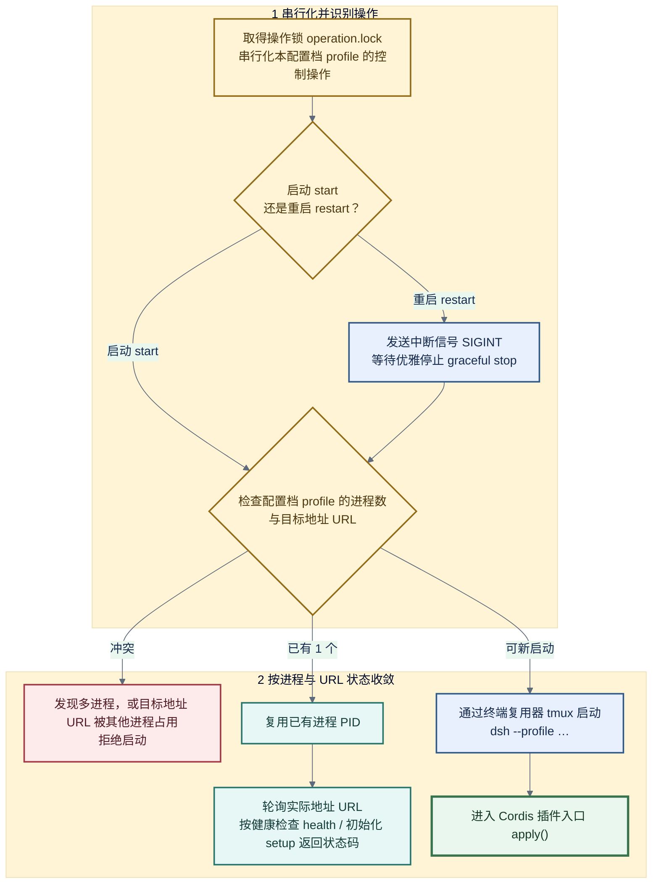

**B. 新进程先装配与恢复，最后才消费工作**

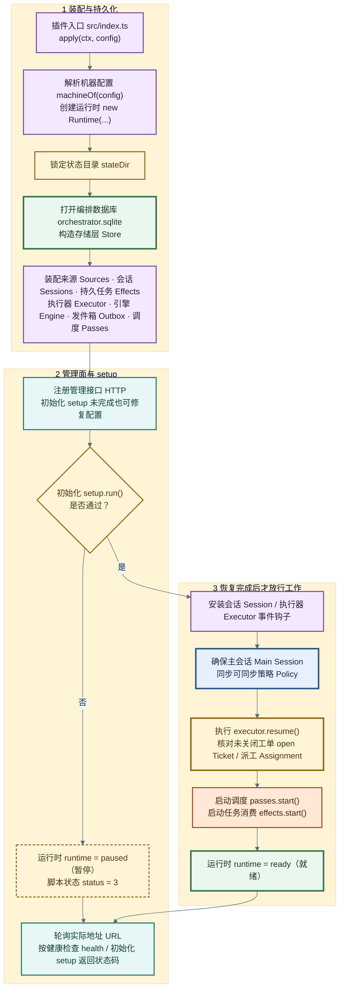

这也解释了第 11 节的四类状态：`1` 是进程、唯一性、API 或 runtime 失败；`2` 是 runtime 已起来但某个 Source/组件报错；`3` 是进程已起来但 setup 未闭环；只有 `0` 才是服务可用。`status=2/3` 需要修配置，盲目 restart 不会解决。

源码入口：[服务脚本](../scripts/dsh-superagent)、[插件入口](../src/index.ts)、[Runtime 组合与生命周期](../src/app/runtime.ts)。完整关闭链见[主调研报告 A.1](dsh-superagent-research.md#a1-启动与关闭)。

### 1.2 一条明确请求的内部时序

操作者在 GitHub 或飞书里看到的是“一条请求进去、一条结果回来”，内部却跨过三个不同边界：SQLite 事务、DSH Session 和外部网络。下列四图按异步边界连续阅读，只画 explicit 请求的成功主链；duplicate、filtered、ignore、observe-only 和失败分支仍会在相应阶段提前结束或等待重试。图内不使用跨图连续编号，以 A1、A2、B、C 作为主索引。

**A1. 外部事件先变成持久候选**

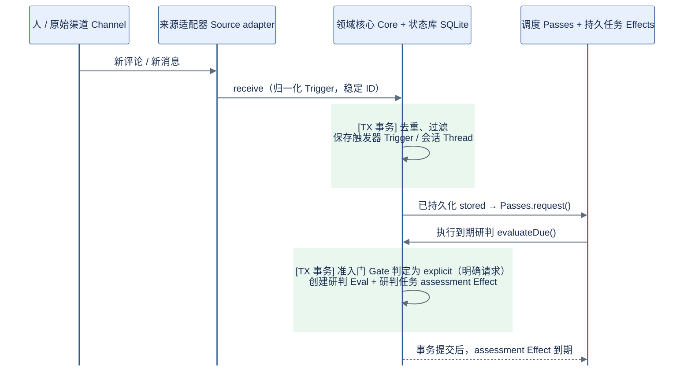

**A2. Main 研判后原子创建 Ticket 与启动意图**

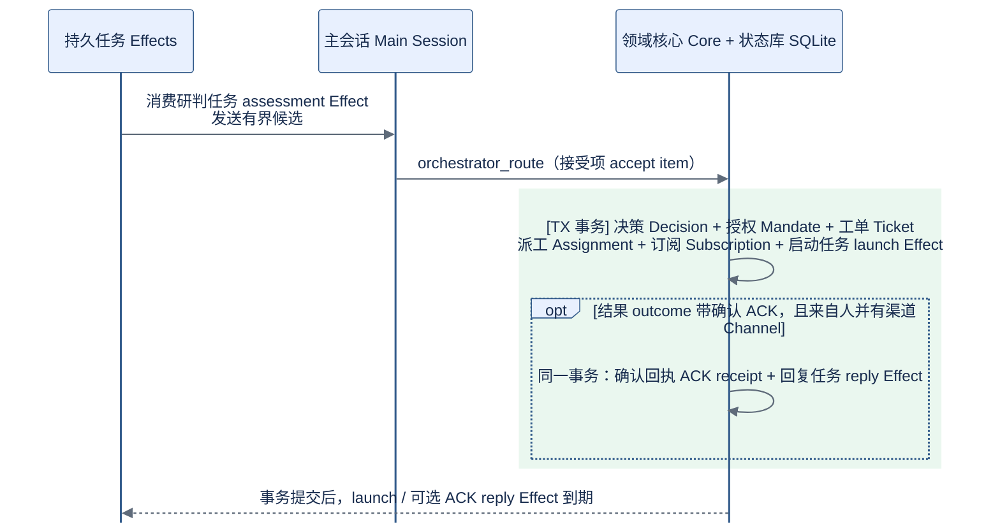

**B. Worker 执行，Main 决定怎样对外说**

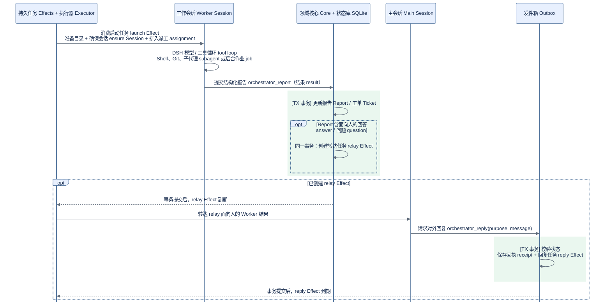

**C. Outbox 发送并按网络结果收敛**

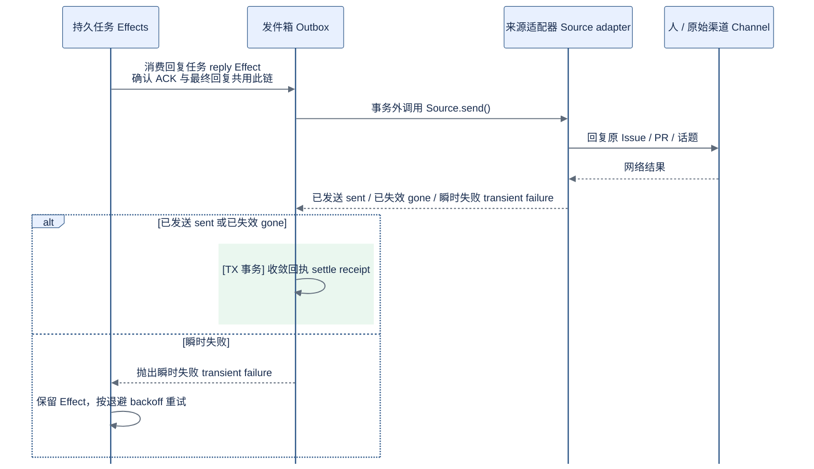

读图时记住四点：`Engine` 是领域状态的单写者；`Main Session` 负责路由和对外沟通，不直接替 Worker 做代码任务；每个 Ticket 对应持久 Worker Session 与独立目录；所有外部发送都在 SQLite 事务之外，因此系统只能通过稳定 ID、receipt 和重试实现 at-least-once 收敛，不能承诺任意 Shell/API 的 exactly-once。

源码入口：[Source 收口](../src/app/source-context.ts)、[Pass 调度](../src/app/passes.ts)、[领域 Engine](../src/core/engine.ts)、[Ticket 接单](../src/core/tickets.ts)、[Worker 执行器](../src/executor/dsh.ts)、[Outbox](../src/app/outbox.ts)。包含 Gate、follow-up 与异常分支的函数级时序见[主调研报告 7.10](dsh-superagent-research.md#710-函数级主时序)和[附录 A](dsh-superagent-research.md#附录-a-函数级调用链)。

### 1.3 重启恢复时序：先对账，再放行 Effect

`restart` 不是简单地重新跑旧 Prompt。Runtime 会先把 SQLite 中的 Assignment、DSH Session 和后台工作重新对齐；只有 `executor.resume()` 全部完成后，才开始消费新的或遗留的持久 Effect。

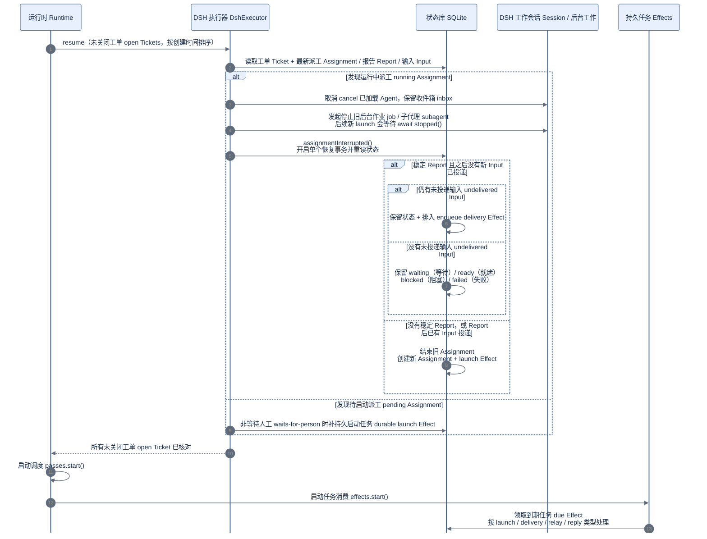

这里的“稳定 Report”只包括 `waiting`、`ready`、`blocked`、`failed`。恢复事务保证“状态判断”和“该排队哪种 Effect”一起提交，但 Effect 之后仍可能至少执行一次；Worker 在重复 `push`、发评论或调用外部 API 前，必须核对 Git、目录和远端事实。第 16 节的备份/恢复演练正是围绕这个边界设计的。完整恢复分支见[主调研报告 A.10](dsh-superagent-research.md#a10-重启恢复)。

## 2. 安全前置条件

在安装前先做这些决定：

1. 使用专用 OS 用户或隔离 VM；不要把原型直接放在装有个人 SSH key、云凭据和大量私有文件的日常账号下。
2. 创建专用 GitHub 用户；不要使用操作者个人账号。
3. 只授予目标仓库必要的读写权限；初期不要授予组织级广泛权限。
4. 初期仅启用 GitHub、单仓库、单 allowed user、`observe`、不自动合并。
5. 飞书 App Secret 只在操作者本机通过 stdin 输入，不发送到聊天、Issue 或日志。
6. 明确这是 `danger-full-access` 型 worker；`blockedCommands` 不是容器隔离，绝对路径仍可能绕过。

以上不是一般性提醒：项目文档明确说明 worker 作为操作者 OS 用户运行、能读取 home，wrapper 只选择凭据而不隔离进程（[中文：权限与隔离边界](006-deployment.zh-CN.md) / [English](006-deployment.md#L15-L22)）。

## 3. 前置依赖与预检

官方要求：

- Node.js 22.19+ 或 24+；
- pnpm；仓库声明 `pnpm@11.7.0`；
- git 2.32+；
- tmux；
- Python 3.8+；
- GitHub CLI 2.48+；
- 与 `engines.dsh` 兼容的 DeepSeek Harness；
- 一个可工作的模型提供商；
- 可选 `lark-cli`；
- 仓库用 Git LFS 时安装 `git-lfs`；
- 使用管理 API 示例时安装 `curl` 和 `jq`；停机备份与恢复演练还需支持 JSON1 的 `sqlite3`。

项目正式列出的版本和外部服务前置条件见 [中文：前置条件](006-deployment.zh-CN.md) / [English: Prerequisites](006-deployment.md#L23-L29)；Node、DSH 和 pnpm 声明见 [package engines](../package.json#L53-L57)。

只读预检：

```sh
cd /home/sizuoyi/workspace/ai/dsh-superagent-prototype

node -v
pnpm -v
git --version
tmux -V
python3 --version
gh --version | head -1
dsh --version
command -v curl
command -v jq
command -v lark-cli

grep -l -E 'id: dsh-superagent\b' \
  "${DSH_HOME:-$HOME/.dsh}"/profiles/*/cordis.patch.yml 2>/dev/null
```

当前机器已经安装仓库固定的 pnpm 11.7.0。其他环境若尚未安装，可在团队允许全局安装时由操作者执行并重新验证：

```sh
npm install -g pnpm@11.7.0
pnpm -v
```

若 pnpm 报数据库或 store 错误，不要继续，因为后续依赖安装、测试和构建可能根本没有执行；处理方式见第 17 节。

原始 setup probe 还会检查当前 GitHub 登录和已有 profile（[中文：SETUP probe](../SETUP.zh-CN.md) / [English](../SETUP.md#L18-L31)）。

## 4. 版本策略

项目部署文档固定安装：

```text
@deepseek-ai/dsh@0.2.1-rc.3
```

2026-11-02 npm 的 `latest` 是 `0.2.1-rc.5`，但 DSH 官方明确仍处于 developer preview，并可能产生破坏性兼容变化。推荐：

1. 首次复现严格使用项目文档的 `0.2.1-rc.3`；
2. 将 DSH 和本仓库 commit 一起记录；
3. 在隔离 profile/数据库副本上验证更高版本；
4. `pnpm check`、启动检查、真实但低风险工单都通过后再升级；
5. 升级前保留旧源码和旧数据库，旧程序可能不能打开新 schema。

固定安装版本与兼容范围来自 [中文：安装](006-deployment.zh-CN.md) / [English: Install](006-deployment.md#L73-L89)，数据库降级限制见 [中文：升级](006-deployment.zh-CN.md) / [English: Upgrade](006-deployment.md#L235-L244)。

## 5. 收集部署参数

安装前一次性收集：

| 参数 | 推荐初始值 |
|---|---|
| Sources | GitHub only |
| 目标仓库 | `owner/name`，仅 `github.com` |
| Agent GitHub 账号 | 新建专用账号 |
| GitHub allowed list | 仅操作者账号 |
| profile | `superagent` |
| Web 端口 | `3082` |
| stateDir | `~/.dsh/state/superagent` 的绝对路径 |
| accept mode | `observe` |
| maxWorkers | `3`，试运行可降到 `1` |
| branch prefix | `agent/` |
| auto-merge | 关闭 |
| 飞书 | 初期关闭；需要时再开 |

这些初始选择与项目 setup 的窄范围默认值一致（[中文：SETUP questions](../SETUP.zh-CN.md) / [English](../SETUP.md#L33-L61)）。

## 6. GitHub 专用身份

### 6.1 为什么必须是专用用户

系统依赖该账号的 GitHub notifications，因此当前实现不能直接用 GitHub App 替代。Agent 的评论、PR 和提交应清楚显示为 Agent 身份，降低误归属风险。

账号要求和 wrapper 设计见 [中文：Agent GitHub 账号](006-deployment.zh-CN.md) / [English](006-deployment.md#L31-L49)。

人工步骤：

1. 创建 GitHub 专用用户；
2. 邀请该用户加入目标仓库；
3. 只授予所需写权限；
4. 操作者在自己的终端登录 wrapper；
5. 不把 token 发给 Agent 或写入项目文件。

### 6.2 创建独立 gh wrapper

下面命令会创建文件，应由操作者审阅后执行：

```sh
(
set -eu
fail() { printf 'Refusing wrapper update: %s\n' "$1" >&2; exit 1; }
umask 077

HOME_REAL="$(realpath -e -- "$HOME")" || fail 'cannot resolve HOME'
for directory in "$HOME_REAL/.local" "$HOME_REAL/.local/bin" "$HOME_REAL/.config" "$HOME_REAL/.config/gh-agent"; do
  test ! -L "$directory" || fail "directory is a symlink: $directory"
  if test -e "$directory"; then
    test -d "$directory" || fail "path is not a directory: $directory"
    test "$(stat -c '%u' -- "$directory")" -eq "$(id -u)" || fail "directory is not owned by current user: $directory"
  else
    mkdir -m 700 -- "$directory"
  fi
done
BIN_DIR="$(realpath -e -- "$HOME_REAL/.local/bin")"
case "$BIN_DIR/" in "$HOME_REAL/"*) : ;; *) fail 'wrapper directory escaped HOME' ;; esac

WRAPPER="$BIN_DIR/gh-agent"
STAMP="$(date +%Y%m%d-%H%M%S)-$$"
test ! -L "$WRAPPER" || fail "wrapper is a symlink: $WRAPPER"
if test -e "$WRAPPER"; then
  test -f "$WRAPPER" || fail "existing wrapper is not a regular file: $WRAPPER"
  test "$(stat -c '%u' -- "$WRAPPER")" -eq "$(id -u)" || fail 'existing wrapper is not owned by current user'
  BACKUP="$WRAPPER.before-superagent-$STAMP"
  test ! -e "$BACKUP" && test ! -L "$BACKUP" || fail "backup target already exists: $BACKUP"
  cp -p -- "$WRAPPER" "$BACKUP"
fi

TMP="$(mktemp "$BIN_DIR/.gh-agent.tmp.XXXXXX")"
cleanup() { test -z "${TMP:-}" || rm -f -- "$TMP"; }
trap cleanup 0
trap 'exit 1' HUP INT TERM
cat > "$TMP" <<'EOF'
#!/bin/sh
GH_CONFIG_DIR="$HOME/.config/gh-agent" exec gh "$@"
EOF
chmod 700 "$TMP"
mv -f -- "$TMP" "$WRAPPER"
TMP=''

"$WRAPPER" auth login
"$WRAPPER" api user --jq .login
)
```

验证仓库权限：

```sh
"$HOME/.local/bin/gh-agent" api repos/OWNER/REPOSITORY \
  --jq '{full_name,permissions}'
```

期望 `permissions.push == true`。不要让 wrapper 落到操作者个人 `GH_CONFIG_DIR`。

### 6.3 自动合并身份

初期关闭 auto-merge。若以后开启，Agent 账号本身不应作为启用自动合并的高权限身份；另建一个具备 merge 权限的 CLI，并把使用条件写入 Delivery requirements。该约束主要依赖 prompt，生产前应进一步下沉为硬策略。

项目 setup 同样默认关闭 auto-merge，并要求开启时使用另一个可合并账号（[中文：执行问题](../SETUP.zh-CN.md) / [English](../SETUP.md#L49-L53)）。

## 7. 可选飞书接入

当前机器未安装 `lark-cli`，而本次调研没有核验到可固定复现的官方安装命令和兼容版本，因此本节仍有一个未闭环的外部前置：操作者必须先从已经确认的官方渠道取得与本仓库兼容的 `lark-cli`，记录下载来源和版本，并完成版本与帮助命令检查。在此前提满足前，不执行本节任何配置命令；本文不提供未经核验的安装猜测。

### 7.1 创建机器人

在飞书开放平台创建并发布自建应用，配置消息接收、群消息读取/发送、群成员读取等项目所需权限，把机器人加入目标群。

所需 bot 能力和权限见 [中文：飞书 bot](006-deployment.zh-CN.md) / [English](006-deployment.md#L51-L69)。

### 7.2 独立 bot-only 配置

```sh
(
set -eu
umask 077

command -v lark-cli >/dev/null 2>&1 || {
  printf '%s\n' 'lark-cli is not installed; stop and install a verified compatible version from an official channel.' >&2
  exit 1
}
lark-cli --version
lark-cli --help >/dev/null

HOME_REAL="$(realpath -e -- "$HOME")"
LARK_CONFIG_DIR="$HOME_REAL/.lark-cli-dsh-superagent"
test ! -L "$LARK_CONFIG_DIR" || {
  printf 'bot config directory is a symlink: %s\n' "$LARK_CONFIG_DIR" >&2
  exit 1
}
if test -e "$LARK_CONFIG_DIR"; then
  test -d "$LARK_CONFIG_DIR"
  test "$(stat -c '%u' -- "$LARK_CONFIG_DIR")" -eq "$(id -u)"
  printf '%s\n' 'Existing bot config found; inspect it instead of overwriting.'
  exit 1
fi

LARKSUITE_CLI_CONFIG_DIR="$LARK_CONFIG_DIR" \
  lark-cli config init \
  --app-id '<cli_xxx>' \
  --app-secret-stdin

LARKSUITE_CLI_CONFIG_DIR="$LARK_CONFIG_DIR" \
  lark-cli config strict-mode bot --global

for directory in "$HOME_REAL/.local" "$HOME_REAL/.local/bin"; do
  test ! -L "$directory" || { printf 'directory is a symlink: %s\n' "$directory" >&2; exit 1; }
  if test -e "$directory"; then
    test -d "$directory"
    test "$(stat -c '%u' -- "$directory")" -eq "$(id -u)"
  else
    mkdir -m 700 -- "$directory"
  fi
done
BIN_DIR="$(realpath -e -- "$HOME_REAL/.local/bin")"
case "$BIN_DIR/" in "$HOME_REAL/"*) : ;; *) printf '%s\n' 'wrapper directory escaped HOME' >&2; exit 1 ;; esac

WRAPPER="$BIN_DIR/lark-bot"
STAMP="$(date +%Y%m%d-%H%M%S)-$$"
test ! -L "$WRAPPER" || { printf 'wrapper is a symlink: %s\n' "$WRAPPER" >&2; exit 1; }
if test -e "$WRAPPER"; then
  test -f "$WRAPPER"
  test "$(stat -c '%u' -- "$WRAPPER")" -eq "$(id -u)"
  BACKUP="$WRAPPER.before-superagent-$STAMP"
  test ! -e "$BACKUP" && test ! -L "$BACKUP"
  cp -p -- "$WRAPPER" "$BACKUP"
fi

TMP="$(mktemp "$BIN_DIR/.lark-bot.tmp.XXXXXX")"
cleanup() { test -z "${TMP:-}" || rm -f -- "$TMP"; }
trap cleanup 0
trap 'exit 1' HUP INT TERM
cat > "$TMP" <<'EOF'
#!/bin/sh
export LARKSUITE_CLI_CONFIG_DIR="$HOME/.lark-cli-dsh-superagent"
exec lark-cli "$@"
EOF
chmod 700 "$TMP"
mv -f -- "$TMP" "$WRAPPER"
TMP=''
)
```

注意：

- Secret 只通过 stdin 输入；
- 配置必须是 bot-only，系统会拒绝可用用户身份行动的配置；
- bot 配置与个人配置分目录；
- 两套配置可能共享 keychain 中的 secret；停用时不要随意执行 `lark-cli config remove`；
- 原项目 SETUP 没给完整 chat-id 查询命令，优先用 Web UI 的刷新/选择群功能。

bot-only 限制、独立配置目录和共享 keychain 注意事项来自 [中文：飞书身份约束](006-deployment.zh-CN.md) / [English](006-deployment.md#L54-L71)。

## 8. 安装与构建

### 8.1 安装项目固定的 DSH

```sh
npm install -g @deepseek-ai/dsh@0.2.1-rc.3
dsh --version
```

先在默认 DSH profile 中配置并验证模型提供商。不要在模型仍不能完成普通 DSH Session 时继续安装 SuperAgent。

### 8.2 安装依赖、检查、构建

```sh
(
set -eu

cd /home/sizuoyi/workspace/ai/dsh-superagent-prototype

pnpm install --frozen-lockfile
pnpm exec vitest run tests/docs.spec.ts
pnpm typecheck
)
```

全量测试必须单独执行并检查它自己的 exit code：

```sh
cd /home/sizuoyi/workspace/ai/dsh-superagent-prototype
pnpm test
```

构建也单独执行。它成功只能证明 bundle 可构建，不能覆盖或掩盖前一个测试命令的失败：

```sh
cd /home/sizuoyi/workspace/ai/dsh-superagent-prototype
pnpm build
```

本机复核结果是：文档测试 7/7、`pnpm typecheck` 和 `pnpm build` 通过；`pnpm test` 的既有基线为 1197/1198，唯一失败位于 `tests/sources.spec.ts:1097`。仓库的 `pnpm check` 会依次运行 typecheck、全部 Vitest 测试和 build，因此当前会在全量测试阶段非零退出，不能写成“构建和全部测试通过”；构建通过是单独执行 `pnpm build` 得到的结果。

部署或升级前应先确认并处理这处测试失败，再使用下面的 fail-fast 门禁；`pnpm check` 一旦在 typecheck 或测试阶段失败，就不会继续构建：

```sh
(
set -eu
cd /home/sizuoyi/workspace/ai/dsh-superagent-prototype
pnpm check
)
```

只有该门禁 exit 0，才能写成“类型检查、全量测试和构建均通过”。仓库未配置可见的 80% coverage gate，因此即使该命令通过，也不能仅凭它声称覆盖率达到 80%。

脚本定义见 [package scripts](../package.json#L47-L52)。

## 9. 创建独立 DSH profile

### 9.1 先确认不存在旧 profile

```sh
PROFILE_DIR="${DSH_HOME:-$HOME/.dsh}/profiles/superagent"
test ! -e "$PROFILE_DIR"
```

如果已经存在，不要执行 `--from-default-profile`，否则可能覆盖 profile 并删除原 `cordis.patch.yml`。应按升级流程备份并编辑现有配置；这是[中文：官方 profile 创建警告](006-deployment.zh-CN.md) / [English](006-deployment.md#L85-L89)。

### 9.2 首次创建与链接 bundle

```sh
cd /home/sizuoyi/workspace/ai/dsh-superagent-prototype

dsh superagent --from-default-profile web --dump-config > /dev/null
dsh plugin --profile superagent add "link:$PWD"
```

### 9.3 机器配置

官方模板在 [profile 配置示例](../examples/profile.cordis.patch.yml#L1-L12)。新 profile 可按以下方式准备；即使是新 profile，也先保留生成的配置：

```sh
PROFILE_DIR="${DSH_HOME:-$HOME/.dsh}/profiles/superagent"
STATE_DIR="${DSH_HOME:-$HOME/.dsh}/state/superagent"
PROFILE_CONFIG="$PROFILE_DIR/cordis.patch.yml"
STAMP="$(date +%Y%m%d-%H%M%S)"

install -d -m 700 "$PROFILE_DIR" "$STATE_DIR"

if test -e "$PROFILE_CONFIG"; then
  cp -p "$PROFILE_CONFIG" "$PROFILE_CONFIG.before-superagent-$STAMP"
fi

install -m 600 \
  examples/profile.cordis.patch.yml \
  "$PROFILE_CONFIG"
```

编辑占位符：

```yaml
- id: webserver
  config:
    host: 127.0.0.1
    port: 3082

- id: dsh-superagent
  config:
    stateDir: /absolute/path/to/.dsh/state/superagent

# 需要飞书时取消注释
# - id: dsh-superagent-feishu
#   disabled: false
```

机器级参数：

| 参数 | 默认/要求 | 说明 |
|---|---|---|
| `stateDir` | 必填绝对路径 | SQLite、锁、worker shim、git config、默认工作根 |
| `promptMaxChars` | 100000；1000–1000000 | Prompt 配置上限 |
| `admissionContextMaxPages` | 10；1–100 | 单 Eval 最多读取线程页数 |
| `admissionContextTimeoutMs` | 15000；1–90000 | 上下文读取超时 |

除 `stateDir` 外其余为 volatile，可在线调整。

字段默认值和约束来自 [deployment config](../src/deployment.ts#L14-L29) 与 [validation limits](../src/limits.ts#L1-L10)。

## 10. 目标仓库与独立 Worktree

先准备一个基础 clone：

```sh
SOURCE_CLONE="$HOME/src/REPOSITORY"

if test -e "$SOURCE_CLONE"; then
  printf '%s\n' "Clone already exists: $SOURCE_CLONE"
else
  mkdir -p "$HOME/src"
  "$HOME/.local/bin/gh-agent" repo clone OWNER/REPOSITORY "$SOURCE_CLONE"
fi

git -C "$SOURCE_CLONE" rev-parse --is-inside-work-tree
git -C "$SOURCE_CLONE" remote -v
realpath "$SOURCE_CLONE"
```

私有仓库应通过专用 `gh-agent` clone，避免回落到操作者个人凭据。记录 `realpath` 输出，并把下面 `/absolute/path/to/source-clone` 全部替换为同一个已经验证的绝对路径。

推荐的 prepare command：

```sh
git -C /absolute/path/to/source-clone fetch --no-tags \
  "https://github.com/$DSH_SUPERAGENT_GITHUB_REPOSITORY.git" \
  "${DSH_SUPERAGENT_GITHUB_PR_HEAD:-HEAD}:refs/dsh-superagent/$DSH_SUPERAGENT_TICKET" &&
git -C /absolute/path/to/source-clone worktree add \
  -b "agent/$DSH_SUPERAGENT_NAME" \
  "$DSH_SUPERAGENT_DIR" \
  "refs/dsh-superagent/$DSH_SUPERAGENT_TICKET"
```

每个 Ticket 获得独立目录和分支。prepare 失败会使 Ticket 失败；修正后从面板或 API retry。

官方 worktree 模板与 blocked command 提示见 [中文：执行设置](006-deployment.zh-CN.md) / [English](006-deployment.md#L149-L159)。

## 11. 启动、停止与状态

下面四个动作是独立操作，一次只执行需要的一个代码块。

启动：

```sh
cd /home/sizuoyi/workspace/ai/dsh-superagent-prototype
./scripts/dsh-superagent start
```

查看状态：

```sh
cd /home/sizuoyi/workspace/ai/dsh-superagent-prototype
./scripts/dsh-superagent status
```

重启：

```sh
cd /home/sizuoyi/workspace/ai/dsh-superagent-prototype
./scripts/dsh-superagent restart
```

停止：

```sh
cd /home/sizuoyi/workspace/ai/dsh-superagent-prototype
./scripts/dsh-superagent stop
```

自定义 profile/URL：

```sh
./scripts/dsh-superagent \
  --profile my-superagent \
  --url http://127.0.0.1:4082 \
  status
```

参数：

- `--timeout`：启动检查超时，默认 60 秒；
- `--stop-timeout`：优雅停止等待，默认 300 秒；
- `--respect-stop`：人工 stop 后，监控不自动拉起。

状态退出码：

| code | 含义 | 动作 |
|---:|---|---|
| 0 | 健康，无 setup 问题 | 继续验收 |
| 1 | 未运行/重复实例/API 不可达/runtime error | 查日志，必要时 restart |
| 2 | Source/同步等组件错误 | 先修具体错误，restart 通常无效 |
| 3 | 运行中但等待 setup | 到面板补配置 |

服务使用 tmux session `dsh-<profile>`，默认 `dsh-superagent`；最多保留 20 个启动日志。

服务行为、退出码和控制文件语义见 [中文：启动与停止](006-deployment.zh-CN.md) / [English](006-deployment.md#L102-L133)；脚本实际参数见 [service CLI](../scripts/dsh-superagent#L209-L225)。

查看日志：

```sh
cd /home/sizuoyi/workspace/ai/dsh-superagent-prototype

ls -1t .artifacts/dsh-superagent-superagent-*.log | head
LATEST="$(ls -1t .artifacts/dsh-superagent-superagent-*.log | head -1)"
tail -n 300 "$LATEST"
```

## 12. Web 管理面配置

默认地址：

```text
http://127.0.0.1:3082
```

打开 DSH 后在侧栏进入 **Superagent**。

推荐按以下顺序配置，避免 revision 或 restart 冲突：

1. Sources → GitHub：
   - enable；
   - `repository=owner/name`；
   - `cli=/absolute/path/to/gh-agent`；
   - 初期所有 `observe*` 关闭。
2. Sources → Feishu（可选）：
   - enable；
   - bot wrapper；
   - 选择群；
   - 初期 `mentions`，不要 `all`。
3. Eval / Policy：
   - allowed list 仅操作者；
   - accept mode `observe`；
   - 检查 admission table；
   - bot list 只放必要自动 reviewer。
4. Execution：
   - worker model；
   - `maxWorkers=1` 或 3；
   - directory root；
   - prepare command；
   - 把个人 CLI 名称加入 `blockedCommands`。
5. Prompts：
   - commit identity；
   - 项目验证要求；
   - review bots；
   - 保持 auto-merge 关闭。
6. Deployment：
   - setup 全绿；
   - 检查 stateDir 和机器限制。

设置保存若返回 `restarting: true`，等待 `status` 不再是 1，再重新读取 settings revision 后保存下一项。

页面设置顺序与保存后的 setup 行为见 [中文：设置](006-deployment.zh-CN.md) / [English](006-deployment.md#L145-L159)。

## 13. 管理 API

API 默认只接受本机 host，并要求 `x-orchestrator-request: 1`。这个 header 是请求标记，不是身份认证；同一网络命名空间中任何能访问该 loopback 端口的进程都可能调用高权限接口，包括修改 Executor `prepare` 并间接执行命令。

因此管理面只应绑定隔离 VM/容器内的 `127.0.0.1`。不要直接反向代理、端口转发或暴露给不可信网络；多用户主机上的“专用 OS 用户”本身也不能隔离 loopback。确需远程管理时，应在外层增加强认证和网络访问控制，并把访问端限制为受信设备。

本地 host、header、Origin 与权限限制见 [中文：管理 API](006-deployment.zh-CN.md) / [English](006-deployment.md#L161-L169)。

### 13.1 只读查询

```sh
service_url="${DSH_SUPERAGENT_URL:-http://127.0.0.1:3082}"
api="${service_url%/}/orchestrator/api"

curl -fsS -H 'x-orchestrator-request: 1' "$api/state" | jq .
curl -fsS -H 'x-orchestrator-request: 1' "$api/settings" | jq .
curl -fsS -H 'x-orchestrator-request: 1' "$api/sources" | jq .
curl -fsS -H 'x-orchestrator-request: 1' "$api/prompts" | jq .
```

任何写操作都不使用默认端口。先把目标 profile 的**实际** URL 显式写入环境变量，读取 `/state`，人工核对 `masterId`、`stateDir`、仓库和账号，再把核对过的 `masterId` 固定下来：

```sh
export DSH_SUPERAGENT_URL='http://127.0.0.1:3082'
api="${DSH_SUPERAGENT_URL%/}/orchestrator/api"
curl -fsS -H 'x-orchestrator-request: 1' "$api/state" |
  jq '{masterId,paused,stateDir:.setup.machine.stateDir,repository:.setup.accounts.repository,agent:.setup.accounts.agent}'

# 只在上面的实例身份、目录、仓库和账号都与目标一致后设置。
export DSH_SUPERAGENT_MASTER_ID='<copy-the-verified-masterId>'
```

以下每个写请求都会重新读取 `/state` 并比较 `DSH_SUPERAGENT_MASTER_ID`。如果 URL 指向另一个实例，命令会在写入前失败；不要通过复制“另一个实例”的 `masterId` 绕过这道检查。

### 13.2 暂停与恢复

暂停是独立写操作；执行后先检查返回的 `paused`，不要把恢复命令粘在同一个代码块里：

```sh
(
set -eu
service_url="${DSH_SUPERAGENT_URL:?set the exact target URL}"
expected_master_id="${DSH_SUPERAGENT_MASTER_ID:?set the verified target masterId}"
api="${service_url%/}/orchestrator/api"
actual_master_id="$(curl -fsS -H 'x-orchestrator-request: 1' "$api/state" | jq -er '.masterId | strings | select(length > 0)')"
test "$actual_master_id" = "$expected_master_id" || {
  printf 'Refusing write: expected masterId %s, got %s\n' "$expected_master_id" "$actual_master_id" >&2
  exit 1
}

curl -fsS -X POST \
  -H 'x-orchestrator-request: 1' \
  -H 'content-type: application/json' \
  "$api/executor/pause" \
  -d '{"paused":true}' | jq -e '.paused == true'
)
```

完成检查并明确决定恢复处理后，单独执行：

```sh
(
set -eu
service_url="${DSH_SUPERAGENT_URL:?set the exact target URL}"
expected_master_id="${DSH_SUPERAGENT_MASTER_ID:?set the verified target masterId}"
api="${service_url%/}/orchestrator/api"
actual_master_id="$(curl -fsS -H 'x-orchestrator-request: 1' "$api/state" | jq -er '.masterId | strings | select(length > 0)')"
test "$actual_master_id" = "$expected_master_id" || {
  printf 'Refusing write: expected masterId %s, got %s\n' "$expected_master_id" "$actual_master_id" >&2
  exit 1
}

curl -fsS -X POST \
  -H 'x-orchestrator-request: 1' \
  -H 'content-type: application/json' \
  "$api/executor/pause" \
  -d '{"paused":false}' | jq -e '.paused == false'
)
```

暂停会阻止新 Eval、dispatch、Input delivery 和 reply，但不强制终止正在运行的 Worker turn；Source 继续记录新 Trigger。

暂停的完整语义见 [中文：暂停处理](003-execution.zh-CN.md) / [English](003-execution.md#L194-L202)。

### 13.3 Ticket retry / stop

优先在 UI 查看 Ticket 标题、stage、Mandate、最新 Report 和未完成外部动作，再使用带确认的按钮。API 操作前至少先读取完整 Ticket：

```sh
(
set -eu
service_url="${DSH_SUPERAGENT_URL:?set the exact target URL}"
expected_master_id="${DSH_SUPERAGENT_MASTER_ID:?set the verified target masterId}"
api="${service_url%/}/orchestrator/api"
actual_master_id="$(curl -fsS -H 'x-orchestrator-request: 1' "$api/state" | jq -er '.masterId | strings | select(length > 0)')"
test "$actual_master_id" = "$expected_master_id" || {
  printf 'Refusing read: expected masterId %s, got %s\n' "$expected_master_id" "$actual_master_id" >&2
  exit 1
}
TICKET_ID='<ticket-id>'

curl -fsS -H 'x-orchestrator-request: 1' \
  "$api/tickets/$TICKET_ID" | jq .
)
```

只有人工确认应在原 Mandate、Session 和目录中重新尝试时，才单独执行 retry：

```sh
(
set -eu
service_url="${DSH_SUPERAGENT_URL:?set the exact target URL}"
expected_master_id="${DSH_SUPERAGENT_MASTER_ID:?set the verified target masterId}"
api="${service_url%/}/orchestrator/api"
actual_master_id="$(curl -fsS -H 'x-orchestrator-request: 1' "$api/state" | jq -er '.masterId | strings | select(length > 0)')"
test "$actual_master_id" = "$expected_master_id" || {
  printf 'Refusing write: expected masterId %s, got %s\n' "$expected_master_id" "$actual_master_id" >&2
  exit 1
}
TICKET_ID='<ticket-id>'

curl -fsS -X POST \
  -H 'x-orchestrator-request: 1' \
  -H 'content-type: application/json' \
  "$api/tickets/$TICKET_ID/retry" \
  -d '{}'
)
```

只有人工确认要撤销 Mandate、终止该 Ticket 且不再接收后续消息时，才单独执行 stop：

```sh
(
set -eu
service_url="${DSH_SUPERAGENT_URL:?set the exact target URL}"
expected_master_id="${DSH_SUPERAGENT_MASTER_ID:?set the verified target masterId}"
api="${service_url%/}/orchestrator/api"
actual_master_id="$(curl -fsS -H 'x-orchestrator-request: 1' "$api/state" | jq -er '.masterId | strings | select(length > 0)')"
test "$actual_master_id" = "$expected_master_id" || {
  printf 'Refusing write: expected masterId %s, got %s\n' "$expected_master_id" "$actual_master_id" >&2
  exit 1
}
TICKET_ID='<ticket-id>'

curl -fsS -X POST \
  -H 'x-orchestrator-request: 1' \
  -H 'content-type: application/json' \
  "$api/tickets/$TICKET_ID/stop" \
  -d '{}'
)
```

`stop` 会撤销 Mandate、结束当前 Assignment，并使该 Ticket 不再接收后续消息；继续工作必须重新接受任务。`retry` 会结束旧 Assignment 并在同一 Mandate 下启动新 Assignment，任意非幂等 shell/API 动作可能重复。不要把这两个请求当成无副作用或可随意重放的 API。

API 写设置必须带当前 revision；陈旧 revision 返回 409。除非确实要自动化部署，初次配置优先用 UI，避免手写不完整 JSON 覆盖现有 Source/Policy/Prompt。

稳定 API 路由、revision 和错误码见 [中文：API 路由](006-deployment.zh-CN.md) / [English](006-deployment.md#L171-L207)。

### 13.4 带 revision 更新设置

设置接口要求提交完整 block 和当前 revision。下面以启用 GitHub Source 为例；先把仓库和 CLI 路径改成真实值，并在执行写请求前检查生成的 JSON：

```sh
(
set -eu
service_url="${DSH_SUPERAGENT_URL:?set the exact target URL}"
expected_master_id="${DSH_SUPERAGENT_MASTER_ID:?set the verified target masterId}"
api="${service_url%/}/orchestrator/api"
actual_master_id="$(curl -fsS -H 'x-orchestrator-request: 1' "$api/state" | jq -er '.masterId | strings | select(length > 0)')"
test "$actual_master_id" = "$expected_master_id" || {
  printf 'Refusing write: expected masterId %s, got %s\n' "$expected_master_id" "$actual_master_id" >&2
  exit 1
}
REPOSITORY='OWNER/REPOSITORY'
AGENT_CLI="$HOME/.local/bin/gh-agent"

revision="$(curl -fsS -H 'x-orchestrator-request: 1' "$api/settings" |
  jq -r '.sources[] | select(.id == "github") | .revision')"

payload="$(jq -n \
  --arg repository "$REPOSITORY" \
  --arg cli "$AGENT_CLI" \
  --argjson revision "$revision" \
  '{value:{enabled:true,config:{repository:$repository,cli:$cli}},revision:$revision}')"

printf '%s\n' "$payload" | jq .

curl -fsS -X PUT \
  -H 'x-orchestrator-request: 1' \
  -H 'content-type: application/json' \
  "$api/settings/source:github" \
  --data "$payload" | jq .
)
```

如果响应包含 `restarting: true`，先等服务恢复，再重新读取 revision；不要复用旧 revision。Policy、Eval 和 Executor 也必须先 `GET settings`、修改完整 block，再带当前 revision 保存。首次配置仍推荐使用 UI，避免误把已有字段恢复为默认值。

## 14. 首次验收

### 14.1 服务验收

```sh
./scripts/dsh-superagent status
```

必须退出 0，且面板 Overview 没有 setup/health error。

### 14.2 明确请求验收

从 allowed list 中的账号，在测试仓库新发 Issue 评论：

```text
@<agent-login> 请只分析这个 Issue，给出复现步骤；不要修改代码。
```

注意：编辑旧 Issue body 补 `@` 通常不会产生新 notification，必须新发评论。

验证：

1. 一分钟左右出现 Trigger/Ticket；
2. Gate 显示 explicit；
3. Agent 只确认一次；
4. 创建独立 Worker Session/目录；
5. 结果回到原评论线程；
6. 无多余进展刷屏；
7. Ticket/Decision/Assignment/Report 可追溯。

### 14.3 修改任务验收

再使用一个可回滚的小改动：

```text
@<agent-login> 在独立分支修正文档中的一个错别字，运行相关检查并提交 PR；不要合并。
```

验证专用身份、分支前缀、commit author、检查结果、PR 描述和不自动合并。

### 14.4 主动模式验收

打开一个 `observe*`，保持 `eval.mode=observe`：

- 制造一个匹配规则的候选；
- 确认系统只记录 would-accept；
- 不应创建主动 Ticket；
- 观察一段时间后再考虑 `auto`。

## 15. 日常操作

### 15.1 Overview 先看什么

1. 是否有 Attention 等人决定；
2. setup/health 是否异常；
3. worker load 是否长时间满；
4. 是否有 unavailable Eval、failed delivery 或 dropped reply；
5. 最近 Trigger 是否按预期被 filtered/evaluated/fan-out。

### 15.2 人工接管

可以：

- stop Ticket；
- retry blocked/failed/undelivered Ticket；
- re-evaluate Trigger；
- unsubscribe Thread；
- dismiss unavailable；
- pause processing；
- 打开 Worker Session 人工继续；
- 修改 Policy/Prompt/Execution。

注意：直接在 Worker Session 输入的人类消息不完全等价于 Ticket Input，审计链可能不如从原 Source follow-up 完整。

### 15.3 权限紧急回收

只从 allowed list 删除用户或关闭 rule，不会立即停止 live Ticket。需要区分两类事件。

普通策略收紧：

1. `pause`；
2. stop 受影响 Ticket；
3. 必要时停止服务；
4. 修改 Policy；
5. 检查所有进行中 Assignment 和外部动作；
6. 明确确认后恢复。

凭据泄露、疑似失控 Worker 或正在外传数据：

1. 先在 VM/容器/防火墙层隔离网络，或立即撤销 GitHub/飞书 token、仓库权限和相关 secret；
2. 再 pause、stop Ticket，并请求服务优雅停止；
3. 如果 300 秒内未停止，不继续等待模型或脚本，应使用基础设施级关机/容器停止隔离该运行环境；
4. 保全日志、stateDir、执行目录和外部系统审计记录；
5. 在隔离环境调查影响、轮换所有可能暴露的凭据；
6. 修复根因并完成复核后才恢复网络与服务。

原因是 `pause` 不会中断正在运行的 Worker turn，而服务脚本也刻意不做强制 kill；主动攻击场景必须先切断外部能力。

### 15.4 小时级健康检查

监控应运行在独立于 `superagent` 的 profile 或系统监控中，确保服务宕机时检查器仍能运行。按 `scripts/dsh-superagent --profile superagent status` 的退出码处理：

| code | 自动化策略 |
|---:|---|
| 0 | 保持静默 |
| 1 | 若不是人工 stop，可用 `--respect-stop restart` 尝试恢复一次；仍失败则告警并附最新日志 |
| 2 | 不盲目重启；报告具体 health part 和 detail |
| 3 | 不重启；报告缺失的 setup 项 |

必须保留“状态未变化时静默”的去重策略，避免监控本身消耗人的注意力。官方给出的完整小时检查 prompt 见 [中文：小时检查](006-deployment.zh-CN.md) / [English](006-deployment.md#L135-L143)。

## 16. 备份、升级和回滚

| 子节 | 要解决的问题 | 成功信号 |
|---|---|---|
| 16.1 边界 | 哪些数据真正进入恢复保证 | 明确 SQLite、profile 配置、远端 Git 与 Session/secret 的边界 |
| 16.2 备份 | 怎样得到可核验的停机快照 | checksum 通过、存在 `COMPLETE`、目录已从 `.partial-*` 原子改名 |
| 16.3 升级 | 怎样避免追随未审阅版本 | 固定目标 commit，`pnpm check` 通过后才重启 |
| 16.4 恢复演练 | 怎样在不碰生产目录和身份的前提下验证恢复 | 文件层与服务层结论分开记录，恢复实例保持 paused |
| 16.5 回滚 | 怎样避免旧程序打开新 schema | 源码、SQLite、配置和 DSH 版本成套回退 |

### 16.1 为什么要停机备份

SQLite 使用 WAL。只在线复制 `orchestrator.sqlite` 可能遗漏 WAL 中的数据。本文采用的原型级流程是先让 worker idle，再优雅停止并复制整个 `stateDir` 和 `cordis.patch.yml`。它只保证保存编排 SQLite、这一份 profile 配置，以及已经提交并推送到远端的 Git 状态；它不是完整 DSH profile、Session 或任意 Ticket 工作目录的全量备份。更成熟的生产方案应使用 SQLite backup API，并按所安装 DSH 版本的官方方式另行保护 Session persistence。

备份前先明确边界：

- `stateDir` 包含编排数据库、WAL/SHM、worker shim/gitconfig，以及默认的 `work/`；备份 manifest 校验复制后 `state/` 下的每个普通文件。目录内符号链接按链接本身保留，链接指向的外部内容不属于备份保证；
- 本流程只复制 `cordis.patch.yml`，不复制 profile 中的其他文件，也不复制 DSH Session persistence；恢复时必须先创建新的 profile、重新链接 bundle，再覆盖这份配置；
- git worktree 的 `.git` 文件依赖基础 clone 下的 `.git/worktrees` 元数据，单独复制 Ticket 目录不可移植；Ticket 会把接单时确定的绝对 `execution.directory` 持久化，后续修改当前 Execution root 不会改写历史 Ticket。脚本因此在停机后直接查询 SQLite `ticket.value` 的 `$.execution.directory`，逐个检查所有历史与当前目录；只看当前 root 不足以形成备份保证；
- 任一持久目录不存在、经过 symlink、被多个 Ticket 复用、存在未提交/未跟踪内容、缺少远端 upstream、无法刷新远端或仍含未 push commit，备份都会失败；
- 自定义 Execution root 不会被本流程复制。若默认 root 位于 `stateDir/work`，其中目录可能随 `stateDir` 被带入备份，但只作为取证材料，不能视为可直接恢复的 worktree；恢复应从远端已 push commit 重建基础 clone 和 worktree；
- GitHub/飞书 CLI 凭据通常位于独立配置目录或 keychain，本手册不把 secret 复制进备份。恢复后应重新认证或从 secret manager 注入。

### 16.2 停机备份

先看两张连续的控制流，再执行后面的长脚本。第一张给出备份事务的总闸门，第二张展开“逐 Ticket 目录核对”。所有校验都是 fail-closed：任何一项失败都立即停止；只有 checksum、`COMPLETE` 和最终原子改名都完成，目录才算可用于恢复。

**A. 停机、核对、封装与原子发布**

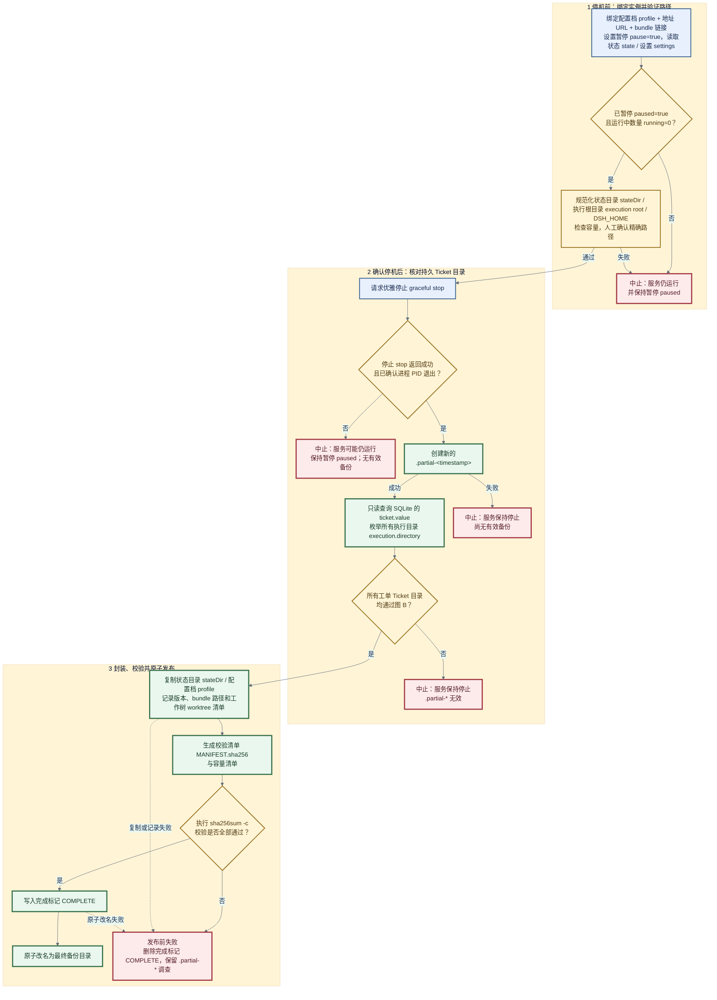

**B. 每个 Ticket 目录的 fail-closed 核对循环**

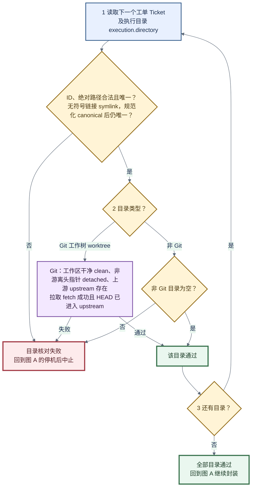

图中的“备份成功”只覆盖编排 SQLite、当前 `cordis.patch.yml`、版本/路径清单，以及已经提交并进入远端 upstream 的 Git 状态；不覆盖 DSH Session persistence、secret、未提交文件或未 push commit。恢复时仍按 16.4 节重建 profile、bundle link 和 worktree，不能把复制出来的 `.git` 指针当作可移植恢复点。

```sh
(
set -eu

cd /home/sizuoyi/workspace/ai/dsh-superagent-prototype

PROFILE="${DSH_SUPERAGENT_PROFILE:?set the exact target profile}"
service_url="${DSH_SUPERAGENT_URL:?set the exact target URL}"
expected_master_id="${DSH_SUPERAGENT_MASTER_ID:?set the verified target masterId}"
api="${service_url%/}/orchestrator/api"
fail() { printf 'Refusing backup: %s\n' "$1" >&2; exit 1; }
overlap() {
  case "$1/" in "$2/"*) return 0 ;; esac
  case "$2/" in "$1/"*) return 0 ;; esac
  return 1
}
reject_broad() {
  case "$1" in
    /|/boot|/dev|/etc|/home|/opt|/proc|/root|/run|/srv|/sys|/tmp|/usr|/var|"$HOME_REAL")
      fail "source path is too broad: $1" ;;
  esac
}

printf '%s\n' "$PROFILE" | grep -Eq '^[A-Za-z0-9_][A-Za-z0-9_.-]*$' || fail 'invalid DSH profile name'
if STATUS_JSON="$(./scripts/dsh-superagent --profile "$PROFILE" --url "$service_url" status)"; then
  STATUS_CODE=0
else
  STATUS_CODE=$?
fi
case "$STATUS_CODE" in
  0|2) : ;;
  *) fail "profile and URL do not identify one running configured instance (status=$STATUS_CODE)" ;;
esac
printf '%s\n' "$STATUS_JSON" | jq -e --arg url "$service_url" \
  '.url == $url and (.pids | type == "array" and length == 1)' >/dev/null ||
  fail 'profile process and health URL did not resolve to one instance'

PRE_STATE_JSON="$(curl -fsS -H 'x-orchestrator-request: 1' "$api/state")"
actual_master_id="$(printf '%s\n' "$PRE_STATE_JSON" | jq -er '.masterId | strings | select(length > 0)')"
test "$actual_master_id" = "$expected_master_id" ||
  fail "URL points to masterId $actual_master_id, expected $expected_master_id"

CHECKOUT_REAL="$(realpath -e -- "$(pwd)")" || fail 'cannot resolve current checkout'
HOME_REAL="$(realpath -e -- "$HOME")" || fail 'cannot resolve HOME'
DSH_HOME_REAL="$(realpath -e -- "${DSH_HOME:-$HOME/.dsh}")" || fail 'cannot resolve DSH_HOME'
PROFILE_DIR="$(realpath -e -- "$DSH_HOME_REAL/profiles/$PROFILE")" || fail 'profile directory does not exist'
PROFILE_CONFIG="$PROFILE_DIR/cordis.patch.yml"
PROFILE_MANIFEST="$PROFILE_DIR/package.json"
test -f "$PROFILE_CONFIG" || fail "profile config not found: $PROFILE_CONFIG"
test -f "$PROFILE_MANIFEST" || fail "profile manifest not found: $PROFILE_MANIFEST"
jq -e '.dsh.profile.bundles | arrays | index("dsh-superagent") != null' "$PROFILE_MANIFEST" >/dev/null ||
  fail 'dsh-superagent is not an active bundle in the selected profile'
BUNDLE_SPEC="$(jq -er '.dependencies["dsh-superagent"] | strings | select(startswith("link:"))' "$PROFILE_MANIFEST")" ||
  fail 'selected profile does not record dsh-superagent as a link: dependency'
BUNDLE_TARGET="${BUNDLE_SPEC#link:}"
case "$BUNDLE_TARGET" in
  /*) BUNDLE_CANDIDATE="$BUNDLE_TARGET" ;;
  *) BUNDLE_CANDIDATE="$PROFILE_DIR/$BUNDLE_TARGET" ;;
esac
LINKED_CHECKOUT="$(realpath -e -- "$BUNDLE_CANDIDATE")" || fail 'cannot resolve profile link bundle target'
INSTALLED_BUNDLE="$(realpath -e -- "$PROFILE_DIR/node_modules/dsh-superagent")" ||
  fail 'cannot resolve installed dsh-superagent bundle projection'
test "$LINKED_CHECKOUT" = "$CHECKOUT_REAL" ||
  fail "profile link bundle points to $LINKED_CHECKOUT, not current checkout $CHECKOUT_REAL"
test "$INSTALLED_BUNDLE" = "$CHECKOUT_REAL" ||
  fail "profile node_modules resolves to $INSTALLED_BUNDLE, not current checkout $CHECKOUT_REAL"
jq -e '.name == "dsh-superagent"' "$CHECKOUT_REAL/package.json" >/dev/null ||
  fail 'linked checkout package is not dsh-superagent'
SOURCE_COMMIT="$(git -C "$CHECKOUT_REAL" rev-parse HEAD)" || fail 'cannot read SuperAgent source commit'
test -z "$(git -C "$CHECKOUT_REAL" status --porcelain --untracked-files=all)" ||
  fail 'SuperAgent checkout is not clean; the recorded commit would not describe the running source tree'
test -f "$CHECKOUT_REAL/lib/index.js" || fail 'built bundle entry lib/index.js is missing; fix the build before backup'

curl -fsS -X POST \
  -H 'x-orchestrator-request: 1' \
  -H 'content-type: application/json' \
  "$api/executor/pause" \
  -d '{"paused":true}' | jq -e '.paused == true' >/dev/null
STATE_JSON="$(curl -fsS -H 'x-orchestrator-request: 1' "$api/state")"
SETTINGS_JSON="$(curl -fsS -H 'x-orchestrator-request: 1' "$api/settings")"
RUNNING="$(printf '%s\n' "$STATE_JSON" | jq -er '.load.running | numbers')"
PAUSED="$(printf '%s\n' "$STATE_JSON" | jq -er '.paused | booleans')"
STATE_DIR="$(printf '%s\n' "$STATE_JSON" | jq -er '.setup.machine.stateDir | strings | select(length > 1)')"
EXECUTION_ROOT="$(printf '%s\n' "$SETTINGS_JSON" | jq -er '.environment.root | strings | select(length > 1)')"

STATE_DIR="$(realpath "$STATE_DIR")"
EXECUTION_ROOT="$(realpath -m "$EXECUTION_ROOT")"

test "$PAUSED" = 'true' || fail 'processing did not remain paused'
test "$RUNNING" -eq 0 || fail "worker load is not idle after pause (running=$RUNNING); wait and retry"
test -f "$STATE_DIR/orchestrator.sqlite" || fail "database not found under $STATE_DIR"
WORKER_GIT_CONFIG="$STATE_DIR/worker-gitconfig"
WORKER_BIN="$STATE_DIR/worker-bin"
test -f "$WORKER_GIT_CONFIG" || fail "worker git config not found: $WORKER_GIT_CONFIG"
test -d "$WORKER_BIN" || fail "worker command directory not found: $WORKER_BIN"
reject_broad "$STATE_DIR"
reject_broad "$EXECUTION_ROOT"
reject_broad "$DSH_HOME_REAL"

# Run every Ticket Git check with the same isolated global/system config and
# non-interactive credential path as the worker, never the operator's ambient tokens.
worker_git() {
  env \
    -u GH_TOKEN -u GITHUB_TOKEN \
    -u GIT_DIR -u GIT_WORK_TREE -u GIT_INDEX_FILE -u GIT_PREFIX \
    -u GIT_COMMON_DIR -u GIT_OBJECT_DIRECTORY -u GIT_ALTERNATE_OBJECT_DIRECTORIES -u GIT_NAMESPACE \
    -u GIT_CONFIG_COUNT -u GIT_CONFIG_PARAMETERS \
    -u SSH_ASKPASS \
    GIT_CONFIG_GLOBAL="$WORKER_GIT_CONFIG" \
    GIT_CONFIG_NOSYSTEM=1 \
    GIT_ASKPASS= \
    GIT_TERMINAL_PROMPT=0 \
    PATH="$WORKER_BIN:$PATH" \
    git "$@"
}

umask 077
BACKUP_ROOT_RAW="$HOME_REAL/dsh-superagent-backups"
BACKUP_ROOT_LEXICAL="$(realpath -m -s -- "$BACKUP_ROOT_RAW")"
test ! -L "$BACKUP_ROOT_RAW" || fail "backup root is a symlink: $BACKUP_ROOT_RAW"
if test -e "$BACKUP_ROOT_RAW"; then
  test -d "$BACKUP_ROOT_RAW" || fail "backup root is not a directory: $BACKUP_ROOT_RAW"
  test "$(stat -c '%u' -- "$BACKUP_ROOT_RAW")" -eq "$(id -u)" || fail 'backup root is not owned by current user'
  test "$(stat -c '%a' -- "$BACKUP_ROOT_RAW")" = '700' || fail 'existing backup root must already have mode 700'
else
  mkdir -m 700 -- "$BACKUP_ROOT_RAW"
fi
BACKUP_ROOT="$(realpath -e -- "$BACKUP_ROOT_RAW")" || fail 'cannot resolve backup root'
test "$BACKUP_ROOT" = "$BACKUP_ROOT_LEXICAL" || fail 'backup root contains a symlink'
case "$BACKUP_ROOT/" in "$HOME_REAL/"*) : ;; *) fail 'backup root escaped HOME' ;; esac
reject_broad "$BACKUP_ROOT"
overlap "$BACKUP_ROOT" "$STATE_DIR" && fail 'backup root overlaps stateDir'
overlap "$BACKUP_ROOT" "$EXECUTION_ROOT" && fail 'backup root overlaps execution root'
overlap "$BACKUP_ROOT" "$DSH_HOME_REAL" && fail 'backup root overlaps DSH_HOME'

printf 'stateDir:       %s\nexecution root: %s\nbackup root:    %s\n' \
  "$STATE_DIR" "$EXECUTION_ROOT" "$BACKUP_ROOT"
du -sh "$STATE_DIR"
if test ! -d "$EXECUTION_ROOT"; then printf 'execution root does not exist yet; no Ticket directories to verify\n'; fi
df -h "$BACKUP_ROOT"

state_size="$(du -sk "$STATE_DIR")"
NEEDED_KIB="${state_size%%[!0-9]*}"
df_output="$(df -Pk "$BACKUP_ROOT")"
AVAILABLE_KIB="$(printf '%s\n' "$df_output" | awk 'END { print $4 }')"
REQUIRED_KIB=$((NEEDED_KIB + NEEDED_KIB / 5 + 102400))
test "$AVAILABLE_KIB" -gt "$REQUIRED_KIB" ||
  fail "insufficient target space: need ${REQUIRED_KIB} KiB including margin, have ${AVAILABLE_KIB} KiB"

# 先检查上面的规范化路径和容量；确认后把 NO 改成 YES 再执行整个块。
CONFIRM_BACKUP_PATHS='NO'
test "$CONFIRM_BACKUP_PATHS" = 'YES' || fail 'set CONFIRM_BACKUP_PATHS=YES after reviewing every path'

# stop 返回成功才继续；超时会使子 shell 立即退出。
./scripts/dsh-superagent --profile "$PROFILE" --url "$service_url" stop

STAMP="$(date +%Y%m%d-%H%M%S)"
BACKUP_DIR="$BACKUP_ROOT/$STAMP"
PARTIAL_DIR="$BACKUP_ROOT/.partial-$STAMP"
test ! -e "$BACKUP_DIR" && test ! -L "$BACKUP_DIR" || fail "backup destination already exists: $BACKUP_DIR"
test ! -e "$PARTIAL_DIR" && test ! -L "$PARTIAL_DIR" || fail "partial destination already exists: $PARTIAL_DIR"
mkdir -m 700 -- "$PARTIAL_DIR"
cleanup_incomplete() {
  test ! -d "${PARTIAL_DIR:-}" || rm -f -- "$PARTIAL_DIR/COMPLETE"
}
trap cleanup_incomplete EXIT
trap 'exit 1' HUP INT TERM

# Ticket.execution.directory is persisted in ticket.value. Query every Ticket that
# has execution metadata; the current Execution root is not authoritative for history.
TICKET_DIRECTORIES="$PARTIAL_DIR/ticket-directories.json"
sqlite3 -readonly "$STATE_DIR/orchestrator.sqlite" "
  SELECT json_group_array(json_object(
    'id', id,
    'directory', json_extract(value, '$.execution.directory')
  ))
  FROM (
    SELECT id, value FROM ticket
    WHERE json_type(value, '$.execution') = 'object'
    ORDER BY id
  );
" > "$TICKET_DIRECTORIES" || fail 'cannot enumerate persisted Ticket execution directories'

jq -e 'type == "array" and all(.[];
  (.id | type == "string") and (.id | length > 0) and ((.id | test("[[:cntrl:]]")) | not) and
  (.directory | type == "string") and (.directory | startswith("/")) and
  ((.directory | test("[[:cntrl:]]")) | not)
)' "$TICKET_DIRECTORIES" >/dev/null || fail 'Ticket execution directory data is invalid'
jq -e '([.[].directory] | length) == ([.[].directory] | unique | length)' \
  "$TICKET_DIRECTORIES" >/dev/null || fail 'multiple Tickets persist the same execution directory'
jq -c '.[]' "$TICKET_DIRECTORIES" > "$PARTIAL_DIR/ticket-directory-records.jsonl"

printf 'ticket_id\tkind\tdirectory\tbranch\tupstream\thead\n' > "$PARTIAL_DIR/git-worktrees.tsv"
: > "$PARTIAL_DIR/canonical-ticket-directories.txt"
while IFS= read -r record; do
  ticket_id="$(printf '%s\n' "$record" | jq -er '.id')" || fail 'cannot read Ticket id'
  ticket_dir="$(printf '%s\n' "$record" | jq -er '.directory')" || fail "cannot read directory for Ticket $ticket_id"
  ticket_lexical="$(realpath -m -s -- "$ticket_dir")" || fail "cannot normalize Ticket directory: $ticket_dir"
  ticket_real="$(realpath -e -- "$ticket_dir")" || fail "persisted Ticket directory is missing: $ticket_dir"
  test "$ticket_real" = "$ticket_lexical" || fail "Ticket directory contains a symlink: $ticket_dir"
  ticket_dir="$ticket_real"
  reject_broad "$ticket_dir"
  test -d "$ticket_dir" || fail "Ticket execution path is not a directory: $ticket_dir"
  if grep -Fqx -- "$ticket_dir" "$PARTIAL_DIR/canonical-ticket-directories.txt"; then
    fail "multiple Tickets resolve to the same execution directory: $ticket_dir"
  fi
  printf '%s\n' "$ticket_dir" >> "$PARTIAL_DIR/canonical-ticket-directories.txt"

  if worker_git -C "$ticket_dir" rev-parse --is-inside-work-tree >/dev/null 2>&1; then
    if credential_settings="$(worker_git -C "$ticket_dir" config --show-scope --get-regexp '^(credential\..*|http\..*extraheader)$' 2>&1)"; then
      if printf '%s\n' "$credential_settings" | grep -Eq '^(local|worktree)[[:space:]]'; then
        fail "Ticket repository adds credential or extraheader config: $ticket_dir"
      fi
    else
      credential_status=$?
      test "$credential_status" -eq 1 || fail "cannot audit Ticket Git credential config: $ticket_dir"
    fi
    worktree_status="$(worker_git -C "$ticket_dir" status --porcelain --untracked-files=all)" ||
      fail "cannot read Git status for $ticket_dir"
    test -z "$worktree_status" ||
      fail "Ticket worktree has uncommitted or untracked files: $ticket_dir"
    branch="$(worker_git -C "$ticket_dir" symbolic-ref --quiet --short HEAD)" ||
      fail "Ticket worktree is detached: $ticket_dir"
    remote="$(worker_git -C "$ticket_dir" config --get "branch.$branch.remote")" ||
      fail "Ticket worktree has no upstream remote: $ticket_dir"
    case "$remote" in ''|.) fail "Ticket worktree has no remote upstream: $ticket_dir" ;; esac
    worker_git -C "$ticket_dir" fetch --quiet --prune "$remote" ||
      fail "cannot refresh remote $remote for $ticket_dir"
    upstream="$(worker_git -C "$ticket_dir" rev-parse --abbrev-ref --symbolic-full-name '@{upstream}')" ||
      fail "Ticket worktree has no upstream branch: $ticket_dir"
    worker_git -C "$ticket_dir" merge-base --is-ancestor HEAD "$upstream" ||
      fail "Ticket worktree contains commits not present in $upstream: $ticket_dir"
    head="$(worker_git -C "$ticket_dir" rev-parse HEAD)"
    printf '%s\tgit\t%s\t%s\t%s\t%s\n' "$ticket_id" "$ticket_dir" "$branch" "$upstream" "$head" >> "$PARTIAL_DIR/git-worktrees.tsv"
  elif find "$ticket_dir" -mindepth 1 -print -quit | grep -q .; then
    fail "non-Git Ticket directory is not empty: $ticket_dir"
  else
    printf '%s\tempty\t%s\t-\t-\t-\n' "$ticket_id" "$ticket_dir" >> "$PARTIAL_DIR/git-worktrees.tsv"
  fi
done < "$PARTIAL_DIR/ticket-directory-records.jsonl"

cp -a -- "$STATE_DIR" "$PARTIAL_DIR/state"
cp -a -- "$PROFILE_CONFIG" "$PARTIAL_DIR/"
cp -a -- "$PROFILE_MANIFEST" "$PARTIAL_DIR/profile-package.json"
printf '%s\n' "$SOURCE_COMMIT" > "$PARTIAL_DIR/source-commit.txt"
printf '%s\n' "$LINKED_CHECKOUT" > "$PARTIAL_DIR/bundle-checkout.txt"
printf '%s\n' "$BUNDLE_SPEC" > "$PARTIAL_DIR/bundle-link-spec.txt"
dsh --version > "$PARTIAL_DIR/dsh-version.txt"
node --version > "$PARTIAL_DIR/node-version.txt"
pnpm --version > "$PARTIAL_DIR/pnpm-version.txt"
printf '%s\n' "$PROFILE" > "$PARTIAL_DIR/profile.txt"
printf '%s\n' "$EXECUTION_ROOT" > "$PARTIAL_DIR/execution-root.txt"
printf '%s\n' "$STATE_DIR" > "$PARTIAL_DIR/state-dir.txt"
printf '%s\n' "$DSH_HOME_REAL" > "$PARTIAL_DIR/dsh-home.txt"
(
  set -eu
  cd "$PARTIAL_DIR"
  find state -type f -print0 > .manifest-state.unsorted
  LC_ALL=C sort -z .manifest-state.unsorted > .manifest-state.sorted
  xargs -0 -r sha256sum -- < .manifest-state.sorted > MANIFEST.sha256
  rm -- .manifest-state.unsorted .manifest-state.sorted
  du -sk state > SIZES-KiB.txt
  sha256sum \
    cordis.patch.yml \
    profile-package.json \
    source-commit.txt \
    bundle-checkout.txt \
    bundle-link-spec.txt \
    dsh-version.txt \
    node-version.txt \
    pnpm-version.txt \
    profile.txt \
    ticket-directories.json \
    ticket-directory-records.jsonl \
    canonical-ticket-directories.txt \
    git-worktrees.tsv \
    dsh-home.txt \
    state-dir.txt \
    execution-root.txt \
    SIZES-KiB.txt >> MANIFEST.sha256
  sha256sum -c MANIFEST.sha256
)
printf 'complete\n' > "$PARTIAL_DIR/COMPLETE"
mv -T -- "$PARTIAL_DIR" "$BACKUP_DIR"
PARTIAL_DIR=''
trap - EXIT HUP INT TERM
printf 'Backup created at %s\n' "$BACKUP_DIR"
)
```

整个块在子 shell 中以 fail-fast 运行：它要求显式给出 `PROFILE`、实际 health URL 和预先核对过的 `masterId`，并只接受 status 0 或“runtime 已就绪但组件报错”的 status 2。随后它同时检查 profile `package.json` 中启用的 `dsh-superagent`、`link:` dependency 和 `node_modules/dsh-superagent` 实际投影，三者都必须指向运行脚本所在的同一 canonical checkout；只有这样，`source-commit.txt` 才能描述该 profile 实际加载的源码。checkout 还必须干净并已有 `lib/index.js`。脚本随后持久化 `paused=true`，再要求 worker load 已经归零。若仍有 Worker，脚本失败并保持暂停，操作者应等待后重跑，不能跳过。HTTP/JSON/路径必须通过预检，目标空间必须大于 `stateDir` 估算数据量加 20% 与 100 MiB 余量，且操作者必须把确认值显式改成 `YES`。

服务停下后，脚本从 SQLite `ticket` 表枚举每个带 `execution` 的持久 Ticket；所有 Git 检查和 `fetch` 都显式清除操作者的 GitHub token、Git 定位/config 覆盖与交互式 askpass，并复用该实例的 `worker-gitconfig`、`worker-bin` 和 Agent 凭据。目录数据无效、重复、缺失、经过 symlink，repository 本地配置加入 credential/extraheader，或者出现非空非 Git 目录、dirty worktree、detached HEAD、缺失 upstream、远端刷新失败或 HEAD 尚未进入 upstream，都会中止并留下不带 `COMPLETE` 的 `.partial-*` 供人工检查。当前 Execution root 只记录为环境事实，不用于替代历史 Ticket 枚举。

成功时，`ticket-directories.json` 保存 SQLite 枚举结果，`git-worktrees.tsv` 记录每个 Ticket 的已验证 worktree 目录、分支、upstream 和 commit，也标记合法的空目录；`profile-package.json`、`bundle-checkout.txt` 和 `bundle-link-spec.txt` 保存已核验的 profile/bundle 绑定证据，`profile.txt` 固化 DSH profile，外部 Execution root 本身不复制。脚本先分别执行并检查 `find`、NUL 安全排序和 `xargs sha256sum`，避免 POSIX `sh` 缺少 `pipefail` 时掩盖上游错误；临时列表删除后，复制后 `state/` 下的每个普通文件、固定元数据文件和容量清单都会进入 `MANIFEST.sha256`。随后脚本立即执行一次 `sha256sum -c`；目录和符号链接本身不由 SHA-256 覆盖，符号链接所指向的外部内容也不属于备份。只有校验通过，才写 `COMPLETE` 并以 `mv -T` 发布最终目录。操作者必须处理失败项或另行保护其内容后重新执行，不能把失败的目录称为完整备份。备份仍可能包含源码、Issue 内容和其他敏感上下文，应加密保存并限制访问。

### 16.3 升级

必须先完成 16.2 的停机备份。不要直接追随远端最新提交；先阅读变更、选定并记录审阅过的 commit/tag，再执行：

```sh
(
set -eu
fail() { printf 'Refusing upgrade: %s\n' "$1" >&2; exit 1; }

cd /home/sizuoyi/workspace/ai/dsh-superagent-prototype
PROFILE="${DSH_SUPERAGENT_PROFILE:?set the exact target profile}"
service_url="${DSH_SUPERAGENT_URL:?set the exact target URL}"
TARGET_COMMIT='<reviewed-commit-or-tag>'

CHECKOUT_REAL="$(realpath -e -- "$(pwd)")"
DSH_HOME_REAL="$(realpath -e -- "${DSH_HOME:-$HOME/.dsh}")"
PROFILE_DIR="$(realpath -e -- "$DSH_HOME_REAL/profiles/$PROFILE")"
PROFILE_MANIFEST="$PROFILE_DIR/package.json"
BUNDLE_SPEC="$(jq -er '.dependencies["dsh-superagent"] | strings | select(startswith("link:"))' "$PROFILE_MANIFEST")" ||
  fail 'selected profile does not record dsh-superagent as a link: dependency'
BUNDLE_TARGET="${BUNDLE_SPEC#link:}"
case "$BUNDLE_TARGET" in
  /*) BUNDLE_CANDIDATE="$BUNDLE_TARGET" ;;
  *) BUNDLE_CANDIDATE="$PROFILE_DIR/$BUNDLE_TARGET" ;;
esac
LINKED_CHECKOUT="$(realpath -e -- "$BUNDLE_CANDIDATE")"
INSTALLED_BUNDLE="$(realpath -e -- "$PROFILE_DIR/node_modules/dsh-superagent")"
test "$LINKED_CHECKOUT" = "$CHECKOUT_REAL" || fail "profile link points to $LINKED_CHECKOUT"
test "$INSTALLED_BUNDLE" = "$CHECKOUT_REAL" || fail "profile bundle projection points to $INSTALLED_BUNDLE"
jq -e '.dsh.profile.bundles | arrays | index("dsh-superagent") != null' "$PROFILE_MANIFEST" >/dev/null ||
  fail 'dsh-superagent is not active in the selected profile'

# 16.2 的完成备份已经停止目标实例。这里拒绝修改仍在运行或 URL 仍被占用的 checkout。
if STATUS_JSON="$(./scripts/dsh-superagent --profile "$PROFILE" --url "$service_url" status)"; then
  STATUS_CODE=0
else
  STATUS_CODE=$?
fi
test "$STATUS_CODE" -eq 1 || fail "target profile is not stopped (status=$STATUS_CODE)"
printf '%s\n' "$STATUS_JSON" | jq -e --arg url "$service_url" \
  '.url == $url and (.pids | type == "array" and length == 0)' >/dev/null ||
  fail 'target profile still has a running process'
if curl -fsS -H 'x-orchestrator-request: 1' \
  "${service_url%/}/orchestrator/api/state" >/dev/null 2>&1; then
  fail 'target URL still answers; identify and stop the owning instance first'
fi

git remote -v
test -z "$(git status --porcelain --untracked-files=all)"
git fetch --tags origin
git show --stat --oneline "$TARGET_COMMIT"
git merge --ff-only "$TARGET_COMMIT"
pnpm install --frozen-lockfile
pnpm check

./scripts/dsh-superagent --profile "$PROFILE" --url "$service_url" start
./scripts/dsh-superagent --profile "$PROFILE" --url "$service_url" status
)
```

升级块要求 16.2 已留下完成备份并停止服务，随后再次核对选中的 profile 仍把 active bundle 和 `node_modules` projection 链接到当前 checkout；只有同一 profile、URL 和 checkout 都绑定成功才修改代码。启动前任一步失败都会阻止新版本启动；若启动本身返回非零，服务进程可能仍在运行，应继续用同一组显式参数读取状态和日志，不要改用默认 profile。若 DSH 本身也要升级，先在隔离 profile 验证其与 `engines.dsh` 兼容，再另行固定版本。升级成功后检查 Prompt 页面中的 **Default updated**：团队文本和显式 override 会保留，未 override 的部分会跟随新默认值。

### 16.4 隔离恢复演练

不要把“有文件”当成“可恢复”。至少做一次不接生产 GitHub/飞书写权限的恢复演练。当前机器没有安装 `dsh`，所以下面的 profile 创建、bundle link、启动与状态命令复用第 9、11 节的项目命令，但尚未在本机真实执行；必须先在隔离环境验证，不能把本文步骤本身当成恢复成功证据。

**A. 文件、数据库与版本先离线通过**

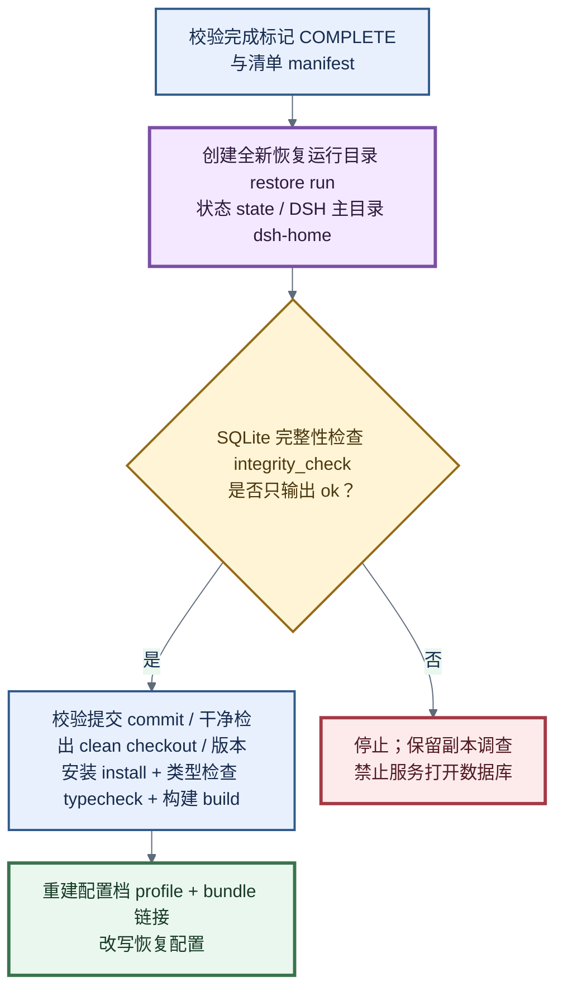

**B. 首次断网检疫；通过后才可选择受控服务演练**

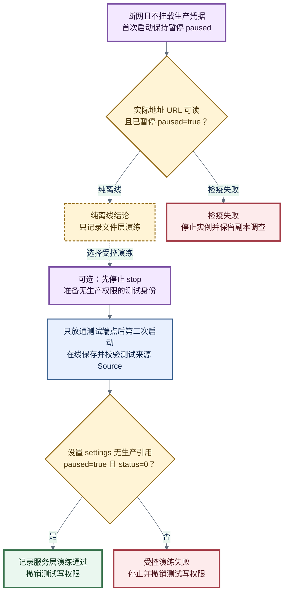

先选择一种演练口径，不能混用结论：

- **纯离线文件演练**：完全断网，只验证 manifest、SQLite、目录清单、profile 文件和 bundle link。GitHub setup 会访问外部服务并要求 Agent 账号对配置仓库具有 `push=true`，因此 setup pending、Source error 或非零 status 是预期可能结果；这种模式不能宣称服务验收通过。
- **受控服务演练**：第一次打开恢复数据库时仍然阻断全部外网，并确保生产 GitHub/飞书 wrapper、配置目录、keychain 和 secret 不挂载进演练环境。检疫检查完成后先 stop，再准备只能访问低风险测试仓库、对生产资源没有权限的测试 CLI/身份，并把出网限制为测试所需的提供商端点；随后第二次启动，通过本地管理面保存测试 Source。`Settings.save` 会在线校验账号和仓库，因此保存测试配置时必须允许这条受限网络，不能声称全断网下可完成，也不能直接修改 SQLite 绕过校验。需要 clean setup 时，测试身份可临时获得测试仓库所需的 push 权限；身份与配置校验后立即撤销。不要为了得到 status 0 给生产仓库或生产身份恢复写权限。

1. 创建隔离 VM/容器，按所选模式控制网络与凭据；安装备份记录的 Node、DSH 和源码 commit。无论选择哪种模式，第一次启动恢复实例前都必须阻断外网，并确保生产 wrapper、CLI 配置、keychain 和 secret 不可见；`paused=true` 不会阻止 Source 记录新 Trigger，不能替代这道网络与凭据隔离。由管理员事先创建一个专用于演练、且不位于 home 或生产目录中的父目录，例如 `/srv/dsh-superagent-restore`；下面命令只接受这个**已存在**父目录，不创建或修改其权限。
2. 先验证备份完成标记和 manifest，再在演练父目录下创建一个全新的 run 目录、`state` 和 `dsh-home`。所有目标先做 lexical canonicalization，必须位于本次 run 目录内，并与 home、备份记录的生产 `stateDir`、生产 `DSH_HOME` 完全隔离；任一空值、宽泛路径、重叠或既有目标都会 fail closed：

   ```sh
   (
   set -eu
   BACKUP_DIR='/absolute/path/to/completed-backup'
   RESTORE_PARENT='/srv/dsh-superagent-restore'
   RESTORE_RUN='run-20261104-001'
   fail() { printf 'Refusing restore: %s\n' "$1" >&2; exit 1; }
   overlap() {
     case "$1/" in "$2/"*) return 0 ;; esac
     case "$2/" in "$1/"*) return 0 ;; esac
     return 1
   }
   reject_broad() {
     case "$1" in
       ''|/|/boot|/dev|/etc|/home|/opt|/proc|/root|/run|/srv|/sys|/tmp|/usr|/var)
         fail "path is empty or too broad: $1" ;;
     esac
   }

   test "$(cat "$BACKUP_DIR/COMPLETE")" = 'complete'
   (cd "$BACKUP_DIR" && sha256sum -c MANIFEST.sha256)

   case "$RESTORE_RUN" in ''|.|..|*/*) fail 'RESTORE_RUN must be one new path segment' ;; esac
   case "$RESTORE_PARENT" in /*) : ;; *) fail 'RESTORE_PARENT must be absolute' ;; esac
   RESTORE_PARENT="$(realpath -e -- "$RESTORE_PARENT")" || fail 'restore parent does not exist'
   HOME_REAL="$(realpath -e -- "$HOME")" || fail 'cannot resolve home for safety check'
   PROD_STATE_RAW="$(cat "$BACKUP_DIR/state-dir.txt")" || fail 'cannot read production stateDir'
   PROD_DSH_HOME_RAW="$(cat "$BACKUP_DIR/dsh-home.txt")" || fail 'cannot read production DSH_HOME'
   case "$PROD_STATE_RAW" in /*) : ;; *) fail 'production stateDir is empty or not absolute' ;; esac
   case "$PROD_DSH_HOME_RAW" in /*) : ;; *) fail 'production DSH_HOME is empty or not absolute' ;; esac
   PROD_STATE="$(realpath -m -s -- "$PROD_STATE_RAW")"
   PROD_DSH_HOME="$(realpath -m -s -- "$PROD_DSH_HOME_RAW")"
   reject_broad "$RESTORE_PARENT"
   reject_broad "$HOME_REAL"
   reject_broad "$PROD_STATE"
   reject_broad "$PROD_DSH_HOME"

   RESTORE_BASE="$(realpath -m -s -- "$RESTORE_PARENT/$RESTORE_RUN")"
   RESTORE_STATE="$(realpath -m -s -- "$RESTORE_BASE/state")"
   RESTORE_DSH_HOME="$(realpath -m -s -- "$RESTORE_BASE/dsh-home")"
   reject_broad "$RESTORE_BASE"
   case "$RESTORE_BASE/" in "$RESTORE_PARENT/"*) : ;; *) fail 'restore run escaped its dedicated parent' ;; esac
   case "$RESTORE_STATE/" in "$RESTORE_BASE/"*) : ;; *) fail 'restore state escaped its run directory' ;; esac
   case "$RESTORE_DSH_HOME/" in "$RESTORE_BASE/"*) : ;; *) fail 'restore DSH_HOME escaped its run directory' ;; esac
   overlap "$RESTORE_BASE" "$HOME_REAL" && fail 'restore run overlaps home'
   overlap "$RESTORE_BASE" "$PROD_STATE" && fail 'restore run overlaps production stateDir'
   overlap "$RESTORE_BASE" "$PROD_DSH_HOME" && fail 'restore run overlaps production DSH_HOME'
   test ! -e "$RESTORE_BASE" || fail 'restore run already exists'

   umask 077
   mkdir -- "$RESTORE_BASE"
   mkdir -- "$RESTORE_STATE"
   mkdir -- "$RESTORE_DSH_HOME"
   test "$(realpath -e -- "$RESTORE_STATE")" = "$RESTORE_STATE"
   test "$(realpath -e -- "$RESTORE_DSH_HOME")" = "$RESTORE_DSH_HOME"
   cp -a -- "$BACKUP_DIR/state/." "$RESTORE_STATE/"

   test -f "$RESTORE_STATE/orchestrator.sqlite"
   result="$(sqlite3 "$RESTORE_STATE/orchestrator.sqlite" 'PRAGMA integrity_check;')"
   printf '%s\n' "$result"
   test "$result" = 'ok'
   )
   ```

3. 完整性检查必须输出且只输出 `ok`；否则保留副本、停止恢复并调查，不要让服务打开该数据库。
4. 先按所安装 DSH 版本的官方流程，在第 2 步新建的 `dsh-home` 中准备可用的 default profile；再创建新的 `superagent` profile、链接当前源码 bundle，并用备份的 `cordis.patch.yml` 覆盖生成配置。链接或启动前必须确认 checkout 的 HEAD 与备份 commit 完全一致、工作树干净，DSH、Node 和 pnpm 版本也与备份记录一致；随后从锁文件安装依赖、通过 typecheck 和 build，并确认 Git 不跟踪的 `lib/index.js` 已生成，避免链接不可加载的 checkout 或让错误版本首次打开恢复 SQLite。依赖应来自已审阅的镜像或预热缓存，纯离线模式不能临时访问公共 registry。下面命令只接受第 2 步已存在的 run 目录和专用 `dsh-home`，并拒绝覆盖已有 `superagent` profile：

   ```sh
   (
   set -eu
   BACKUP_DIR='/absolute/path/to/completed-backup'
   CHECKOUT='/absolute/path/to/dsh-superagent-prototype'
   RESTORE_PARENT='/srv/dsh-superagent-restore'
   RESTORE_RUN='run-20261104-001'

   RESTORE_PARENT="$(realpath -e -- "$RESTORE_PARENT")"
   RESTORE_BASE="$(realpath -e -- "$RESTORE_PARENT/$RESTORE_RUN")"
   RESTORE_DSH_HOME="$(realpath -e -- "$RESTORE_BASE/dsh-home")"
   case "$RESTORE_BASE/" in "$RESTORE_PARENT/"*) : ;; *) printf 'restore run escaped its parent\n' >&2; exit 1 ;; esac
   case "$RESTORE_DSH_HOME/" in "$RESTORE_BASE/"*) : ;; *) printf 'DSH_HOME escaped its restore run\n' >&2; exit 1 ;; esac
   test -d "$CHECKOUT"
   test -f "$BACKUP_DIR/cordis.patch.yml"
   test -f "$BACKUP_DIR/source-commit.txt"
   test -f "$BACKUP_DIR/dsh-version.txt"
   test -f "$BACKUP_DIR/node-version.txt"
   test -f "$BACKUP_DIR/pnpm-version.txt"
   test -f "$BACKUP_DIR/profile.txt"
   test -d "$RESTORE_DSH_HOME"
   test ! -e "$RESTORE_DSH_HOME/profiles/superagent"
   EXPECTED_COMMIT="$(cat "$BACKUP_DIR/source-commit.txt")"
   ACTUAL_COMMIT="$(git -C "$CHECKOUT" rev-parse HEAD)"
   test "$ACTUAL_COMMIT" = "$EXPECTED_COMMIT" || {
     printf 'Checkout commit mismatch: expected %s, got %s\n' "$EXPECTED_COMMIT" "$ACTUAL_COMMIT" >&2
     exit 1
   }
   test -z "$(git -C "$CHECKOUT" status --porcelain --untracked-files=all)" || {
     printf 'Checkout is not clean; refuse to link it to the restore profile\n' >&2
     exit 1
   }
   test "$(dsh --version)" = "$(cat "$BACKUP_DIR/dsh-version.txt")" || {
     printf 'DSH version differs from the completed backup\n' >&2
     exit 1
   }
   test "$(node --version)" = "$(cat "$BACKUP_DIR/node-version.txt")" || {
     printf 'Node version differs from the completed backup\n' >&2
     exit 1
   }
   test "$(pnpm --version)" = "$(cat "$BACKUP_DIR/pnpm-version.txt")" || {
     printf 'pnpm version differs from the completed backup\n' >&2
     exit 1
   }
   export DSH_HOME="$RESTORE_DSH_HOME"

   cd "$CHECKOUT"
   pnpm install --frozen-lockfile
   pnpm typecheck
   pnpm build
   test -f lib/index.js
   dsh superagent --from-default-profile web --dump-config > /dev/null
   dsh plugin --profile superagent add "link:$CHECKOUT"

   PROFILE_CONFIG="$DSH_HOME/profiles/superagent/cordis.patch.yml"
   test -f "$PROFILE_CONFIG"
   cp -p "$PROFILE_CONFIG" "$PROFILE_CONFIG.generated-before-restore"
   cp -p "$BACKUP_DIR/cordis.patch.yml" "$PROFILE_CONFIG"
   printf 'Restored config: %s\n' "$PROFILE_CONFIG"
   )
   ```

   覆盖后、启动前，人工编辑恢复副本中的 `cordis.patch.yml`：把 `stateDir` 改成第 2 步 run 目录中的 `state`，确认 Web `host` 仍是 `127.0.0.1`，并选择隔离环境未占用的端口。下面示例选 `4082`，后续 health URL 必须使用同一个值。至少执行下面的只读核对；任一检查失败都不要启动：

   ```sh
   RESTORE_PARENT="$(realpath -e -- '/srv/dsh-superagent-restore')"
   RESTORE_RUN='run-20261104-001'
   RESTORE_PORT='4082'
   RESTORE_BASE="$(realpath -e -- "$RESTORE_PARENT/$RESTORE_RUN")"
   RESTORE_DSH_HOME="$(realpath -e -- "$RESTORE_BASE/dsh-home")"
   RESTORE_STATE="$(realpath -e -- "$RESTORE_BASE/state")"
   PROFILE_CONFIG="$RESTORE_DSH_HOME/profiles/superagent/cordis.patch.yml"

   grep -F "stateDir: $RESTORE_STATE" "$PROFILE_CONFIG"
   grep -E '^[[:space:]]*host:[[:space:]]*127\.0\.0\.1[[:space:]]*$' "$PROFILE_CONFIG"
   grep -E "^[[:space:]]*port:[[:space:]]*$RESTORE_PORT[[:space:]]*$" "$PROFILE_CONFIG"
   printf 'Health URL: http://127.0.0.1:%s\n' "$RESTORE_PORT"
   ```

5. `git-worktrees.tsv` 是远端可恢复性清单，不是 worktree 本体。对每个 `git` 行，在受控网络中刷新对应 upstream，并确认记录的 commit 仍可从远端取得；纯离线模式只能校验清单和本地对象，不能证明远端可恢复。不要在当前宿主机直接创建清单里的原绝对目录：它们可能位于 home、生产 stateDir 或其他演练基目录之外，也不要复用 `state/` 中随包带来的 `.git` 指针。

   历史 Ticket 的绝对目录已经写入 SQLite，本仓库没有提供迁移这些路径的受支持命令。因此本手册的宿主机演练保持恢复实例 `paused`，只验证远端 commit 和目录清单；若必须验证 Worker 恢复，应在一次性 VM/容器自己的隔离文件系统中复现原绝对路径，并保证宿主侧所有可写层仍位于本次 `RESTORE_BASE` 下，再按第 10 节的既有方式重建基础 clone/worktree。做不到这一点就停止，不宣称 Worker 恢复完成。
6. 本流程没有备份 DSH Session persistence。除非操作者另外按相同 DSH 版本的官方方式保存并验证过 Session，否则必须明确接受 Session 历史丢失，只依赖 Ticket/Input/Report、`git-worktrees.tsv` 和远端 Git 证据判断是否继续。
7. 备份流程会把 `paused=true` 持久化；启动前先确认使用的是该完成备份，不手工改写恢复数据库。下面第一次启动是**隔离检疫启动**：外网必须仍被阻断，生产 wrapper/secret 必须不可见。它只允许本机管理 API 和 panel 打开恢复数据库、暴露 setup 问题并验证 paused 状态，不允许 Source 接触生产渠道。启动和状态检查必须显式使用第 4 步配置的实际 URL：

   ```sh
   CHECKOUT='/absolute/path/to/dsh-superagent-prototype'
   RESTORE_PARENT="$(realpath -e -- '/srv/dsh-superagent-restore')"
   RESTORE_RUN='run-20261104-001'
   RESTORE_PORT='4082'
   RESTORE_BASE="$(realpath -e -- "$RESTORE_PARENT/$RESTORE_RUN")"
   RESTORE_DSH_HOME="$(realpath -e -- "$RESTORE_BASE/dsh-home")"
   RESTORE_URL="http://127.0.0.1:$RESTORE_PORT"
   export DSH_HOME="$RESTORE_DSH_HOME"

   cd "$CHECKOUT"
   ./scripts/dsh-superagent --profile superagent --url "$RESTORE_URL" start
   ```

   无论 start 的 exit code 是什么，都用完全相同的 `DSH_HOME` 与 URL 单独读取状态，不依赖脚本默认的 3082：

   ```sh
   CHECKOUT='/absolute/path/to/dsh-superagent-prototype'
   RESTORE_PARENT="$(realpath -e -- '/srv/dsh-superagent-restore')"
   RESTORE_RUN='run-20261104-001'
   RESTORE_PORT='4082'
   RESTORE_BASE="$(realpath -e -- "$RESTORE_PARENT/$RESTORE_RUN")"
   export DSH_HOME="$(realpath -e -- "$RESTORE_BASE/dsh-home")"
   RESTORE_URL="http://127.0.0.1:$RESTORE_PORT"

   cd "$CHECKOUT"
   ./scripts/dsh-superagent --profile superagent --url "$RESTORE_URL" status
   ```

   管理 API 可达后还必须确认恢复数据库仍处于暂停状态；不是 `true` 就立即停止实例并调查，不继续 setup：

   ```sh
   RESTORE_PORT='4082'
   RESTORE_URL="http://127.0.0.1:$RESTORE_PORT"
   curl -fsS -H 'x-orchestrator-request: 1' \
     "$RESTORE_URL/orchestrator/api/state" | jq -e '.paused == true' >/dev/null
   ```

   纯离线模式到这里为止，只核对进程是否打开恢复数据库、runtime 是否启动以及错误是否符合断网预期；setup pending、Source error 或 status 非零都不能写成服务验收通过。

   受控服务模式在这次断网检疫检查后先 stop。然后准备已认证的测试 CLI/身份：它只能访问低风险测试仓库，对任何生产仓库、生产飞书群或生产 secret 都没有权限；网络策略只放通保存和验证测试 Source 所需的提供商端点。用同一 `DSH_HOME`、profile 和 `RESTORE_URL` 第二次 start，使管理 API 可用；旧生产 wrapper 因未挂载而必须保持不可用。此时才在本地 panel/API 中保存测试仓库与测试 CLI、关闭不参与演练的 Source，让在线 `Settings.save` 校验测试身份，再重新读取 settings 确认所有 Source、profile 和命令路径都不引用生产身份。不要直接改 SQLite，也不要临时挂载生产凭据来让旧配置通过 setup。只有测试身份符合预期、恢复状态仍为 paused、潜在重放已核对且 status 0，才能记录“服务层恢复演练通过”；检查完成后立即撤销测试写权限。两种模式都要检查数据库版本、Ticket、pending Effect/Outbox 和持久执行目录，并保持 paused，不恢复生产写权限。
8. 只在核对不会重放危险外部动作后，才按试点流程配置最小权限并跑 explicit-only 验收。一次文件层演练要求 SQLite 完整、profile/bundle 配置可复建、清单 worktree 可由远端重建；一次服务层演练还必须满足受控网络、测试仓库和 status 0，二者结论不可互相替代。

原型级 RPO 是最后一次成功停机备份；备份之后的新 Trigger、Report 和未推送文件会丢失。即使 SQLite 完整，崩溃前已经成功、但尚未被内部记录的任意 shell/API 副作用仍需到外部系统核对。

### 16.5 回滚原则

旧程序可能不能打开新 schema。回滚必须同时恢复：

- 旧源码 commit；
- 升级前 SQLite；
- 升级前 `cordis.patch.yml`，以及按第 16.4 节重建的 profile/bundle link；
- 与之兼容的 DSH 版本。

不要直接让旧代码打开已经迁移的新库。失败升级产生的 SQLite/WAL/SHM 先移动到保留目录，不要删除，待事故复盘。

## 17. 常见故障

| 症状 | 可能原因 | 处理 |
|---|---|---|
| `pnpm unable to open database file` | pnpm 的 store/cache/数据库路径无权限、目录缺失或损坏，也可能是安装问题 | 先查 `pnpm config get store-dir` 和相关目录权限/空间，保留错误输出；排除路径与损坏后才重装固定 11.7.0 |
| Agent GitHub CLI 未设置/找不到 | wrapper 路径错误 | 使用绝对路径并检查 executable |
| `cannot read its account` | wrapper 未登录/错 config dir | `gh-agent auth login`，再 `api user` |
| `cannot read/push` | 仓库邀请/权限不足 | 查询 `permissions`，人工修正 |
| mention 无响应 | 非 allowed、Source off、paused、旧正文无 notification | 新发评论，检查 Policy/Source/pause |
| prepare 失败 | clone 路径/ref/worktree 冲突 | 修命令/清理明确目标后 retry |
| status=1 | 进程/API/runtime 问题 | 看最新日志，确认无重复实例，必要时 restart |
| status=2 | Source/sync 等组件错误 | 修具体 error，不要只 restart |
| status=3 | setup pending | 面板 Deployment/Sources 补配置 |
| 飞书拒绝用户身份 | CLI 不是 bot-only | 重新 strict-mode bot |
| 飞书收不到群消息 | App 未发布、bot 不在群、listen 范围 | 人工检查开放平台和群配置 |
| worker-bin/gitconfig 被拒绝覆盖 | 文件不是本程序创建 | 移到安全位置，查来源，不直接覆盖 |
| Git 凭据异常 | clone 有自定义 credential/extraheader | 审查 `.git/config`，移除冲突配置 |
| 数据库持续增大 | 当前无历史 GC | 监控文件、建立归档/retention 方案 |

## 18. 安全加固清单

部署到真实团队前至少完成：

- [ ] 专用 OS 用户/VM/容器，不与操作者 home 混用
- [ ] GitHub/飞书专用身份和最小权限
- [ ] 模型 provider 凭据不进入 worker 上下文
- [ ] 严格 allowed list 和 admission table
- [ ] 主动模式先 observe，规则有回放样本
- [ ] 敏感命令不只靠 PATH shim，增加系统级限制
- [ ] 限制网络出口和文件系统范围
- [ ] 禁止 auto-merge，或增加独立硬审批
- [ ] 数据库停机备份/恢复演练
- [ ] 固定 DSH、本仓库和 Node/pnpm 版本
- [ ] 监控 health、Effect 失败、Outbox、worker load 和 DB size
- [ ] 明确紧急 pause/stop/撤权 runbook
- [ ] 检查 Prompt override，不弱化宿主规则
- [ ] 为任意外部写操作设计幂等 key 或补偿检查

## 19. Source 扩展入口

新增 Source 属于研发扩展，不是部署和运维步骤。领域映射、持久化顺序、幂等、Policy 接口和调用链见[主调研报告的架构与源码实现](dsh-superagent-research.md#7-架构与源码实现)；实现清单与双语示例见[中文：Source 扩展 cookbook](008-cookbook.zh-CN.md) / [English: Source extension cookbook](008-cookbook.md#L3-L19)。其中 `hookq` 是虚构示例，不是可直接安装的第三方 webhook 产品。

扩展完成后仍应按本手册第 8、11、14 节完成依赖检查、构建、服务状态和真实低风险验收；当前仓库的全量测试基线仍有 `tests/sources.spec.ts:1097` 一处失败，不能把其他检查通过表述为“全量测试通过”。

## 20. 可恢复停用

仓库没有正式、经过验证的一键卸载流程。建议先做可恢复停用，不直接删除：

1. 完整执行 16.2 节停机备份；该流程内部会依次 pause、等待 worker idle、stop、复制并校验，不能在它之前手工 stop；
2. 确认最终备份目录存在 `COMPLETE` 且 `sha256sum -c MANIFEST.sha256` 通过，并保持服务停止；
3. 将 profile、stateDir 和 wrapper 移动到带时间戳的 `.disabled-*` 位置；
4. 从 GitHub 仓库移除/降权 Agent 用户；
5. 在飞书开放平台停用 App，必要时轮换 secret；
6. 确认其他 profile 不依赖 DSH 后，才考虑卸载全局 DSH。

不要在未知依赖关系下删除 stateDir、profile 或 keychain 配置。

## 21. 交付验收表

| 项目 | 验收标准 |
|---|---|
| Build | `pnpm typecheck`、全量测试、`pnpm build` 均通过；当前本机尚差 `tests/sources.spec.ts:1097` 一处测试 |
| Service | `scripts/dsh-superagent status` exit 0 |
| Identity | GitHub/飞书消息显示专用 Agent 身份 |
| Authorization | 非 allowed 明确请求被拒绝；allowed mention 为 explicit |
| Isolation | 每 Ticket 独立 Session、目录和分支 |
| Recovery | 未 settle 的持久 Effect 会重试，Outbox 与外部系统之间存在 at-least-once 风险，重复由稳定 ID、receipt 和 Source 幂等逻辑收敛；DSH Session 投递使用稳定 request ID 防止同一请求重复进入，但本备份不含 Session persistence。任意 Shell/API 副作用仍须用幂等 key、执行前外部查询或补偿检查判断是否可继续 |
| Noise | 工作中无普通进展刷屏，只在结果/问题/失败时通知 |
| Observability | Trigger→Decision→Mandate→Ticket→Assignment→Report 可追溯 |
| Proactivity | `observe` 只记录，不执行；切 `auto` 前人工审阅样本 |
| Backup | 能在隔离基目录恢复 SQLite 和配置、重建 profile/bundle link，并验证清单 commit 可从远端取得；只有在隔离 VM/容器内安全复现持久绝对路径后才验收 Worker worktree 恢复，不把 DSH Session 或未 push 工作算入保证 |
| Security | 专用 OS/外部身份、最小权限、出网/文件限制、撤权 runbook |

## 22. 本地源码索引

- 安装协作流程：[中文](../SETUP.zh-CN.md) / [English](../SETUP.md#L1-L17)
- 哲学与操作责任：[中文](000-philosophy.zh-CN.md) / [English](000-philosophy.md#L1-L17)
- 领域对象：[中文](001-domain.zh-CN.md) / [English](001-domain.md#L1-L21)
- 授权：[中文](002-authorization.zh-CN.md) / [English](002-authorization.md#L1-L18)
- 执行、失败和恢复：[中文](003-execution.zh-CN.md) / [English](003-execution.md#L1-L19)
- Prompt：[中文](004-prompts.zh-CN.md) / [English](004-prompts.md#L1-L18)
- Panel：[中文](005-panel.zh-CN.md) / [English](005-panel.md#L1-L16)
- 官方部署说明：[中文](006-deployment.zh-CN.md) / [English](006-deployment.md#L1-L13)
- 完整架构：[中文](007-architecture.zh-CN.md) / [English](007-architecture.md#L1-L18)
- Source 扩展：[中文](008-cookbook.zh-CN.md) / [English](008-cookbook.md#L1-L19)
- profile 模板：[examples/profile.cordis.patch.yml](../examples/profile.cordis.patch.yml#L1-L12)
- DSH bundle/presets：[cordis.patch.yml](../cordis.patch.yml#L1-L20)
- 服务脚本：[scripts/dsh-superagent](../scripts/dsh-superagent#L1-L20)
