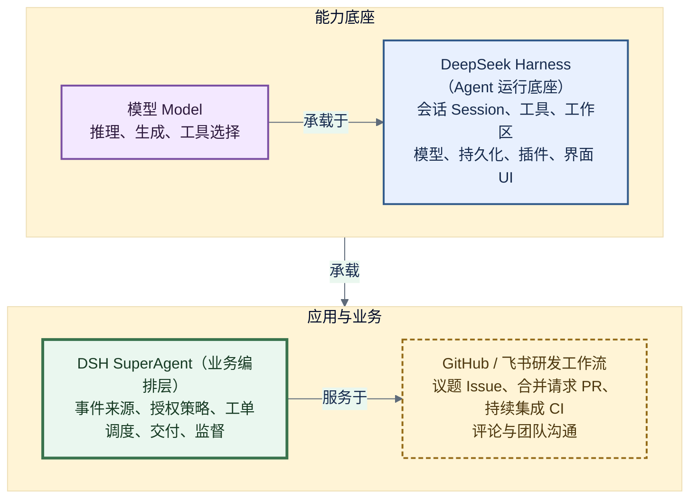
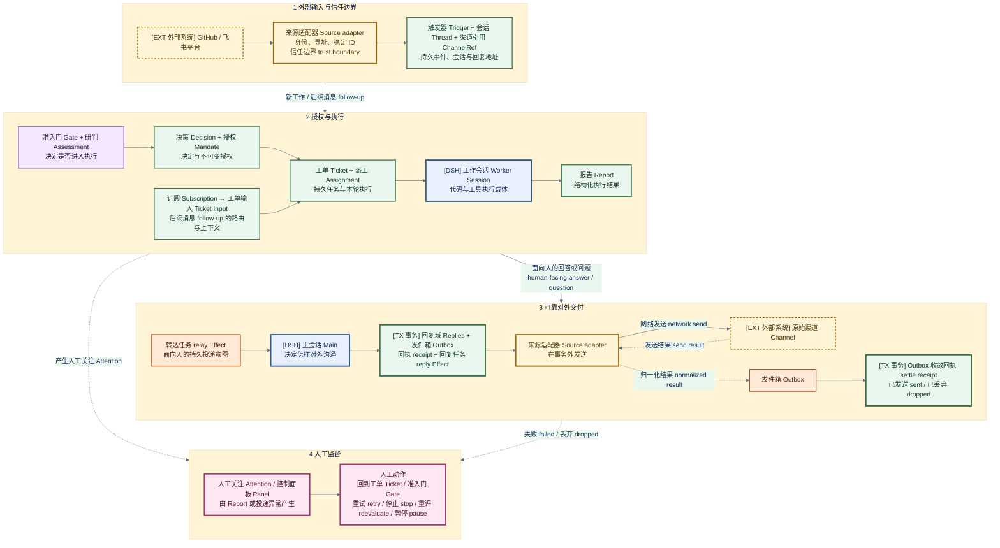
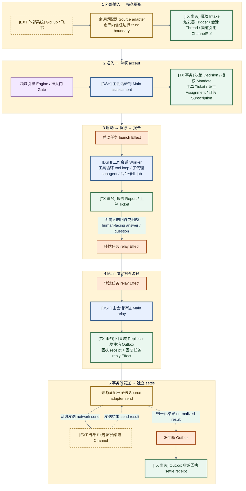
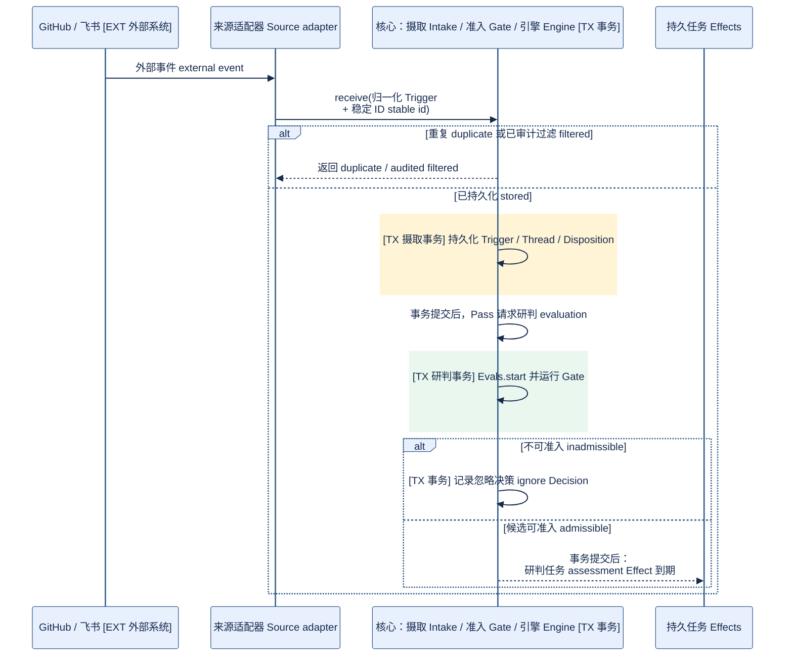
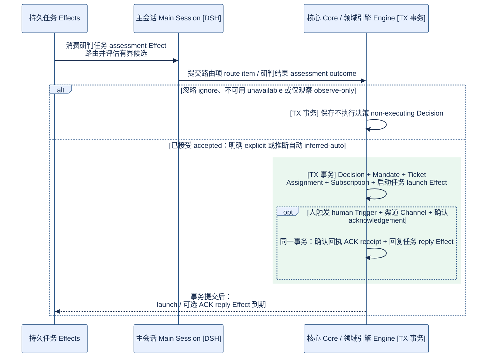
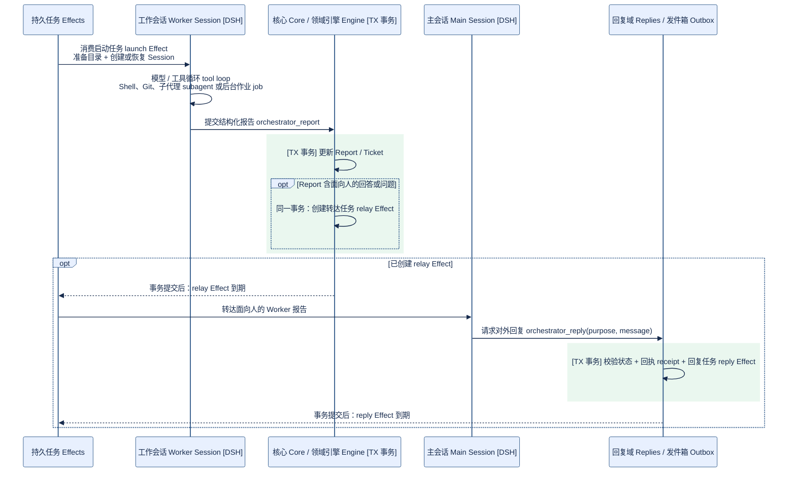
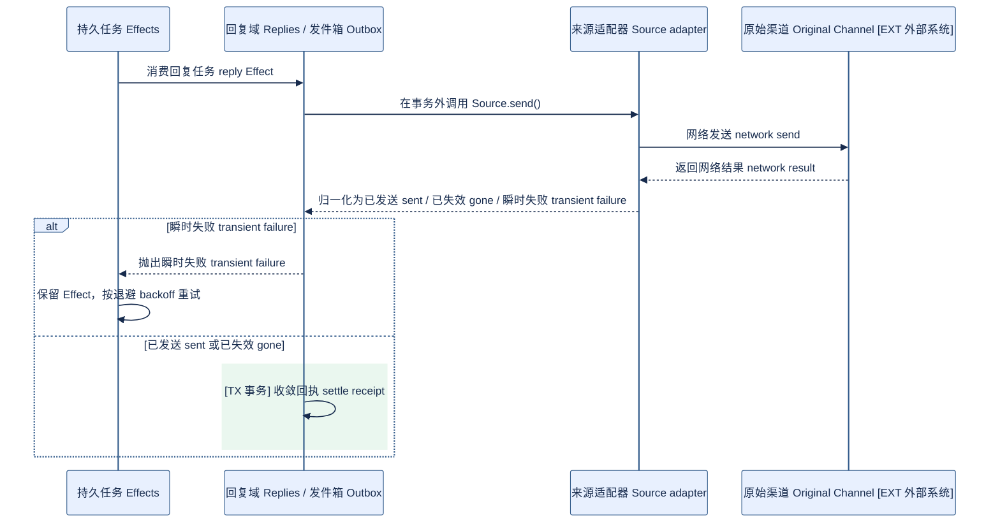
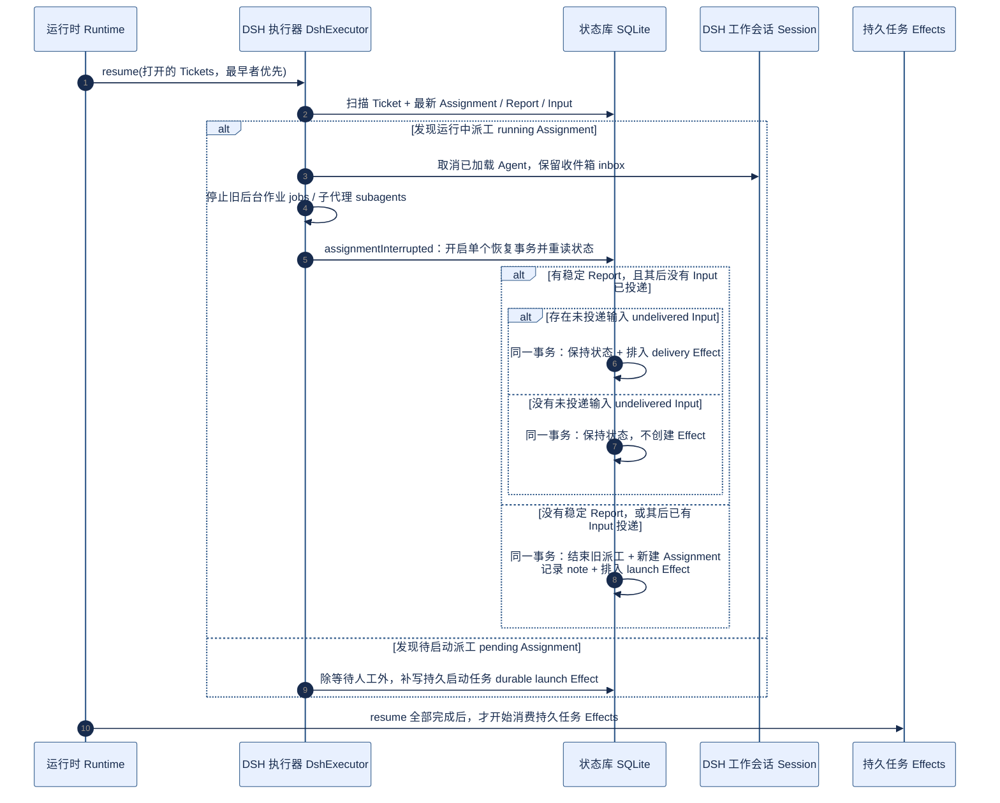

# DSH SuperAgent 深度调研报告

> 调研日期：2026-11-02；结构与调用链复核：2026-11-04
>
> 研究对象：DeepSeek 团队公开文章、DeepSeek Harness、官方 `dsh-superagent-prototype` 与本地源码快照
>
> 本地版本：`6337fc823ce20251c8de8085948165c81aaa701e` / `0.1.0`
>
> 结论边界：本文讨论设计思想与公开研究原型，不把它描述为已商业化或可直接生产使用的 DeepSeek 产品。

阅读路线：本文负责解释“是什么、为什么、怎样工作、是否值得采用”；安装、配置、运行、排障和备份见 [操作手册](dsh-superagent-operation-guide.md)；Multica 的版本、源码与运行形态深挖见 [Multica 专题](multica-research.md)。第 4 节正式定义术语；在此之前可把 Policy 理解为规则配置、Trigger 理解为外部事件记录、Decision 理解为处理决定、Attention 理解为待人处理事项、Report 理解为 Worker 的结构化状态。

## 0 执行摘要

DSH SuperAgent 是一个构建在 DeepSeek Harness（DSH）之上的、面向单仓库研发工作的主动式长期 Agent 应用与治理控制层。

它持续接收 GitHub 和可选飞书事件，先判断“谁在什么范围内授权了什么”，再把获准工作固化为可恢复的工单，为每项工作创建隔离的执行会话和目录，最后把结果送回原始讨论。

它解决的重点不是模型会不会写代码，而是五个系统问题：短命会话无法承载长期责任；人被迫充当跨 Issue、CI、聊天与 Agent 的调度器；主动发现容易产生噪声或越权；并行任务互相污染上下文和工作区；进程或网络失败后工作与回复难以恢复。

它对用户呈现一个持续负责的 Agent，对内则把路由与技术执行分开：主会话（Main Session / Router）只做候选研判、路由和沟通，工单（Ticket）工作会进入独立执行会话（Worker Session）；Worker 内可以使用后台任务（job）或子 Agent（subagent），但这些只是单个工单的执行能力，不是产品级 Agent 身份。

授权不是一段提示词（Prompt）。来源适配器（Source adapter）先声明事件是否来自人、是否指向 Agent 以及行为者是谁；确定性准入规则再给出 `explicit`（明确）或 `inferred`（推断）强度；模型只在受限候选中研判；接单后形成不可变授权（Mandate），限定该 Ticket 的范围。

可靠性也不依赖模型“记住继续”。SQLite 保存领域状态和待执行副作用，DSH 会话（Session）保存执行历史与模型上下文；二者共同工作，但业务真相以 SQLite 中的领域对象和投递回执为准。

公开原型已经实现主要单机骨架：GitHub/飞书来源（Source）、授权与工单模型、Main/Worker 双层会话、持久副作用任务（Effect）、发件箱（Outbox）、重启恢复、面板和运维脚本。

它仍是研究原型：单机单活、一个部署对应一个 GitHub 仓库、Worker 以宿主 OS 用户权限运行、没有多节点 HA、没有强沙箱，也不保证任意外部动作 exactly-once。

来源：[中文 README][R-ZH] / [English README][R-EN]

适合的起点不是 `auto`，而是只接受明确请求；随后用 `observe` 检验主动规则，最后只把低风险、高确定性的规则切到自动接受。

对比 Multica 时，结论应收束到首要产品对象：Multica 管许多人和许多 Agent 如何协作；SuperAgent 管一个 Agent 在什么授权下长期主动负责一个仓库。

## 1 为什么需要 SuperAgent

一个常见研发日并不是“给 Agent 一个任务，等它交 PR”这么简单。

上午，GitHub Issue 报告一个回归；开发者把正文复制进 coding agent。

中午，Agent 提交修改后 CI 失败；开发者把失败日志再贴回会话。

下午，评审者在 PR 留下评论，产品同学又在飞书补充边界；开发者需要判断哪些信息属于原任务，哪些需要新授权。

晚上，运行 Agent 的进程重启；第二天还要确认它是否重复 push、是否已经回复、是否仍在原权限内。

模型可能已经具备读代码、改文件和运行测试的能力，真正持续消耗团队注意力的是事件搬运、上下文归属、授权判断、并发隔离、失败恢复和结果追踪。

### 1.1 五类问题

第一类是短命 Session（会话）。

一次 Session 可以完成一个回合，却不是稳定的业务对象。它可能被压缩、取消、换模型或重启；PR、CI、review 和后续评论却会在数小时乃至数天后继续到来。

如果长期事实只存在聊天历史里，任务责任就会随 Session 一起变脆弱。

第二类是人工调度。

人需要在 Issue、PR、CI、飞书与多个 Agent 窗口之间复制信息，决定唤醒谁、何时追问、是否重试。Agent 越能并行，人的切换成本越容易成为瓶颈。

第三类是主动性失控。

让 Agent 主动观察所有评论和 CI 很容易；让它只对合适事件行动，并能解释“凭什么做、允许做到哪里”，才是难点。

未经治理的主动性会变成无穷建议、重复任务、越权修改和通知噪声。

第四类是并行上下文污染。

用一个巨大 Session 同时处理多个任务，会把需求、分支、工具输出、失败状态和评审意见混在一起。一次错误恢复还可能影响其他工作。

第五类是失败后难恢复。

模型、Provider、网络、Shell、GitHub、飞书和宿主进程都会失败。单靠 Prompt 中的“失败请重试”无法回答：数据库已写但评论未发怎么办；评论已发但本地未记账怎么办；进程重启后哪些消息已经读入、哪些还要重投。

### 1.2 SuperAgent 的回答

SuperAgent 把这些问题从模型上下文移到系统结构中：外部事件先成为可审计事件；授权先于执行；长期工作成为工单；每个工单有隔离 Session；待执行副作用先落盘；只有结果可用、需要决定或发生失败时才占用人的注意力。

项目把原则概括为“尽可能少地占用人的注意力，同时尽可能多地创造价值”。这不是文案，而是消息、面板、路由和恢复机制的共同设计约束。

来源：[中文：理念][P-ZH] / [English: Philosophy][P-EN]

## 2 定义与边界

SuperAgent 同时指一种协作思想、一套系统架构和这个仓库中的研究原型；若不拆开这三层，很容易把愿景写成已交付产品，或把上层治理误认成基础模型能力。

### 2.1 三层含义

| 层次 | 定义 | 当前证据 |
| --- | --- | --- |
| 设计思想 | 让 Agent 以低注意力、可授权、可恢复的方式持续承担团队工作 | 公开文章、理念文档与 Prompt 原则 |
| 系统架构 | 事件驱动、路由/执行分层、版本化授权、工作连续性、可靠副作用与人工监督 | 公开原型的领域模型、源码和测试 |
| 仓库实现 | 一个自托管 DSH bundle，服务单个 GitHub 仓库，可接 GitHub、飞书和 DSH Web 面板 | `dsh-superagent-prototype` 0.1.0 |

仓库将自己称为 framework，也把它描述为一种与 Agent 协作的方式；这里的 framework 是带明确领域语义的应用框架，不是通用多 Agent SDK。

来源：[中文：理念][P-ZH] / [English: Philosophy][P-EN]

### 2.2 它在技术栈中的位置

图示约定：图内以中文说明业务动作，以英文保留源码对象、函数、状态值和协议名，便于对照实现；`[TX]` 表示 SQLite 事务边界，`[EXT]` 表示仓库外部系统边界，`Effect` 表示可持久重试的异步任务。



Model（模型）提供推理能力。

SDK 或 Agent framework 提供 tool schema、handoff、graph 或 loop 等编程积木。

Agent harness/runtime（Agent 宿主或运行时）承载 Session、工具、Shell、工作区、权限 preset、持久化和 UI；本项目的直接底座是 DeepSeek Harness。

Agent application/control plane（Agent 应用与控制面）决定外部事件怎样成为工作、谁授权、由哪个 Session 执行、失败后如何继续；这是 dsh-superagent 的主要位置。

Business workflow（业务工作流）是团队真实使用的 Issue、PR、CI 与飞书讨论。

### 2.3 它不是什么

- 不是新的 DeepSeek 基础模型。
- 不是替代 DSH 的通用 harness。
- 不是只靠一个无限对话窗口长期运行的 bot。
- 不是通用多 Agent 名册、组织管理或跨 runtime 调度平台。
- 不是已经验证的托管 SaaS；没有公开租户、计费、云控制台或 SLA 证据。
- 不是分布式高可用调度器；当前是 SQLite、状态目录锁和单进程内存并发。
- 不是强安全沙箱；Worker 仍以宿主 OS 用户权限执行命令。
- 不是无限自治系统；主动工作受外部来源、准入、接受模式、书面规则、研判和授权范围约束。

### 2.4 仓库身份

官方上游是 [deepseek-ai/dsh-superagent-prototype][UPSTREAM]，README 明确称其为研究原型、仅供参考，并说明公开版本不等同内部系统。

来源：[中文 README][R-ZH] / [English README][R-EN]

源码观察：本地快照为 `6337fc823ce20251c8de8085948165c81aaa701e`，`package.json` 标记版本 `0.1.0`、`private: true`，许可证为 MIT；bundle 通过 Cordis patch 注入 DSH 插件、Router/Worker preset 与 Web client。[package.json](../package.json) [cordis.patch.yml](../cordis.patch.yml)

因此，最稳妥的中文定位是：**一个基于 DeepSeek Harness、面向团队单仓库研发工作流的主动式长期 Agent 应用与治理控制层。**

## 3 产品形态与使用方式

当前可确认的产品形态是一套自托管 DSH bundle：一个部署绑定一个 github.com 仓库，以 GitHub 为主要工作入口，可选飞书机器人，并在 DSH Web 中提供监督面板。

### 3.1 使用者能看到什么

| 触点 | 用途 | 当前边界 |
| --- | --- | --- |
| GitHub | 接收 Issue、PR、评论、review 与 CI；回复原讨论；关联 PR | 只支持 github.com；建议专用 Agent 用户 |
| 飞书 | 接收私聊、提及、配置范围内的群消息；回复原话题 | 可选；使用 bot-only CLI |
| DSH Web 面板 | 查看来源事件、研判决定、工单、待人工项、执行报告、健康与设置 | 属于 DSH 侧边栏，不是独立 SaaS 控制台 |
| Worker 执行会话 | 人可进入具体会话检查或继续工作 | 仍受宿主权限和工单生命周期约束 |
| 单仓库部署 | 每个实例持续负责一个仓库 | 不是多租户、多仓库共享平台 |

面板优先展示需要人处理的事项，而不是模型 token stream；这是“低注意力”原则在产品上的直接体现。

来源：[中文：面板][PANEL-ZH] / [English: Panel][PANEL-EN]

安装、CLI 配置、GitHub/飞书账号、面板、备份、恢复和排障步骤统一见 [DSH SuperAgent 操作手册](dsh-superagent-operation-guide.md)。

### 3.2 用户旅程一：明确请求

允许名单中的开发者在 GitHub Issue 写：`@agent 修复登录超时回归，补测试并提交 PR`。

系统确认消息确实指向 Agent、发送者有权发起工作，然后由主会话接单。

若接单结果提供 acknowledgement，且主 Trigger 来自人并带可回复 Channel，用户会在原 Issue 收到一次具体确认；否则系统可以静默接单。之后工作过程保持安静，直到 PR 可评审、需要一个决定或任务失败。

### 3.3 用户旅程二：主动发现

团队先写一条窄规则，例如“默认分支出现确定性类型错误时，准备一个最小修复并交人工评审”。

系统观察到 CI 事件后，把它作为候选研判。

在 `observe` 模式下，即使研判为匹配，也只记录“本来会接单”，不会建立工单或启动 Worker。

团队审阅一段时间的研判记录，确认命中率、范围与噪声后，才可把这条低风险路径切到 `auto`。

### 3.4 用户旅程三：后续跟进

原 PR 上又出现评审评论，或原 Issue 补充同范围要求。

订阅关系（Subscription）把消息送回已有 Ticket；普通人工 follow-up 不重新创建授权，也不要求用户再次 @ Agent。

Worker 判断内容是否仍在原 Mandate 范围内：在范围内继续，越界则交还，重新进入新工作的研判路径。

这条体验让用户感到自己在和一个持续负责的团队成员协作，而不是每次事件都重新启动一个陌生会话。

## 4 核心概念与领域模型

领域模型回答三个问题：事件来自哪里、凭什么成为工作、工作怎样跨会话持续。下面先给全景，再按五组解释；实现专用词留到第 7 节。



图中只有虚线框是外部平台或真实会话；Source adapter 位于仓库内，但承担身份与寻址的信任边界。Trigger、Thread、ChannelRef、授权和工单都是 SQLite 中的持久领域事实，DSH Session 只是执行载体。`[TX]` 只覆盖本地落库，不覆盖发往外部 Channel 的网络请求。

### 4.1 事件与沟通

**Source（来源）** 是事件流及其具体配置，例如一个 GitHub 仓库监听器或飞书机器人。Source 保存读取位置，决定什么属于其监听范围，并把外部对象转换为内部事件和可回复地址。

Source adapter 还声明 `human`、`addressed` 和 `actor`：是否来自人、是否明确指向 Agent、行为者是谁。Core 不会重新解析原始 GitHub/飞书载荷验证这些字段，所以适配器是授权信任边界，不只是格式转换器。

来源：[中文：领域模型][D-ZH] / [English: Domain][D-EN]

**Trigger（触发）** 是不可变外部事件，也是幂等和审计的基本单元。稳定 ID 让重复轮询或回填不会重复开工。

**Thread（线程）** 是按时间排序的一组 Trigger，例如一个 Issue、PR 或飞书话题。一个 Thread 可以承载多个彼此独立的 Ticket，但同一时刻至多有一个新工作评估。

**Channel（渠道）** 是 Thread 的写入侧，保存回复地址。确认、答案、结果和人工问题都通过 Channel 回到原始讨论。

**Correlation（关联）** 表示同一个 Trigger 所属的多个 Thread 之间有关联。它只补充评估上下文，不承担路由。

### 4.2 授权与决策

**Policy（策略）及 Policy version（策略版本）** 保存有版本的规则、每个 Source 的允许范围和接受模式。每个 Mandate 记录接单时的策略版本，使后来可以审计“当时依据什么”。

**Gate（准入）** 是确定性第一关。它根据 Source 声明的身份、是否指向 Agent、允许名单、准入表和既有 Thread 关系，决定候选是否进入系统以及授权强度。

**Assessment（研判）** 是模型对候选是否构成工作、匹配哪条书面规则的语义判断。模型只处理 Gate 放行的有限上下文。

**Decision（决定）** 在当前新评估路径中只有 `accept`、`stop`、`ignore` 或 `unavailable`；存储类型中的 `reopen` 仅供历史数据与迁移兼容，当前恢复路径不会新建 `reopen` Decision。

**Mandate（授权）** 是一次 accept 固化的不可变授权事实，包含 Policy version、Scope（范围）、Strength（强度）、行为者、接收方式和匹配规则。扩大范围需要新 Ticket；Prompt 不能扩大 Mandate。

来源：[中文：授权][A-ZH] / [English: Authorization][A-EN]

Mandate 不是 Prompt。Mandate 由宿主代码创建和校验；Prompt 负责告诉模型怎样沟通和做事。团队可以改 Prompt，却不能据此越过 Gate、资源范围或工具检查。

**Strength（授权强度）** 有两个值：`explicit` 表示合格的人明确请求，`inferred` 表示系统根据观察与规则推断候选。

**Accept mode（接受模式）** 有三个值：`off`、`observe`、`auto`。它们只控制 inferred 候选是否进入研判、只记录 would-accept，还是实际接单。

授权强度与接受模式是两条正交轴，不是同一个枚举：explicit 请求在三种模式下都可生效；inferred 在 `off` 不准入，在 `observe` 只记录，在 `auto` 才可能执行。

| 授权强度 | `off` | `observe` | `auto` |
| --- | --- | --- | --- |
| `explicit` | 可接单 | 可接单 | 可接单 |
| `inferred` | 不进入候选 | 研判并记录，不执行 | 研判、规则匹配后可接单 |

### 4.3 工作连续性

**Ticket（工单）** 是一个获授权的长期工作单元。它拥有 Mandate、Channel、Input、Assignment 和 Report，并定义自己的开放或结束状态。

**Assignment（派工）** 是 Ticket 与一次执行器接手之间的绑定。一个 Ticket 可因重试或重启产生多次 Assignment，而不改变原工作身份。

**Subscription（订阅）** 把 Ticket 与 Thread 连接起来，使后续 Trigger 自动成为 Ticket 上下文。

普通 Subscription 可以让人工 follow-up 由原 Worker 负责；**context-only Subscription（仅上下文订阅）** 只送达信息，不授予 follow-up owner，不恢复已结束 Ticket，也不增加权限。

Subscription 不是 Correlation。前者负责把 Thread 的后续事件路由到 Ticket；后者只说明不同 Thread 之间存在上下文关系。

**Input（输入）** 是送达 Ticket 的新上下文，包括后续 Trigger、策略变化、恢复说明或文本备注。

**Report（报告）** 是 Worker 对 Assignment 的结构化状态：`progress`、`waiting`、`ready`、`blocked`、`failed` 或 `dropped`。

**Attention（待人工决定）** 是 Ticket 上一个明确、可行动的问题。面板用它把人的注意力集中到真正需要回答的地方。

**Disposition（去向）** 记录 Trigger 被过滤、评估、扇出、附加、交还或回答的过程，形成审计链。

Ticket 不是 Session。Ticket 是业务真相和授权工作单元；Session 是模型执行与对话载体。Session 可以中断、压缩、恢复或换 Assignment，Ticket 仍然存在。

来源：[中文：执行][E-ZH] / [English: Execution][E-EN]

### 4.4 执行角色

**Main Session / Router（主会话 / 路由器）** 是对外持续存在的语义路由角色。它接收候选、完成 inferred 研判、接受或忽略工作、看到 follow-up 与 Worker 结果，并决定何时对外沟通。

**Worker Session（执行会话）** 是单个 Ticket 的技术执行载体。它读取代码、调用工具、运行测试、使用目录和报告结果。

**Execution environment（执行环境）** 是 Worker Session 与准备命令运行的位置，包含 Ticket 目录以及由 Executor 和 Source 注册的变量。

**subagent / job（子 Agent / 后台任务）** 是 Worker 在一次 Ticket 内使用的执行能力。它们继承 Worker 权限和生命周期，不拥有独立 Mandate、Ticket、对外身份或产品级名册。

因此，内部可以同时有多个 Session 和 subagent，用户仍只需要理解一个持续负责的 Agent。

### 4.5 可靠性

**Effect（副作用任务）** 是已经持久化、等待执行的内部异步意图，例如评估投递、启动 Worker、交付 Input、relay 或回复。Effect 失败会记录尝试次数并按 backoff 重试。

**Outbox（发件箱）** 专门管理对外 Channel 消息及其 receipt（回执）。Receipt 记录 `pending`、`sent` 或 `dropped`，并用稳定消息 ID 避免同一回复重复排队。

Effect 与 Outbox 不同：Effect 是通用持久任务队列；Outbox 是外发消息的业务账本，实际发送由 `reply` Effect 驱动。

**Stable ID（稳定 ID）** 从外部对象或请求派生，使重读同一事件、重投同一 Session 消息或重新发送同一回复能够识别重复。

**Idempotency（幂等）** 表示重复执行能收敛到同一结果；**retry（重试）** 和 **backoff（退避）** 控制暂时故障；**recovery（恢复）** 则在进程重启后重新对齐持久状态、Session 和工作目录。

这套设计提供的是 at-least-once（至少一次）尝试并依靠幂等和状态核对收敛，不是跨 SQLite、GitHub、飞书、Shell 和 Git 的分布式 exactly-once。

## 5 一项工作如何跑完

一项工作从外部事件开始，以结果回到原讨论结束；模型只是链中的研判和执行者，授权、状态与交付由系统共同承载。

下面仍以“修复登录超时回归，补测试并提交 PR”为例，只使用业务语言描述。

### 5.1 明确请求的主流程

1. GitHub 或飞书观察到新消息，把它保存为不可变事件，并确定它属于哪个 Thread、由谁发送、是否明确指向 Agent。
2. 系统检查 Source 是否在监听、发送者是否有权请求、消息属于明确请求还是推断候选。
3. 主会话看到候选及有限上下文。明确请求可以直接路由；推断候选必须判断是否匹配团队书面规则。
4. 接单时，系统同时记录 Decision、Mandate、Ticket、首次 Assignment、原 Thread 的 Subscription 和待执行副作用。
5. 若接单结果提供 acknowledgement，且主 Trigger 来自人并带可回复 Channel，用户会在原 Thread 收到一次具体确认；如果外部渠道暂时失败，回复保持待发送并重试。缺少其中任一条件时可以静默接单。
6. Assignment 等待可用并发位；执行目录准备完成后，系统创建或恢复该 Ticket 的 Worker Session。
7. Worker 读取完整需求和必要上下文，调查代码、修改、测试、自审并准备 PR。普通进展只进入 Ticket，不持续通知人。
8. PR、CI 或评审消息到达已订阅 Thread 时，成为 Ticket Input。Worker 在下一轮继续处理，而不是让用户重新开任务。
9. Worker 报告可评审结果、需要决定的问题或失败。主会话把真正对人有用的内容压缩成回复。
10. 回复先写入 Outbox，再通过原 Channel 发送；receipt 最终记录 sent 或 dropped。
11. Ticket 根据 Report 与所跟踪 PR 的状态结束；后续同范围人工评论仍可在授权重新验证后恢复它。

### 5.2 主动任务的分支

主动观察不会直接启动 Worker。

Source 先产生 inferred 候选；系统按当前 Policy 研判每条启用规则。

`observe` 只保存 would-accept Decision，团队可以在面板审阅噪声、误判和范围。

只有 `auto`、至少一条规则匹配、存在意图证据且宿主校验通过时，才进入与明确请求相同的 Ticket 流程。

### 5.3 follow-up 的分支

普通人工 follow-up 命中已有 Ticket 的普通 Subscription 时，先成为该 Ticket 的 Input；Ticket 尚未结束或原 Mandate 重验成功时，才绕过新的 Gate、Assessment、Decision 和 Mandate。重验失败会把 Trigger 释放给新 Eval。

这不等于扩权：Worker 仍受原 Mandate 限制。它要么在范围内处理，要么把消息交还；所有 owner 都交还后，消息才作为新工作重新评估。

成功的快路径仍向主会话发送 follow-up relay，以便在用户明确要求 stop 时介入；Main 不能趁机重新 accept、attach 或扩大原工作。

context-only Subscription 不取得 follow-up owner。来自机器人或 CI 的事件即使也送给 Worker 作为上下文，仍可独立进入新工作评估。

### 5.4 人工介入的分支

人可以在面板重试失败 Assignment、停止 Ticket、重新评估 Trigger、取消订阅或暂停处理。

pause 只暂停新的评估、派发、Input 交付和回复；Source 继续记录事件，已经运行的 Worker turn 不会被强杀。

stop 会结束 Ticket 和当前 Assignment、撤回 Mandate、清理待处理 Input，并在提交后取消后台工作；之后在原 Thread 继续提出工作需要新的 accept。

## 6 核心设计思想

SuperAgent 的设计可以收束为四组选择：降低注意力；对外保持一个 Agent、对内隔离 Session；用确定性授权包住概率模型；用事件、外置状态和可靠副作用支持长期运行。

### 6.1 低注意力，而不是高消息量

问题：传统 Agent 往往把每个中间动作都暴露给用户，主动系统还会把候选、进度和健康信息变成通知洪水。

选择：只确认一次请求；过程默认安静；结果可用、需要决定或无法继续时才发言；一次只问一个具体问题；面板优先显示 Attention 和系统问题。

来源：[中文：理念][P-ZH] / [English: Philosophy][P-EN]

代价：用户看不到每一步，需要信任审计记录与面板；如果 Report 结构或通知策略设计不好，系统可能显得“没有反应”。

工程含义：普通 `progress` 不 relay 给 Main；稳定状态不要求人工确认；主动规则从 `observe` 开始；消息长度与 purpose 受宿主和 Prompt 共同限制。

### 6.2 对外一个持续 Agent，对内多个隔离 Session

问题：一个无限 Session 会串行化所有工作并污染上下文；把每个 Worker 暴露成独立产品 Agent，又会把内部调度负担转给用户。

选择：Main 维护持续身份和路由视角；每个 Ticket 使用独立 Worker Session、目录和 Assignment 历史；Worker 内部按需使用 subagent/job。

代价：Main 与 Worker 之间需要可靠 relay，跨 Ticket 事实必须显式传递，系统也要解决目录、并发位和 Session 生命周期对齐。

边界：Main 不应承担技术实现；subagent/job 不升级为独立授权主体；一个 Ticket 可有多次 Assignment，但仍是同一项业务工作。

### 6.3 确定性授权包住概率模型

问题：模型擅长理解语义，却不适合单独决定身份、权限、幂等键和不可变授权；外部评论和仓库内容还可能包含提示注入。

选择：Source 先提供可信身份元数据；Gate 确定性筛选；模型只评估有限候选；宿主再次校验模式、规则和意图证据；accept 才生成 Mandate；工具和资源继续检查 Ticket 范围。

来源：[中文：授权][A-ZH] / [English: Authorization][A-EN]

代价：Policy、Source adapter 和 Mandate 重验成为安全关键代码；规则过窄会漏掉工作，过宽会增加候选噪声。

边界：Prompt 是行为层，不是权限层；外部文本是数据；恢复只能重新确认原 Mandate 仍有效，不能授予新权限。

### 6.4 事件驱动、状态外置、可靠副作用

问题：让模型永久 `while(true)` 会浪费 token，也无法在进程崩溃后可靠回答“做到哪一步”。

选择：Source、follow-up、CI、Report 和后台任务完成事件按需唤醒组件；SQLite 保存业务状态和副作用意图；DSH Session 保存执行历史；目录与 Git 保存工作产物；外部回复由 Outbox 跟踪。

代价：系统变成一个状态机，需要处理竞态、重复、回滚、退避、恢复和数据增长；“最终收敛”比单轮调用更难测试。

边界：DSH Session persistence、compaction 和 tool-result pruning 控制模型上下文；长期事实仍外置到 Ticket、Input、Report、Source 原记录、目录与 Git，而不是依赖一个永不结束的上下文窗口。

来源：[cordis.patch.yml](../cordis.patch.yml)；[中文：执行][E-ZH] / [English: Execution][E-EN]

## 7 架构与源码实现

源码实现把业务真相放在 SQLite，把 DSH Session 当执行载体，把 GitHub、飞书、模型 Provider 和 Shell 当外部边界；每个边界通过事务、稳定 ID、持久 Effect 和回执连接。
本节只保留影响产品语义的实现证据。更细的函数入口、异步边界和异常分支见附录 A。

来源：[中文：架构][AR-ZH] / [English: Architecture][AR-EN]

### 7.1 一张实现流程图


`[TX]` 是 SQLite 事务，Effect 是提交后执行的持久异步任务，`[DSH]` 是 Harness 提供的 Session 与模型循环，`[EXT]` 是无法与本地数据库共用事务的外部系统。Source adapter 在仓库内执行，但它提供的身份元数据是授权信任边界；网络发送不在任何 `[TX]` 内。

### 7.2 宿主启动：先恢复真相，再放行工作

源码观察：DSH/Cordis 从 `src/index.ts` 进入 `Runtime`。Runtime 锁定 `stateDir`、打开 `orchestrator.sqlite`、构造 Store、Effects、Source registry、Sessions、Settings、Executor、Assessor、Outbox、Engine 和 Passes，再注册管理 HTTP。[index.ts](../src/index.ts) [runtime.ts](../src/app/runtime.ts)
Setup 完成后，系统安装 Session/Executor 钩子，确保 Main Session 存在，同步 Policy，先恢复被中断 Assignment，最后才启动 Passes 与 Effects。
这个顺序避免数据库仍认为 Assignment 正在运行时，新 launch 已经和旧后台工作重叠。
Store 使用 WAL 和 `synchronous=FULL`；进程锁只支持单机单活。没有 leader election、lease、heartbeat fencing 或多节点 failover。[store.ts](../src/app/store.ts)

### 7.3 事件接入：Source adapter 是信任边界

GitHub 通过 notification、仓库观察、PR/CI 和已订阅 Thread 轮询产生 Trigger；飞书通过实时 consumer、历史回填和话题轮询产生 Trigger。多条入口可能读到同一外部对象，稳定 ID 在统一 intake 处去重。[github.ts](../src/sources/github.ts) [feishu-loops.ts](../src/sources/feishu-loops.ts)
源码观察：Source 通过窄 `SourceContext` 调用 intake；`Passes.receive()` 只在 Trigger 确实存储后请求一次可合并 pass。duplicate 不写新对象，filtered 保留审计但不评估，stored 才进入后续流程。[source-context.ts](../src/app/source-context.ts) [passes.ts](../src/app/passes.ts) [intake.ts](../src/core/intake.ts)
适配器负责声明 `human`、`addressed`、`actor`、Thread 和 Channel。新增 Source 若在 bot 识别、mention/direct 判断或身份映射上出错，会直接污染授权链。

### 7.4 决策控制：模型在两道确定性检查之间

Engine 是 Trigger、Thread、Decision、Ticket 和 Assignment 的单写者；同步命令在 `Store.atomic()` 内修改聚合。`evaluateDue()` 按 Thread 分别开事务，不用一个大事务包住整轮扫描。[engine.ts](../src/core/engine.ts)
Gate 对批次中的每条 Trigger 判定 explicit、inferred 或不准入；整批无准入项时直接记录 ignore，不调用模型。候选真正送达 Main Session 后才开始 Eval timeout，避免排队时间误算为模型超时。[evals.ts](../src/core/evals.ts) [assessment.ts](../src/app/assessment.ts)
inferred assessment 之后，宿主再检查每条启用规则是否都有 judgement、是否有方向和意图证据、是否至少命中一条规则，以及当前模式是否允许执行。`observe` 的正向结果被保存为 would-accept，但不建 Ticket。[policy.ts](../src/policy.ts)

accept 在单个 SQLite 事务中创建或保存 Decision、嵌入其中的 Mandate、Ticket、首个 Assignment、Subscriptions 和 `launch` Effect；仅当 accept outcome 带 `acknowledgement`，且 primary Trigger 标记为 `human` 并带可回复 Channel 时，同一事务才创建 acknowledgement receipt 与 `reply` Effect。授权强度不参与该判断：inferred-auto 的人类 Trigger 也可 ACK；bot/CI、无 Channel 或 silent/no-ack outcome 不走 ACK 分支。
Mandate 没有独立表；它以不可变 JSON 同时嵌入 accept Decision 和 Ticket。恢复前 `revalidate` 只判断原授权在当前 Policy 下是否仍成立，不授予新权限。
一次 `orchestrator_route` 可带多个 route item，但每个 item 各自进入独立 Engine 事务；其中一个被拒绝不会回滚其他 item，也不存在整批原子接单。[main.ts](../src/app/tools/main.ts) [tickets.ts](../src/core/tickets.ts)

### 7.5 执行隔离：Ticket 与 Session 对齐，但不等同

accept 提交后，`launch` Effect 才准备目录、取得 `WorkerSlots` 容量并创建或恢复 `worker-<ticket-id>` Session。prepare command 是事务外 Shell；失败不能回滚已经存在的 Ticket，只会让 Ticket 进入失败路径。[dsh.ts](../src/executor/dsh.ts)
`WorkerSlots` 是单进程内存并发控制。它通常覆盖 prepare、launch、活动 turn 和轮次后继续运行的 job/subagent；人工消息可借用一个额外 slot。人工 handoff 时 subagent 会停止，被移交且获准保留的 shell job 可不占 slot 继续运行，直至 Assignment 结束。
它不是分布式 lease，没有心跳和 fencing。单活依赖状态目录锁；进程崩溃后通过 SQLite Assignment 与 DSH Session 状态重新对齐。
每个 Worker 有独立目录；推荐部署可用 prepare command 创建 git worktree，但目录隔离不是安全沙箱。

### 7.6 模型运行：DSH 负责 loop，领域状态负责连续性

源码观察：`Sessions` 为 Main 和 Worker 创建 DSH Session，并在每个模型请求时动态组合角色 Prompt、Policy、执行环境、团队文本、skills 和领域工具。[sessions.ts](../src/app/sessions.ts) [prompts.ts](../src/app/prompts.ts)
DSH 负责 inbox、Session log、Provider 请求、tool loop、基础工具、subagent/job、persistence、compaction 和 tool-result pruning；本仓库监听 Session 事件，并在模型调用 `orchestrator_*` 工具时重新进入领域控制。
Worker 只能读取自己的 Ticket、可达 Thread/Trigger、对应 Source 原文和自己使用过的 Prompt revision。Ticket ended 后，工作工具调用会被拒绝。[resources.ts](../src/app/resources.ts) [sessions.ts](../src/app/sessions.ts)
长期连续性来自组合：SQLite 保存授权和工作事实，DSH 保存会话历史，目录与 Git 保存产物，Source 保存外部原记录。压缩 Session 不应删除这些长期事实。

### 7.7 follow-up：快路径不等于扩权

普通 Subscription 上的人工 follow-up 先在 intake 事务中追加 Ticket Input：running Assignment 写 `delivery` Effect，pending Assignment 写或保留 `launch` Effect；ended Ticket 先只保存 Input，原 Mandate 重验成功后才创建 resumed Input、新 Assignment 与 `launch` Effect。成功的快路径还写 `relay` Effect。[intake.ts](../src/core/intake.ts) [tickets.ts](../src/core/tickets.ts)
running、pending 和重验成功的 resume 不创建新 Eval/Mandate；重验失败才保持 Ticket ended 并把 Trigger 释放给新 Eval。Main 通过 relay 保持可见性，并在用户明确 stop 时介入；消息 scope 仍由 Worker 判断。
context-only Subscription 不获得 follow-up owner；bot/CI 不因 fan-out 自动获得人工 follow-up 强度。Worker hand back 后，只有当不再有其他 owner 时，Trigger 才回到新 Eval。
Input 的 `deliveredAt` 与 `readAt` 是两个可交换、最终收敛的事实：消息可先被 DSH step 认领，再由发送路径标记 delivered；实现不会用后写覆盖已存在的 read 事实。[dsh.ts](../src/executor/dsh.ts)

### 7.8 可靠交付：两段持久链

Worker Report 先在事务中更新 Assignment/Ticket，并在需要沟通时写 `relay` Effect；relay 把结果送入 Main Session。普通 `progress` 不 relay，问题、answer、ready、blocked、failed、dropped 等才需要 Main 处理。[assignments.ts](../src/core/assignments.ts) [notices.ts](../src/app/notices.ts)
Main 通过 `orchestrator_reply` 再开一个事务：`Replies` 校验 purpose 与当前状态，Outbox 写 receipt，并原子加入 `reply` Effect。事务提交后，Effect handler 才经 Source adapter 调用 GitHub 或飞书；网络发送不在该事务内。若返回 `sent` 或 `gone`，系统再以独立事务 settle receipt；瞬时失败则保留 Effect 并退避重试。[replies.ts](../src/core/replies.ts) [outbox.ts](../src/app/outbox.ts)
所以标准结果链有两段持久投递：`Worker report → Main relay`，以及 `Main reply → Outbox → Channel`。Main 不是可省略的内存转发器，而是对外沟通决策点。
Outbox 本地 receipt 防止重复排队；GitHub 使用隐藏 marker 查重，飞书使用服务端幂等 key。若第三方已成功而本地尚未来得及 settle，恢复仍依赖这些幂等手段收敛，不构成分布式 exactly-once。[github-channel.ts](../src/sources/github-channel.ts) [feishu-channel.ts](../src/sources/feishu-channel.ts)

### 7.9 恢复：先核对外部状态，再继续

启动恢复会把真正运行中的 Assignment 标为 interrupted，停止旧后台工作，并为需要继续的 Ticket 创建新 Assignment；waiting、ready、blocked 或 failed 且该 Report 之后没有 Input 被送达时，原状态可以保留。[dsh.ts](../src/executor/dsh.ts) [assignments.ts](../src/core/assignments.ts)
恢复说明要求 Worker 在重复外部动作前检查目录、Git 历史和 GitHub。持久 Effect 会重试尚未完成的启动、交付、relay 和回复；这能避免静默丢失，却不能替任意 Shell/API 自动生成幂等语义。

### 7.10 函数级主时序

一张七参与者长图在普通 Markdown 正文中会把文字压得很小。这里按真实异步边界拆成四段：A1 提交的 assessment Effect 是 A2 的输入，A2 提交的 launch / reply Effect 再进入 B 和 C；这些图不是彼此独立的流程。时序图不使用跨图连续编号，以 A1、A2、B、C 作为主索引。

**A1. 摄取与准入：先保存事实，再生成 assessment Effect**



**A2. Main 研判与原子接单：业务对象和启动意图一起提交**



**B. Worker 执行、Report 与 Main relay**



**C. 事务外发送、结果回传与 settle**



图 A 中 `observe` 分支只适用于 inferred 候选；explicit 与 inferred 是授权强度，`off/observe/auto` 是接受模式。可选 ACK 虽在 accept 事务中入队，但实际发送和 settle 复用图 C。Effect 是通用持久任务，Outbox 是外发消息与 receipt 状态；二者不能合并。follow-up 与 ended Ticket 的恢复分支见 7.7 和 A.7，重启原子事务见 A.10。

### 7.11 实现索引

| 问题 | 关键入口 | 证据重点 |
| --- | --- | --- |
| 宿主怎样启动 | `src/index.ts`、`src/app/runtime.ts` | 锁、Store、恢复、Pass/Effect 启动顺序 |
| Source 怎样入域 | `src/app/source-context.ts`、`src/core/intake.ts` | 稳定 ID、过滤、订阅扇出、信任字段 |
| 怎样授权 | `src/policy.ts`、`src/core/evals.ts` | Gate、模式、规则复核、Mandate 重验 |
| 怎样接单 | `src/core/tickets.ts`、`src/app/tools/main.ts` | 单 item 事务、Ticket/Assignment/Effect 原子创建 |
| 怎样执行 | `src/executor/dsh.ts`、`src/app/sessions.ts` | WorkerSlots、目录、Session、Input 状态 |
| 怎样交付 | `src/core/assignments.ts`、`src/app/notices.ts`、`src/app/outbox.ts` | Report relay 与 Outbox 两段链 |
| 怎样恢复 | `src/executor/dsh.ts`、`src/core/tickets.ts` | interrupted、未读 Input、Mandate revalidate |

## 8 可靠性、安全与人工监督

评估这类系统，应直接问三个问题：崩溃会不会丢工作，主动性会不会越权，人能否看见并制止异常。公开原型给出了单机范围内的清晰答案，也保留明显生产缺口。

### 8.1 崩溃会不会丢工作

已提交的 Trigger、Decision、Ticket、Assignment、Input、Report、Effect 和 Outbox receipt 保存在 SQLite；待执行 Effect 在重启后继续处理。

接单事务把业务对象与 launch/reply 意图一起提交，避免“Ticket 已创建但没有启动记录”。Report relay 与外发回复也各有持久边界，避免只存在于 Session 内存。

DSH Session、目录和 Git 状态提供执行上下文；恢复先检查这些外部事实，再决定是否重复动作。

边界是 at-least-once：数据库能保存“还要做”，不能原子覆盖第三方 API 或 Shell。任意没有稳定 key 的外部动作仍可能需要人工或 Worker 做补偿性去重。

Effects 对同 kind/key 的等待项可合并，失败按指数退避；Outbox 对同 Ticket 与 conversation 的回复维持有限顺序，并保留 sent/dropped receipt。[effects.ts](../src/app/effects.ts) [outbox.ts](../src/app/outbox.ts)

当前不会自动清理多类历史记录，Trigger、Decision、ended Ticket、receipt 与版本历史会持续增长；长期运行需要另行设计保留和归档策略。

来源：[中文：架构][AR-ZH] / [English: Architecture][AR-EN]

### 8.2 主动性会不会越权

授权链同时依赖 Source 身份声明、Policy、Gate、Assessment、宿主复核、Mandate、Ticket 资源边界和工具参数检查。

外部评论、代码和网页只作为数据，不能通过 Prompt 修改 allowed list、Gate 或 Mandate。inferred 工作还要受接受模式和匹配规则限制。

恢复已结束 Ticket 前重验原 Mandate；验证成功只恢复原范围，失败则让消息重新评估。

但进程权限不是强隔离。源码观察：Main 和 Worker 使用 `danger-full-access`；Worker 可执行宿主 OS 用户能执行的程序，blocked-command shim 可被绝对路径绕过。

来源：[sessions.ts](../src/app/sessions.ts)；[中文：部署][DEP-ZH] / [English: Deployment][DEP-EN]

因此，Policy 治理回答“系统是否应做”，容器/VM、专用用户、最小挂载、凭据和网络控制回答“即使模型出错，最多能影响什么”。两者不可互相替代。

### 8.3 人怎样介入

Overview 优先显示 Attention、blocked/failed、delivery failure、unavailable Decision、Source/Effect health 和 worker load。

人可以：

- `retry`：结束停滞 Assignment，在同一 Ticket、Session、目录和 Mandate 下创建新 Assignment；
- `stop`：撤回 Mandate，结束 Ticket/Assignment，取消后台工作并阻止原 Ticket 再接收内容；
- `reevaluate`：让已存 Trigger 重新进入 Eval；
- `pause`：暂停新评估、派发、Input 交付和回复，不强杀当前 Worker turn；
- `unsubscribe`：停止某 Thread 后续事件继续扇出；
- 直接进入 Worker Session：检查或继续具体技术工作。

管理 API 绑定 loopback，并检查专用 header、Origin 和请求 schema；它是本地控制面，不应直接暴露到不受信网络。[http.ts](../src/app/http.ts)

### 8.4 生产加固底线

受控 PoC 至少需要专用 OS 用户或容器/VM、最小仓库与文件挂载、专用 GitHub/飞书账号、最小凭据、出网限制、secret broker、审计日志、资源限额、备份和外部 kill switch。

不要把 allowed list、Prompt、worktree 或 WorkerSlots 当作安全沙箱、组织级 RBAC 或高可用调度。

## 9 完成度与适用边界

当前公开材料应分成三层阅读：官方文章给方向，公开原型证明主要单机机制，生产能力与实验外推仍待验证。

### 9.1 愿景与已实现

| 设计目标 | 公开原型对应物 | 判断 |
| --- | --- | --- |
| Router / Worker 分层 | Main Session + per-Ticket Worker Session | 主要骨架已实现 |
| 事件驱动 intake | GitHub/飞书 Source、Trigger、Thread、Subscription | 单机版已实现 |
| 低注意力交互 | 原 Channel、Attention、Panel、progress 不 relay | 主要交互已实现 |
| 状态 / 计算 / 环境分离 | SQLite、DSH Session、Ticket 目录/worktree | 本地形态已实现 |
| 可靠副作用 | Effect、Outbox、stable ID、retry/recovery | 已实现单机收敛机制 |
| 外部 Watchdog | health/status、服务脚本与部署建议 | 运维骨架，非 HA |

源码观察：原型还实现 Policy/Prompt revision、管理 API、Source cookbook、两种语言文档以及覆盖领域、存储、面板和适配器的大量测试。

实现了单机收敛机制；本轮未做真实 E2E 或全量测试。证据边界详见[第 15 节研究限制](#15-研究限制)。

### 9.2 明确未实现或有限

| 项目 | 当前边界 |
| --- | --- |
| 正式产品化 | README 明示 research prototype |
| 多仓库、多租户 | 一个部署对应一个 github.com 仓库 |
| 多节点 HA | SQLite + stateDir 锁；无 leader election/lease/fencing |
| 强安全隔离 | `danger-full-access`，依赖 OS/容器边界 |
| 数据保留 | 多类历史记录没有 GC |
| 通用 Source 生态 | 新 Source 不自动获得专属 skill/resource/PR binding |
| 组织级身份 | 不跨 Source 建统一人员实体或成员目录 |
| 严格 exactly-once | 任意 Shell、push 和第三方 API 不保证 |
| 产品级多 Agent | subagent/job 不是独立 Agent 名册或授权主体 |
| 托管服务与 SLA | 未发现公开证据 |

### 9.3 实验数据怎样读

微信原文当前无法直接读取；下面数字来自公开转述的交叉核对，可能共同引用同一原文，不能视为独立复现或正式 benchmark。[原文入口][ARTICLE] [EOGEE 转述][SEC-EOGEE] [新浪科技转述][SEC-SINA] [独立分析][SEC-BICHAO]

转述中的合成负载约为 300 条消息、约 20 个请求、每方案 5 次；Super-agent 完成时间约 p50 12.4 分钟、p95 15.7 分钟；中性提示的单 Session + Subagent 方案 p95 约 29.5 分钟。

移除 Thread 到 Worker 直通后，Router decision 约增加 30%，读取缓存 token 从约 2323 万增至 3177 万；Router 压测中，Trigger 速率由约 1 增至 40/分钟时，平均 batch 约 1.0 增至 2.8，单 decision 摊销推理约 6.4 秒降至 1.6 秒。

这些合成数据只能作为架构假设的初步参考：订阅直通可能减少重复路由，积压可能形成自然 batch，双层结构可能改善尾延迟。

它们不能证明真实企业仓库的质量、安全、成本和扩展性，也不能证明单机原型可直接用于多租户生产。

### 9.4 适合与不适合

适合：单个活跃仓库；Issue/PR/CI 流程清晰；重复的小型修复、测试、文档和 review follow-up；团队能写窄规则；可以提供隔离账号和人工评审；目标是降低调度与追踪成本。

不适合：无法提供 OS/容器隔离的高敏环境；多组织多仓库共享调度；严格外部交易 exactly-once；需要 GitHub Enterprise Server；每项工作都依赖重大产品决策；需要正式 SLA、云托管或企业支持。

## 10 竞品与 Multica

市场上最容易混淆的是把 SDK、harness、coding-agent 产品和协作控制面放进同一张能力榜。SuperAgent 的直接比较对象应按层次选择，而 Multica 是协作控制面上最值得单独解释的样本。

### 10.1 简化市场类别

| 类别 | 代表 | 与 SuperAgent 的关系 |
| --- | --- | --- |
| Agent SDK / orchestration framework | [OpenAI Agents SDK][AGENTS-SDK]、[LangGraph][LANGGRAPH] | 可用于重建部分机制，但不自带 Source/Policy/Mandate/Ticket 产品语义 |
| Agent harness / runtime | [DeepSeek Harness][HARNESS]、[SWE-agent][SWE] | 提供 Session、工具或单任务执行；DSH 是直接底座 |
| coding-agent 产品 | [Claude Code][CLAUDE]、[OpenAI Codex][CODEX]、[OpenHands][OPENHANDS] | 与 Worker 代码执行、工作区和 PR 交付重合 |
| 协作与控制面 | [Multica][M-DEF] | 与长期工作、多人/Agent 协作、运行审计和人工监督重合最多 |

这不是完整市场排名。闭源托管产品的价格、数据边界、SLA 和当期能力应在采购时重新核验；官方入口汇总见第 14.3 节。

### 10.2 Multica 的定义与产品

Multica 是一个 **source-available** 的人机协作工作区与 Agent 控制面，不应称为无附加限制的开源产品。

人用 Workspace、Project、Issue、评论、负责人、review 和 Inbox 组织工作；多个命名 Agent 可配置 instructions、skills、model、Access 和 runtime；Squad 用 Leader 与成员名册协调多 Agent；本地 daemon 领取 Run，准备工作目录，再启动 Claude Code、Codex、Cursor 或 DSH 等外部 CLI。[Multica 官方定义][M-DEF] [Multica 工作方式][M-HOW]

产品入口包括 Cloud、Web、Desktop、自托管、CLI/API 和多个聊天渠道；服务端使用共享工作系统和持久队列，执行面可以分布到多台 daemon。

Multica License 允许组织内部使用和自托管，但对向第三方提供托管服务、嵌入商业产品和品牌处理有额外条件；采购与二次产品化需要单独法务审查。[Multica License][M-LIC]

### 10.3 功能与流程

Multica 的核心事实源是 Issue；一次 Agent 执行是 Run。一个 Issue 可有多次 Run、不同 Agent 和不同失败/重试代际。

典型流程是：

```text
Issue / 评论 / 分配
→ 选择 Agent 或 Squad
→ 持久 Run queue
→ daemon claim
→ 准备 workdir / worktree / Agent Home
→ 启动外部 Agent CLI
→ timeline / transcript / result
→ 人工 review、retry 或继续分配
```

Agent 不是常驻进程；分配、mention、聊天、Autopilot、Webhook 或 Issue Wakeup 触发一次 Run。Wakeup 把未来条件、创建者权限、目标 Agent 和指令保存为产品对象，等待时不占用 Agent 进程。[Multica Agent][M-AGENT] [Multica Wakeup][M-WAKE]

Squad 成员是平台一等 Agent 身份，各有 Access、runtime、Run 和审计。Leader 只协调该 Squad 参与的 Issue，不是 Workspace 中央 Router。[Multica Squad][M-SQUAD]

### 10.4 一个简化案例

需求是“修复登录超时回归，补测试并提交 PR”。

在 Multica 中，人先创建 Issue 并分配 Agent 或 Squad。服务端创建 queued Run；daemon 领取后准备 worktree 与 Agent Home，启动配置的 coding CLI；进展、tool transcript、usage 和结果写回 Issue timeline；Run 完成后，人决定是否 review、重试或结束 Issue。

用户补充要求时，Multica 会尽量延续当前工作；无法安全延续时创建后续 Run。等待 CI 可用 Wakeup，详见 [Multica 深度研究](multica-research.md)。

在 SuperAgent 中，人可以直接从 GitHub/飞书 Thread 发起请求。系统先回答这条外部事件是否授权开工、允许做到什么，再建立内部 Ticket；后续评论通过 Subscription 回到同一 Ticket，Worker 受原 Mandate 限制。

两者都把长期事实从模型上下文外置，但起点不同：Multica 先有多人共享 Issue，SuperAgent 先有外部事件与授权判断。

### 10.5 选型结论

| 维度 | Multica | DSH SuperAgent |
| --- | --- | --- |
| 首要对象 | 多 Workspace、多人、多个命名 Agent、Squad 与共享 Issue | 一个仓库对应一个持续 SuperAgent |
| 工作起点 | Issue、分配、mention、自动化或 Wakeup | GitHub/飞书 Trigger 的准入与研判 |
| 授权重点 | RBAC、Agent Access、invoke、runtime 与任务 token | Source 身份、Policy、Decision/Mandate 与 Ticket scope |
| 执行 | daemon 调度多种外部 Agent CLI | 直接复用 DSH Session/tool loop |
| 部署 | 共享服务、PostgreSQL、多客户端、多 daemon | 单机单活、SQLite、DSH bundle |
| 多 Agent | 产品一等公民 | Main/Worker 是角色；subagent 只是 Ticket 内工具 |
| 许可证 | Multica License，source-available | MIT 研究原型 |

需要产品面更完整的多人、多 Agent 工作台、多个 coding CLI、Squad、Inbox 和 Wakeup，优先评估 Multica。

需要围绕一个仓库持续监听 GitHub/飞书，对隐式请求做 host-enforced 准入，并用 Mandate 固化授权，优先评估 DSH SuperAgent。

若组合，保留一个上层主控和一个事实源；不要让同一 GitHub 事件同时触发两套工作项、回复和重试。

完整的版本、调用链、运行形态、许可证与组合边界见 [Multica 深度研究](multica-research.md)。

收束为一句话：**Multica 管许多人和许多 Agent 如何协作；SuperAgent 管一个 Agent 在什么授权下长期主动负责一个仓库。**

## 11 试点与落地建议

最稳妥的试点顺序是 explicit-only 基线、inferred observe、低风险规则 auto；每一步都要同时控制授权强度和接受模式，不能把二者混成一个“自动化等级”。

### 11.1 阶段一：explicit-only 基线

使用专用 OS 用户或容器、专用 GitHub 账号和测试/低风险仓库。

允许名单只放 1—2 名操作者；关闭仓库级 Issue、PR、评论和 CI 主动观察；禁止 auto-merge；所有 PR 人工 review。

目标是验证确定性路径：Source 身份正确、明确请求稳定进入 Ticket、回复回到原 Thread、重启能恢复、凭据不串用。

这里的授权强度是 `explicit`；接受模式可以保持默认 `observe`，但它不会阻止明确请求。

退出条件：无错误身份归类、无重复 Ticket/回复、恢复不重复 push、所有结果可追到 Trigger—Mandate—Ticket—Report—receipt。

### 11.2 阶段二：inferred observe

只打开有限 Source observation，编写少量窄规则，接受模式固定为 `observe`。

系统会对 `inferred` 候选研判并保存 would-accept，但不会建立 Ticket 或启动 Worker。

每周审阅命中、漏报、误报、scope、候选来源和潜在通知量；删除模糊规则，不用更长 Prompt 掩盖错误准入。

退出条件：样本量足够，规则 precision 达到团队约定阈值，误判不涉及高风险目录或权限，未出现 Source adapter 身份错误。

### 11.3 阶段三：低风险规则 auto

只把高确定性、可回滚、必须人工 review 的规则切到 `auto`，例如确定性测试补齐、明确 lint/type error、文档链接修复或锁文件更新。

`auto` 只改变 inferred 候选的接受方式，不改变其 Mandate scope，也不把 subagent、Shell 或外部服务变成新授权主体。

为每条规则写清允许范围、禁止项、交付证据、失败停止条件和人工 reviewer；出现越界、重复动作或噪声时立即退回 `observe`。

### 11.4 指标与退出机制

建议跟踪：每个完成 Ticket 的人工触达次数；Trigger 到 ACK、PR ready 和关闭的 p50/p95；would-accept precision；主动 Ticket 取消率；handback 比例；恢复成功率；重复外部动作；每 Ticket 成本；review 后返工率；敏感文件访问告警。

任何阶段都应保留 pause、stop、外部 kill switch、凭据吊销和恢复演练。具体配置与命令见 [操作手册](dsh-superagent-operation-guide.md)。

只有 PoC 证明价值后，再投资多仓库、集中身份、容器调度、secret broker、保留策略、HA、成本配额和审计集成。

## 12 FAQ

概念关系请先看[第 4 节](#4-核心概念与领域模型)的 Ticket/Session、Mandate/Prompt、Subscription/Correlation；follow-up 见[第 5 节](#5-一项工作如何跑完)，Effect/Outbox 与恢复见[第 7 节](#7-架构与源码实现)和[第 8 节](#8-可靠性安全与人工监督)，pause/stop 也见第 8 节。这里仅保留定位、系统形态与上线边界问题。

### Q1：SuperAgent 就是 DeepSeek 版 Devin 或 OpenHands 吗？

不完全是。它与自治软件工程 Agent 同属一个大类，但公开原型的突出增量是 Source 准入、Mandate、Ticket 连续性、Thread follow-up、可靠投递和低注意力治理；实际 coding loop 主要由 DSH 提供。

### Q2：它算多 Agent 系统吗？

内部有 Main、多个 Worker Session、subagent 和 job；对外刻意呈现为一个持续 Agent。多 Session 是实现机制，不是产品级 Agent 名册。

### Q3：它能直接跑在开发者日常账号上吗？

不建议。Worker 继承宿主 OS 用户能力。研究试用至少使用专用账号；更稳妥的是容器/VM、最小挂载、独立凭据和网络控制。

### Q4：可以直接上生产吗？

官方明确称其为 research prototype。可做受控 PoC，但生产前要补安全隔离、组织身份、数据保留、备份恢复、外部监督和多实例设计。

## 13 结论

用户最初关心的五组问题可以这样回答。

**定义：** SuperAgent 是基于 DeepSeek Harness 的主动式长期 Agent 应用与治理控制层，不是新模型、通用 SDK 或正式托管产品。

**问题域与层次：** 它解决长期工作连续性、人工调度、主动性治理、并行隔离和失败恢复；位于 Model/SDK/harness 之上、GitHub/飞书业务工作流之下。

**产品与对标：** 当前产品形态是单仓库、自托管 DSH bundle，入口是 GitHub、可选飞书和 DSH 面板；coding 产品与它重合 Worker 层，Multica 与它重合协作控制面。

**思想与原理：** 以人的注意力为稀缺资源；对外一个持续 Agent、对内隔离 Session；确定性授权包住概率模型；事件驱动、状态外置、持久副作用和人工监督共同提供长期运行。

**接入与使用：** 从 explicit-only 开始，验证身份、恢复和审计；再用 inferred observe 校准规则；最后只对低风险路径启用 auto。操作步骤见 [操作手册](dsh-superagent-operation-guide.md)。

它最有价值的地方，不是让模型一次做更多，而是把“何时可以做、由谁持续负责、失败后怎样继续、什么时候必须找人”变成可审计的系统对象。

当前原型证明了这条工程路线可以被具体实现，也清楚暴露了单机、单仓库、无强隔离与非 exactly-once 的边界。

## 14 来源

### 14.1 官方文章、仓库与基础文档

- [《Super-agent 设计探索：迈向更自主的 Agent 系统》][ARTICLE]
- [DeepSeek 官方 SuperAgent 原型仓库][UPSTREAM]
- [DeepSeek Harness 官方仓库][HARNESS]
- [DeepSeek Harness 官网][HARNESS-WEB]
- [Cordis 论文][CORDIS]
- 本仓库 README：[中文][R-ZH] / [English][R-EN]
- 000 理念：[中文][P-ZH] / [English][P-EN]
- 001 领域模型：[中文][D-ZH] / [English][D-EN]
- 002 授权：[中文][A-ZH] / [English][A-EN]
- 003 执行：[中文][E-ZH] / [English][E-EN]
- 004 Prompt：[中文][PR-ZH] / [English][PR-EN]
- 005 面板：[中文][PANEL-ZH] / [English][PANEL-EN]
- 006 部署：[中文][DEP-ZH] / [English][DEP-EN]
- 007 架构：[中文][AR-ZH] / [English][AR-EN]
- 008 Source cookbook：[中文][COOK-ZH] / [English][COOK-EN]

本地源码结论固定到 commit `6337fc823ce20251c8de8085948165c81aaa701e`，主要证据来自 `src/`、`prompts/`、`skills/`、`cordis.patch.yml` 与 `tests/`。

### 14.2 Multica 一手来源

- [Multica 官方定义与 README][M-DEF]
- [Multica 如何工作][M-HOW]
- [Multica Agent][M-AGENT]
- [Multica Squad][M-SQUAD]
- [Multica Issue Wakeup][M-WAKE]
- [Multica 安全模型][M-SEC]
- [Multica License][M-LIC]
- 本地专题：[Multica 深度研究](multica-research.md)

Multica 在本文中只用于产品与选型对比；版本、源码调用链和本机去敏实证以专题中的三类证据边界为准。

### 14.3 其他对标官方资料

- [OpenHands][OPENHANDS]
- [Claude Code][CLAUDE]
- [OpenAI Codex][CODEX]
- [SWE-agent][SWE]
- [LangGraph][LANGGRAPH]
- [OpenAI Agents SDK][AGENTS-SDK]
- [CrewAI][CREWAI]
- [AG2][AG2]
- [GitHub Copilot coding agent][COPILOT]
- [Devin][DEVIN]
- [Google Jules][JULES]

### 14.4 原文不可直读时的辅助材料

- [EOGEE 转述][SEC-EOGEE]；[新浪科技 / 智东西转述][SEC-SINA]；[独立设计分析][SEC-BICHAO]

三项均为二手交叉材料，只用于核对当前无法直接读取的文章结构与实验数字，不替代官方仓库、项目文档和本地源码证据。

[ARTICLE]: https://mp.weixin.qq.com/s/zoS7GlReWPhfCjENGxXCdg
[UPSTREAM]: https://github.com/deepseek-ai/dsh-superagent-prototype
[HARNESS]: https://github.com/deepseek-ai/deepseek-harness
[HARNESS-WEB]: https://www.deepseek.com/en/harness/
[CORDIS]: https://arxiv.org/abs/2608.25512
[R-ZH]: ../README.zh-CN.md
[R-EN]: ../README.md
[P-ZH]: 000-philosophy.zh-CN.md
[P-EN]: 000-philosophy.md
[D-ZH]: 001-domain.zh-CN.md
[D-EN]: 001-domain.md
[A-ZH]: 002-authorization.zh-CN.md
[A-EN]: 002-authorization.md
[E-ZH]: 003-execution.zh-CN.md
[E-EN]: 003-execution.md
[PR-ZH]: 004-prompts.zh-CN.md
[PR-EN]: 004-prompts.md
[PANEL-ZH]: 005-panel.zh-CN.md
[PANEL-EN]: 005-panel.md
[DEP-ZH]: 006-deployment.zh-CN.md
[DEP-EN]: 006-deployment.md
[AR-ZH]: 007-architecture.zh-CN.md
[AR-EN]: 007-architecture.md
[COOK-ZH]: 008-cookbook.zh-CN.md
[COOK-EN]: 008-cookbook.md
[M-DEF]: https://github.com/multica-ai/multica/blob/890628511e423864d21c694231277805ce9f113c/README.md#L10-L14
[M-HOW]: https://github.com/multica-ai/multica/blob/890628511e423864d21c694231277805ce9f113c/apps/docs/content/docs/how-multica-works.zh.mdx#L9-L43
[M-AGENT]: https://github.com/multica-ai/multica/blob/890628511e423864d21c694231277805ce9f113c/apps/docs/content/docs/agents.zh.mdx#L9-L35
[M-SQUAD]: https://github.com/multica-ai/multica/blob/890628511e423864d21c694231277805ce9f113c/apps/docs/content/docs/squads.zh.mdx#L9-L72
[M-WAKE]: https://github.com/multica-ai/multica/blob/890628511e423864d21c694231277805ce9f113c/apps/docs/content/docs/issue-wakeups.zh.mdx#L9-L79
[M-SEC]: https://github.com/multica-ai/multica/blob/890628511e423864d21c694231277805ce9f113c/apps/docs/content/docs/security-model.zh.mdx#L9-L42
[M-LIC]: https://github.com/multica-ai/multica/blob/890628511e423864d21c694231277805ce9f113c/LICENSE#L1-L85
[OPENHANDS]: https://docs.openhands.dev/
[CLAUDE]: https://docs.claude.com/en/docs/claude-code/overview
[CODEX]: https://developers.openai.com/codex/
[SWE]: https://swe-agent.com/latest/
[LANGGRAPH]: https://docs.langchain.com/oss/python/langgraph/overview
[AGENTS-SDK]: https://openai.github.io/openai-agents-python/
[CREWAI]: https://docs.crewai.com/en/introduction
[AG2]: https://docs.ag2.ai/latest/
[COPILOT]: https://docs.github.com/en/copilot/concepts/agents/coding-agent/about-coding-agent
[DEVIN]: https://docs.devin.ai/
[JULES]: https://jules.google/docs/
[SEC-EOGEE]: https://eogee.com/article/295
[SEC-SINA]: https://tech.sina.com.cn/csj/2026-11-01/doc-inixepty4335109.shtml
[SEC-BICHAO]: https://bi-chao.com/articles/deepseek-super-agent-design-analysis

## 15 研究限制

微信原文在当前环境触发验证码或权限页，无法逐段引用；愿景与实验数字通过官方仓库说明和三份公开转述交叉核对，实验数据仍按“合成负载、初步参考”处理。

本轮没有在真实 GitHub/飞书环境执行 DSH SuperAgent；当前机器缺少 `dsh` 和 `lark-cli`，因此源码观察、文档与测试不能替代真实端到端验证。

本文不声称全量测试通过或覆盖率达到 80%。重构设计记录的既有基线为 1197/1198；本轮只对文档测试和差异格式做新验证，结果以交付记录为准。

Multica 的产品、源码和本机运行证据有独立版本边界；本文没有创建真实 Multica Issue/Run，也不读取 Workspace、任务正文、人员、token、凭据或私有仓库标识。

竞品按 2026-11-02 至 2026-11-03 可访问的官方资料归类。产品、许可证、托管能力和价格变化很快，采购或架构决策前应重新核验。

源码链接用于证明本地实现，不等于官方对未来版本的兼容承诺。分析推断已在相应段落标明，未知生产行为不会从单元测试或静态代码外推。

## 附录 A 函数级调用链

附录为研发排查提供函数入口、事务边界和异步边界；正文的产品结论不依赖读者先理解这些名字。

### A.1 启动与关闭

```text
src/index.ts apply(ctx, config)
  → machineOf(config) → new Runtime(ctx, machine, restart)
  → lockSync(stateDir) → new Store(orchestrator.sqlite)
  → construct Setup / Prompts / Effects / SourceRegistry / Sessions
  → construct Settings / DshExecutor / MasterAssessor / Outbox / Engine / Passes
  → registerHttp() → initialize()
  → setup.run() → sessions.install() → executor.install()
  → sessions.ensure(Main) → settings sync → executor.resume()
  → passes.start() → effects.start()
```

关键边界：`Runtime` 是组合根，不承载领域规则；`Engine` 是领域单写者；管理 HTTP 在 setup 未完成时也可用于修复配置；业务循环在恢复 Assignment 后才启动。[runtime.ts](../src/app/runtime.ts)

关闭路径：

```text
Runtime.stop()
  → closing=true → passes.stop() → abort lifetime → assessor.stop()
  → cancel Main/Worker turns, keep inbox
  → await passes/effects/agents idle → stop jobs/subagents
  → dispose executor/sessions/HTTP → flush DSH persistence
  → restore environment → close Store → release stateDir lock
```

未开始或仍失败的 Effect 行保留在 SQLite，供下次启动继续处理。

### A.2 GitHub 与飞书摄取

GitHub 主链：

```text
github.apply()
  → SourceRegistry.register(githubKind) → watch() → pollRound()
  → pollNotifications() → readNotified()
  → issueTrigger() | pullTrigger() | intakeComments() → commentTrigger()
  → pollRepository() → pollTicketPulls() / pollChecks() → pollThreads()
  → SourceContext.receive(trigger)
```

飞书主链：

```text
feishu.apply()
  → SourceRegistry.register(feishuKind) → runFeishu()
  ├─ watch() → consume(lark-cli event consume) → parse line → feishuTrigger()
  │    → SourceContext.receive(trigger)
  ├─ backfillLoop() → backfillChat() / pollThreads()
  └─ chatNamesLoop()
```

Source 自己的游标和重试状态属于 Source；进入领域后的 Trigger、Thread 和 Disposition 属于 Engine。adapter 构造的稳定 ID、`human`、`addressed`、`actor`、Thread 与 Channel 是后续授权依据。

### A.3 Intake 事务

```text
SourceContext.receive(trigger)
  → Runtime.sourceDeps.receive → Passes.receive → Engine.receive
  → [TX] Intake.receive(trigger)
      → normalize / require Thread → dedupe (exists → duplicate)
      → SourceScope filter (filtered → audited Disposition)
      → save Trigger / Threads / correlation
      → read Subscriptions → Tickets.addInput(reached Tickets)
      → save Disposition
      → no followupOwners: append primary Thread.pending
      → Tickets.wake() → emit trigger.received
  → COMMIT
  → if stored: Passes.request()
```

duplicate 不触发 Pass；filtered 留审计但不进入 Eval；stored 只证明 intake 已提交，不证明 Ticket、Worker 或外部回复已完成。[intake.ts](../src/core/intake.ts)

### A.4 Pass、Gate 与 assessment

```text
Passes.pumpOnce()
  → effects.kick() → Engine.evaluateDue()
  → per active Eval: [TX] timeout/pause handling
  → per ended Ticket with human Input: [TX] wake + revalidate
  → per pending Thread: [TX] Evals.start(thread, policy)
      → remove owned/already-settled Triggers → policy.gate(each)
      → choose primary: explicit > inferred; newer wins tie
      → none admitted: Decision(ignore)
      → otherwise save Evaluation → MasterAssessor.request()
          → [Effect assessment] enqueue(evalId)
```

Assessment Effect 提交后：

```text
Effects.handle("assessment")
  → Sessions.prompt(Main, candidateCard, steer)
  → Engine.candidateDelivered(evalId) → start timeout clock
  → Main tool
      ├─ explicit: orchestrator_route()
      ├─ inferred obvious ignore: orchestrator_route(ignore)
      └─ inferred: orchestrator_eval() → eval_read() as needed
           → orchestrator_eval_decide() → MasterAssessor.decide()
```

`MasterAssessor` 提供 bounded Thread/repository context；`assessmentOutcome()` 把模型输出转换为领域 outcome；`Evals.decide()` 仍按当前 Policy 复核。

### A.5 accept 的事务边界

```text
routeTool.execute(item)
  or MasterAssessor.decide(result)
  → Engine.decide(triggerId, outcome) → [TX] Evals.decide()
      → check Eval / Policy version / followup owner
      → inferred: check auto + enabled matched rules
      → construct immutable Mandate → finish Evaluation
      → save Decision(Mandate embedded) + Trigger Dispositions
      → Tickets.create()
          → executor.prepare() → newAssignment()
          → save Ticket(Mandate embedded)
          → subscribe origin Threads
          → if primary Trigger is human + has Channel + acknowledgement present:
              Replies.acknowledgeAccepted() → receipt + [Effect reply]
          → executor.start() → [Effect launch]
          → emit ticket.created
  → COMMIT
```

这里的原子性必然覆盖 Decision、Mandate JSON、Ticket、Assignment、Subscription 和 `launch` Effect；只有 human primary Trigger + Channel + acknowledgement present 时才额外覆盖 receipt 与 `reply` Effect。授权强度不参与判断：inferred-auto 的人类 Trigger 也可 ACK；bot/CI、无 Channel 或 silent/no-ack outcome 没有该分支。事务不覆盖 workspace、DSH Session、模型请求或第三方发送。

`orchestrator_route` 的 1—20 个 items 按顺序分别调用 Engine；每个 item 是独立事务和独立结果。

### A.6 launch 与 DSH 边界

```text
[Effect launch]
  → DshExecutor.launchQueued(ticketId, assignmentId)
      → re-read Ticket → verify live/latest pending Assignment
      → WorkerSlots.reserve(ticketId, "launch")
      → launch()
          → if directory absent: prepareDirectory() [EXT]
          → Sessions.ensure(workerSessionId, cwd, title, role=worker)
              → DSH workspace/session + preset/model/tools/permission
          → Sessions.prompt(assignmentMessage, queue)
              → AgentDelivery.send(stable id) → DSH agent.followup()
              → flush Session persistence
          → Engine.assignmentStarted() [TX, idempotent]
      → release startup reservation
```

`WorkerSlots.reserve()` 无容量时抛 `Later`，Effect 延后但不计失败。pause 把 launch/delivery/reply 并发降为零；shutdown 保留未完成 Effect。

进入 `agent.followup/steer/inject` 后，inbox claim、Prompt 组装、Provider 调用、tool call/result 循环与 Session log 属于 DSH；本仓库通过事件和领域工具观察。

### A.7 follow-up、delivery 与 handback

```text
[TX] Intake.receive(follow-up Trigger)
  → find subscribed Ticket → append Ticket Input → mark undelivered
      ├─ running Assignment → [Effect delivery]
      ├─ pending Assignment → [Effect launch]
      └─ ended Ticket → persist Input only → Policy.revalidate(original Mandate)
           ├─ valid → resumed Input + new Assignment + [Effect launch]
           └─ invalid → remain ended; release Trigger to Eval
  → running/pending/valid resume: no Eval; trigger.received → followupNotice → [Effect relay]
```
Delivery：

```text
[Effect delivery]
  → DshExecutor.deliverQueued()
      → reserve wake/person slot → ensure Session
      → deliverInput() → Sessions.prompt(inputMessage, steer)
      → Engine.inputsDelivered() [TX]

DSH session/event user/message
  → Engine.inputsRead() [TX]
```

`inputsRead()` 可先于 `inputsDelivered()`；两个写入保留已有事实并最终收敛。retry/restart 只重投已交付但尚未读入 Session 历史的 Trigger Inputs。

Worker 越界时：

```text
orchestrator_trigger_handback(triggerId, reason)
  → Engine.handback() → record disposition
  → if no remaining followupOwners: append Thread.pending → request Pass
```

context-only follows 使用 `orchestrator_thread_follow` 建立；它们送上下文但不进入 `followupOwners`。

### A.8 Report、relay、reply 与 Outbox

```text
Worker orchestrator_report(report)
  → optional PR read/claim outside report TX
  → [TX] Engine.report() → Assignments.report()
      → update Report / Attention / Ticket outcome
      → if human-facing: [Effect relay]
  → COMMIT 1
```

`progress` 没有 answer/question 时只保存，不 relay。Worker turn quiet-end 可生成 `waiting`；已有 summary 且无新内容时不制造冗余消息。

```text
[Effect relay]
  → Sessions.prompt(Main, worker_report | worker_attention, steer)
  → Main decides whether/where → orchestrator_reply(purpose, text)
  → [TX] Engine.reply() → Replies.reply()
      → validate purpose/state/Channel
      → Outbox.send(stable id) → receipt(pending) + [Effect reply]
  → COMMIT 2
  → sendReplies()/idle attempt
```

```text
[Effect reply]
  → Outbox.deliver(receipt)
      → check earlier Ticket+conversation receipts
      → SourceRegistry.send() → GitHub/Feishu Channel [EXT, outside TX]
      ├─ sent → [TX] settle receipt(sent)
      ├─ gone → [TX] settle receipt(dropped, reason)
      └─ transient error → attempts++, due=backoff
```

Effect row 表示“还要尝试发送”；Outbox receipt 表示“这条业务消息目前是什么状态”。两者不能合并成一个概念。

### A.9 人工操作

| 操作 | HTTP / tool | 函数链与结果 |
| --- | --- | --- |
| re-evaluate | `POST triggers/:id/requeue` | `Engine.reevaluate()` → `Evals.reevaluate()` → Pass |
| retry | `POST tickets/:id/retry` | `Engine.retryTicket()` → end old Assignment → requeue unread Inputs → new Assignment → launch Effect |
| stop | `POST tickets/:id/stop` | `Engine.stopTicket()` → `Tickets.stop/end()` → after-commit executor stop |
| pause/resume | `POST executor/pause` | `Settings.pause()` → versioned setting → request Pass/notice |
| unsubscribe | `POST threads/:key/unsubscribe` | `Engine.unsubscribe()` → drop Subscriptions → notice Effect |
| settings save | `PUT settings/:block` | revision/schema validation → `Settings.save()` → policy effects |

stop 结束 Ticket/Assignment、撤回 Mandate、清理待输入并取消工作；pause 不结束 Ticket，不中断当前 turn。

### A.10 重启恢复



这里的 stable report 仅指 `waiting`、`ready`、`blocked` 或 `failed`；恢复判断只比较 Assignment 的 `deliveredAt` 与 `report.at`。`assignmentInterrupted()` 的核对、状态结果与 delivery/launch Effect enqueue 属于同一个 recovery transaction；该事务返回后 Effect 仍只是一条持久记录，直到整个 resume 完成才开始消费。

ended Ticket 收到人工消息时是另一条恢复链：

```text
Intake.receive(human follow-up)
  → Ticket has ordinary Subscription and no manual stop
  → Policy.revalidate(ticket.mandate)
      ├─ valid → remove ended, new Assignment, resumed Input, launch Effect
      └─ invalid → Ticket remains ended; release message to Eval
```

revalidate 检查 Source 是否仍监听、发送者或 admission basis 是否仍成立、inferred Mandate 是否仍处于 `auto` 且规则仍启用。成功只恢复原 Scope。

排查时应沿持久对象向外走：先确认 SQLite 中记录了什么，再确认 DSH Session 是否收到，最后确认外部 Channel 或 Shell 是否完成。仅看模型 transcript 无法证明业务状态和副作用已经收敛。
