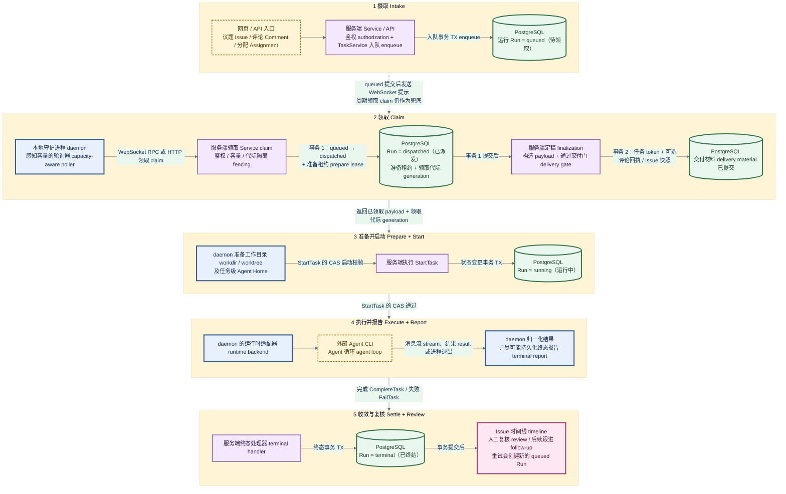
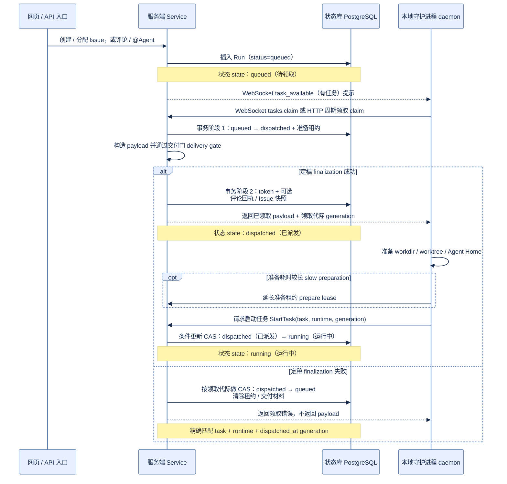
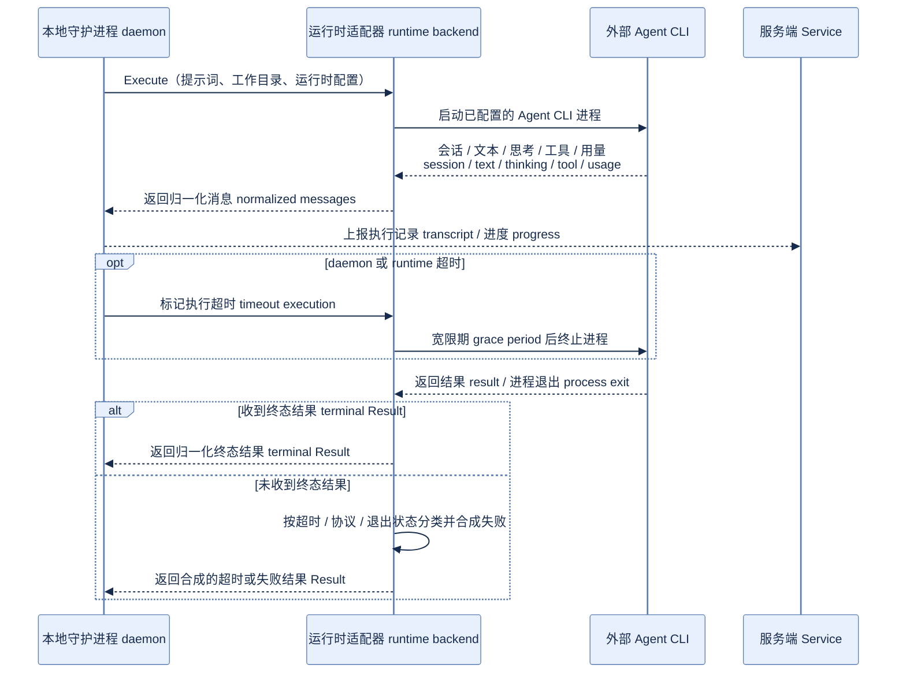
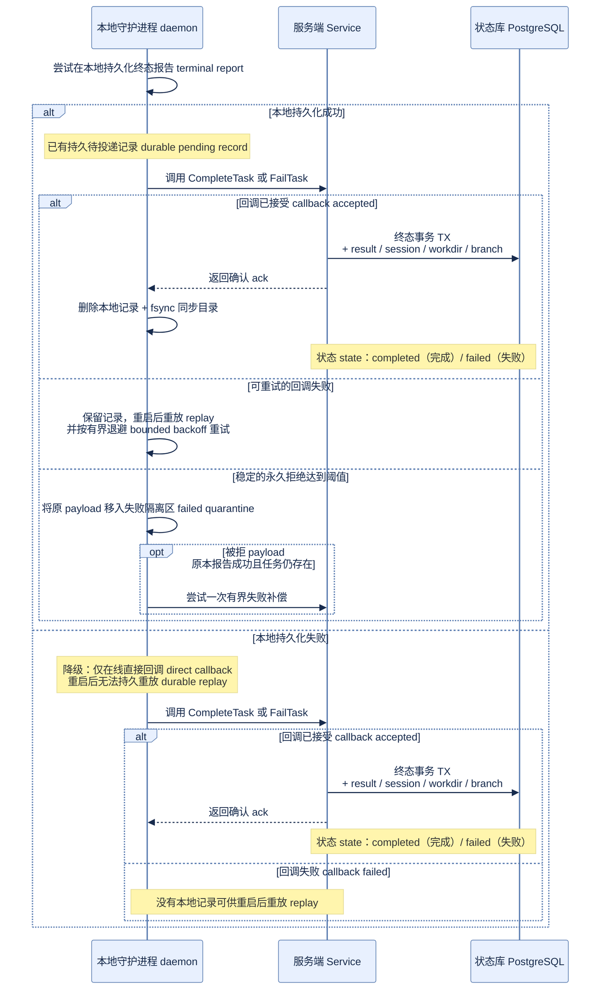

# Multica 深度研究：从人机协作工作台到可靠的 Agent 运行控制面

> 核验日期：2026-11-03。本文面向产品、架构与研发读者，先解释 Multica 如何组织工作，再沿一次 Run 进入源码；证据版本与本机观察边界见第 2 节。

## 1 一句话结论与阅读路线

一句话结论：**Multica 是一个 source-available 的人机协作工作区与 Agent 控制面——它用 Issue 组织多人、多 Agent 的共同工作，用 PostgreSQL 队列和本地 daemon 把工作可靠地交给 Claude Code、Codex、Cursor、DeepSeek Harness 等外部 Agent CLI；它本身不是模型，也不是另一套通用 Agent harness。** [官方定义][S1] [产品架构][S4]

理解 Multica，最省力的路线不是从 `claimTask()` 或数据库表开始，而是依次回答四个问题：

1. 人在产品里怎样提出、分配、追踪和验收一项工作？
2. Issue、Run、Agent、Runtime、Squad 和 Wakeup 各自保存什么事实？
3. 一条 Run 如何从 `queued` 走到 `dispatched`、`running` 和终态，并在断连、重启或回调失败后继续收敛？
4. Multica 与 DSH SuperAgent 分别位于哪一层，什么时候应二选一，什么时候适合上下组合？

第 3—6 节从产品与业务流程回答前两个问题；第 7—9 节进入源码与可靠性；第 10—12 节给出本机去敏实证、三个案例和 DSH bridge；第 13—14 节完成与 DSH SuperAgent 的对比和选型。

## 2 证据、版本与隐私边界

三类证据各有边界，不能互相替代：

| 证据 | 版本 | 只用于证明 |
|---|---|---|
| 官方源码 checkout | `890628511e423864d21c694231277805ce9f113c` | 当前 queue、claim、lease、daemon、runtime、Squad、Wakeup 与恢复实现 |
| 本机已安装二进制 | `0.4.42@76f59f5f1` | 真实安装及任务目录、锁、Agent Home、worktree 等去敏运行形态；不验证新源码行为 |
| 旧公开文档基线 | `9b1ab4f9eed9153a94719596eb8a728d2770f065` | 当时已经公开的产品能力；不证明当前实现或本机能力 |

公开源码链接统一固定到 `8906285`。本机实证只保留版本、数量级和目录/运行形态；不披露 Workspace、Issue、Task、人员或仓库标识、任务正文、token、配置值和进程参数，也不以本机绝对路径作为公开证据。

## 3 Multica 是什么

站在使用者一侧，Multica 像一个为“人类同事 + coding agents”设计的研发工作系统：人创建 Issue、补充评论、指定负责人、查看执行记录和 PR，Agent 则像一个可以被分配工作的团队成员。一次执行结束后，结果回到 Issue timeline，人决定是否继续、重试、进入 review 或完成工作。 [工作方式][S5]

许可上，Multica 是 **source-available workspace**。Multica License 允许单一组织内部使用，包括内部自托管；向第三方提供托管服务、嵌入对外商业产品或移除品牌仍受额外条件约束。因此它不能按无附加限制的 Apache 2.0 或 MIT 开源产品理解。 [许可证][S3]

站在架构一侧，它由三层组成：

- **协作产品层**：Workspace、Project、Issue、评论、Agent 名册、Squad、Inbox、Autopilot、Wakeup、review 与运行分析；
- **控制面**：Go 服务、PostgreSQL 队列、权限与归因、claim/lease、Run 状态机、transcript、重试与通知；
- **执行面**：部署在本地或云主机上的 daemon，准备 workdir/worktree 与任务级 Agent Home，再启动已经安装并登录的外部 Agent CLI。

这三层解释了一个常见误解：Multica 可以调度许多 Agent runtime，但真正的模型调用和 tool loop 不在 Multica 的 Go 服务中实现。`agent.Backend.Execute()` 选择 adapter，由 adapter 启动外部 CLI；Multica 负责把“谁应在何处执行什么”可靠地送到 CLI，并把消息、工具调用、usage 和终态收回。 [Backend 接口][S19] [执行与 drain][S20]

因此，它不是单纯的多 Agent SDK，也不只是任务看板。更准确的定位是：**成品协作产品 + Agent orchestration/control plane + 本地执行 daemon**。 [官方定义][S1] [产品架构][S4]

## 4 产品形态与使用方式

Multica 的入口覆盖 Cloud、Web、Desktop、移动客户端源码、自托管 Docker/Helm、CLI 与 API；产品中可以管理多个 Workspace、Project、Issue、Agent 与 Squad，并通过 Inbox、Autopilot 和运行分析追踪工作。 [功能概览][S2]

一个团队通常按下面的方式使用它：

1. 把代码仓库或本地目录配置为 Project resource；Git/worktree 模式为 Run 准备隔离 checkout，`local_directory` 的 `in_place` 模式则使用真实目录并用锁串行，二者的隔离含义不同。 [项目资源][S8]
2. 注册 Agent，配置其 instructions、skills、model、Access 与 runtime。Agent 是长期身份，不是常驻模型进程；只有被触发时才创建一次 Run。 [Agent][S6]
3. 在 Issue 中分配 Agent 或 Squad，也可以通过评论 `@Agent`、聊天渠道、Webhook、Autopilot 或 Wakeup 触发新 Run。 [工作方式][S5]
4. daemon 在自己的机器上领取 Run，准备执行目录与 Agent Home，启动配置的外部 Agent CLI。
5. 人在 Issue timeline 中查看进度、工具记录、阻塞、结果和成本；Run 完成不等于 Issue 完成，是否进入 `in_review` 或 `done` 仍由团队工作流决定。 [工作方式][S5]

这套产品形态让多个成员、多个项目和多个异构 coding CLI 共用一个工作事实源。它把“Agent 跑了一次”放回团队熟悉的 Issue、评论、负责人、review 和 PR 语境里，而不是要求每个人分别管理一组终端 session。

安全上，Project resource、worktree 和任务级 Agent Home 都不是强沙箱。默认 Run 继承 daemon 所在 OS 用户的权限；官方建议用专用用户、容器或 VM，并按最小权限配置凭据。 [安全模型][S9]

## 5 核心领域概念

先把产品语言和内部语言对齐，后面的状态机就容易理解。

| 概念 | 它保存的事实 | 不应误解为 |
|---|---|---|
| Workspace / Project | 团队边界、成员与代码资源的组织方式 | 单次 Agent session |
| Issue | 目标、状态、负责人、评论、资源和 PR/MR 关联，是团队共享事实源 | 一次不可重试的模型调用 |
| Agent | 长期命名身份，持有 instructions、skills、model、Access 与 runtime 选择 | 常驻运行的进程 |
| Run / Task | 某个 Agent 针对某个 Issue 的一次独立执行；内部由 `agent_task_queue` 持久化 | 整个 Issue 生命周期 |
| Runtime | 某种 Agent CLI 在某台 daemon 主机上的可执行能力与配置 | Multica 自带模型 |
| daemon | 领取 Run、准备目录、启动 CLI、采集 transcript 并报告终态的本地执行器 | 中央业务数据库 |
| Squad | 带 Leader 和成员名册的产品级多 Agent 协作单元 | 一个 Worker 内部临时 subagent 列表 |
| Issue Wakeup | “未来条件 + 创建者权限 + 目标 Agent + 指令”的持久规则 | 等待中的常驻 Agent 进程 |
| Review / Inbox | 把需要人工注意的结果、阻塞与验收动作呈现出来 | 自动把代码合并上线 |

Issue 与 Run 的分离最关键。同一 Issue 可以有多次 Run、不同 Agent 和不同失败/重试代际；每次 Run 都保留自己的 transcript 和终态。这样团队可以讨论“这项工作是否完成”，同时又能审计“哪一次执行做了什么”。 [任务与运行][S7]

内部 `Task` 与产品界面中的 `Run` 大体指同一执行实例，但本文在讨论用户体验时称 Run，在讨论队列、handler 和数据库状态时称 Task。状态主线是：

```text
queued → dispatched → running → completed / failed / cancelled
                 ↘ waiting_local_directory（特定目录等待形态）
```

`dispatched` 只表示某个 runtime 已取得 claim，并由准备租约（`prepare lease`）保护环境准备；`generation`（领取代际）用于识别这一次 claim。`running` 表示执行目录已就绪且服务端接受了 `StartTask` 的 CAS，不能进一步推导为模型已经产生首个 token。 [准备与启动][S16] [StartTask CAS][S18]

## 6 一项任务的完整业务流程

以“修复一个缺陷、补测试并交给人 review”为例，用户看到的流程是：

1. 人创建或打开 Issue，写清目标，然后分配给 Agent/Squad，或在评论中明确 `@Agent`。
2. 服务端检查成员关系、Agent Access、invoke 权限、负责人和触发目标，为这次执行创建一条 queued Run。
3. 在线 daemon 收到“有工作”的提示，或通过周期轮询发现队列；它先取得本地执行 slot，再领取 Run，避免服务端已分发但本机没有容量。
4. daemon 准备 repo/workdir、worktree、任务级 Agent Home、skills、MCP 与 prompt，然后把 Run 从 `dispatched` 启动为 `running`。
5. 外部 Agent CLI 读取当前 Issue 上下文，修改代码、运行测试、评论进度并关联 PR；Multica 持续保存 transcript、tool、usage 与 session 信息。
6. daemon 把终态报告提交给服务端；服务端更新 Run、触发重试或通知，人回到 timeline review。终态投递的异常分支见第 7.6—7.7 节。

下面这张图同时保留产品动作和实现边界。WebSocket 的职责是低延迟提示；PostgreSQL queue 才是可恢复的事实源。图内以中文说明业务动作，以英文保留源码函数、状态值和协议名；`TX` 表示数据库事务，`CAS` 表示比较并交换式的条件更新，`generation` 表示本次领取代际。 [入队][S10] [WS-first claim][S12]



这条链的业务含义是：Issue 保存团队共同目标，Run 保存一次执行，daemon 承担本机执行责任，外部 CLI 运行具体 agent loop；Service 是 daemon 与 PostgreSQL 之间唯一的网络与事务边界。

## 7 queue、claim、lease、daemon、runtime、terminal report 的底层控制面

### 7.1 入队：先保存 Run，再发送提示

`EnqueueTaskForIssue()` 把 Run 写进 `agent_task_queue`。队列行不复制完整 Issue 正文；claim 时服务端组装当前 Issue snapshot/brief，运行中的 Agent 仍可通过 Multica CLI 读取最新 Issue 和评论。入队还记录 `originator`（发起者）、`accountable`（责任归属人）、rule/evidence 和 runtime overlay 等归因信息。 [入队][S10]

常规顺序是先持久化 queued Run、广播 `task:queued`，再发送 `task_available` 或 `pending_work` 提示。提示丢失或重复都不改变事实；daemon 的周期 claim 会重新发现队列。

### 7.2 领取：WS 和 HTTP 共享一套 service 语义

daemon 使用覆盖本机多个 runtime 的 machine-level batch poller，并在 claim 前先取得本地并发 slot。它优先通过 WebSocket RPC `tasks.claim` 领取，必要时退回 HTTP batch claim / 周期轮询。WebSocket 请求发出后若连接断开，daemon 会等待 safety window，再决定是否走 HTTP，降低“响应其实已在途”时的双领风险。 [daemon poller][S11] [WS-first claim][S12]

这里没有两套 claim 状态机：WebSocket 的 `rpcClaimTasks()` 构造同一身份范围的进程内 HTTP 请求，复用 `ClaimTasksByRuntime()`、payload 构建和统一交付门（`delivery gate`）`finalizeClaimDelivery()`。因此应表述为 **WS/HTTP claim 共用同一 service 语义**，而不是“WS 快路径绕过 HTTP 的权限与事务”。 [WS RPC 复用][S13] [claim handler][S14]

### 7.3 两阶段 claim：所有权和交付材料分开收敛

claim 分两个事务阶段：

1. **领取事务**：锁 Agent，检查 `max_concurrent_tasks`、runtime 绑定和归属，把 `queued → dispatched`，并建立 `prepare lease`；`dispatched_at` 同时充当 claim `generation`。
2. **finalization 事务**：再次经过 `delivery gate`，原子写入 task-scoped token；comment-backed task 才写 comment delivery receipt，存在可用 Issue snapshot 时才一并保存，最后把完整 payload 返回 daemon。

如果 finalization 失败，服务端用 `(task_id, runtime_id, dispatched_at)` 做 CAS，只把这一代 claim 精确放回 queued，避免旧请求覆盖新 owner。 [claim transaction][S15] [claim finalization][S17]

task token 把 daemon 领取后的 Agent 写操作限制在本次任务语境。它是运行级凭据，不是长期 Workspace 用户凭据；claim 侧还会校验 daemon、runtime 与 Workspace 的归属关系。 [claim handler][S14]

### 7.4 prepare lease 与 running liveness 是两套机制

claim 后，daemon 才准备 skills、repo/workdir、worktree、Agent Home、MCP broker 和 prompt。准备可能很慢，所以 `dispatched` 阶段由 `prepare lease` 保护，daemon 会周期续租。目录就绪后，daemon 携带 `dispatched_at` `generation` 调 `StartTask`，服务端 CAS 成功才进入 `running`。 [准备与启动][S16] [StartTask CAS][S18]

Multica **没有 task-level heartbeat**：

- pre-start 的 `dispatched` 用 `prepare lease` 防止准备期被错误回收；
- `running` 的存活依赖 runtime-level heartbeat / `agent_runtime.last_seen_at` 与 sweeper；
- daemon 重启会主动上报 orphan，恢复范围覆盖 `dispatched`、`running` 和 `waiting_local_directory`。

这三句话需要合并理解：`prepare lease` 只保护准备期；运行期失活由 runtime heartbeat 与 sweeper 判断；重启遗留则由 orphan recovery 收敛。 [runtime liveness][S23] [orphan recovery handler][S24] [orphan 三态查询][S37]

### 7.5 runtime backend：Go 控制面不实现 agent loop

`agent.Backend.Execute()` 是统一执行接口。具体 adapter 启动 Claude Code、Codex、Cursor、DSH 等外部 CLI；daemon drain 消息流，记录 text、thinking、tool、usage 和 session，并用总超时、idle/tool watchdog 监督外部进程。 [Backend 接口][S19] [执行与 drain][S20]

这种设计让 Agent 名册、权限、队列和审计保持统一，同时允许不同 Agent 使用各自的 model、session 和工具生态。代价是安全边界延伸到 daemon OS 用户和外部 CLI，不能只审查 Go 服务。

### 7.6 terminal report：持久化至少一次（`durable at-least-once`）的适用条件

外部 CLI 结束后，daemon 会先尝试把 terminal report 持久化到本地队列，再调用服务端；只有服务端确认后才 ack 本地记录。若服务端已经提交，而 daemon 在 ack 前崩溃，重启会重放同一个幂等终态请求。若本地队列写入失败，当前实现仍执行有界的在线回调，避免磁盘只读或已满把原本健康的服务端更新也卡死，但这条退化路径不具备跨重启 durable replay。 [terminal report][S21]

因此，准确说法是：**本地持久化成功后，terminal report 对可重试失败提供持久化至少一次交付（`durable at-least-once delivery`）**；允许同一终态报告重放，由服务端幂等收敛，但不承诺严格一次（`exactly-once`）。明确的永久拒绝达到计数与时间条件后，原报告会移出 pending replay 集合、隔离到 failed queue；被拒的是成功报告且任务仍存在时，daemon 还会尝试发送一次有界的失败补偿。 [永久拒绝与隔离][S38]

### 7.7 完整时序：从 queued 到 terminal

为了在普通正文宽度下保留可读字号，状态机拆成三段：A 覆盖领取与启动，B1 覆盖 runtime 执行，B2 单独展开终态投递。各图不使用跨图连续编号，以 A、B1、B2 作为主索引。这里展开的是 `completed` / `failed` 报告路径；服务端主动取消和 daemon 的 `AckTaskCancelled` 走独立 cancel / ack 链，不应从图 B2 推断。

**A. queued → dispatched → running**



**B1. running → runtime execution → normalized Result**



**B2. completed / failed 报告：持久化成功才有跨重启 replay**



### 7.8 一个必须保留的 best-effort 缺口

评论触发通常可以合并进尚未 claim 的 queued Run、成为 active Run 的 planned follow-up，或显式 steer 到当前 turn；多数并发冲突有有界重试和持久义务记录（`durable obligation`）接手。但存在明确例外：**不同 PR head 的 queued blocker 不能安全 merge，当前 schema 也没有对应 obligation row**。实现只记录错误，等待后续事件或人工恢复。 [评论触发与合并][S22]

因此，对评论并发的准确结论是：常规分支可持久转交，不同 PR head blocker 仍需后续事件或人工补偿。

## 8 Squad 与 Issue Wakeup

### 8.1 Squad：平台级身份之间的协作

当 Issue 分配给 Squad，或评论明确 `@Squad`，服务端不是立刻并行启动所有成员，而是先给 Leader 创建一条带 `is_leader_task=true`、`squad_id` provenance 的普通 Run。Leader claim 后会收到 Squad Operating Protocol、Roster 和 Squad Instructions；它阅读 Issue，使用结构化 mention 委派合适成员，记录 evaluation，然后停止。 [Squad 文档][S25] [Leader enqueue][S26] [Leader provenance][S27]

成员被 mention 后，各自获得独立 Run。不同 Agent 可以在同一 Issue 上并行；每个成员拥有自己的 Agent 配置、Access、runtime、worktree/Agent Home、transcript 和审计记录。这是产品级多 Agent 协调，不是一个 Worker 内部临时调用几个 subagent。

Squad Leader 的范围也要说准确：它只在该 Squad 参与的 Issue 上被首次分配、mention、成员结果或相关评论再次唤醒。**它不是 Workspace 的中央 Router，更不是 DSH SuperAgent 中持续处理全局候选事件的 Main Session。** [Squad 文档][S25]

### 8.2 Wakeup：等待条件，而不是占着一个 Agent 进程

Issue Wakeup 把未来工作保存成一个显式产品对象：条件、revision、创建者、目标 Agent 和届时要执行的 instruction。等待评论、字段变化、子任务、时间或关联 PR CI 时，没有 Agent 进程常驻占用 runtime。 [Wakeup 文档][S28]

条件满足后，scheduler 的 `dispatch()` 不会盲目沿用旧决定。它在事务中重新验证：

- Wakeup revision 是否仍是当前版本；
- Issue 是否仍 active；
- 创建者是否仍有 invoke 权限；
- 目标 Agent、runtime 与归因是否仍有效；
- 创建或合并 Run 时是否仍满足相应约束。

随后，claim 还会通过 `CheckClaim()` 再做一次 Wakeup 相关验证。 [Wakeup scheduler][S29] [Wakeup 事务][S30] [Wakeup claim 检查][S31]

对于“等待 PR checks”条件，边界也很具体：只观察直接关联的 GitHub PR，并且只认 Wakeup 规则创建后出现的检查结果。它不是一个对任意 CI 系统和任意历史状态的通用事件查询器。 [Wakeup 文档][S28]

## 9 可靠性、安全与恢复

Multica 的可靠性不是来自某一个锁，而是持久事实与隔离旧所有者的 fencing 机制配合：

| 风险 | 主要机制 | 仍需注意 |
|---|---|---|
| WS 提示丢失 | PostgreSQL queue 是 durable truth；HTTP/周期 poll 可补偿 | WS 只做 hint/RPC，不应承载唯一事实 |
| 双领或旧 owner 写入 | Agent 行锁、capacity、runtime fence、`dispatched_at` `generation`、StartTask CAS | 网络断连后还要遵守 safety window |
| 准备时间过长 | `prepare lease` + 周期续租 | lease 只覆盖 pre-start，不是 running heartbeat |
| daemon 重启 | 上报 orphan，覆盖 `dispatched/running/waiting_local_directory`，再走统一 failure/retry pipeline | retry 是否发生取决于 failure reason 与 attempt |
| 终态回调 | 见第 7.6—7.7 节的 terminal-report queue 与时序 | 按响应分类进入确认、稍后重放或隔离 |
| 评论与 Run 竞态 | queued merge、planned follow-up、supplement receipt、completion reconcile | 不同 PR head blocker 仍有 best-effort 缺口 |
| 凭据越权 | Workspace RBAC、Agent Access、runtime owner、task token、daemon token | 外部 CLI 仍继承 daemon OS 用户能力 |

orphan recovery 的顺序值得强调：daemon 启动时把上一进程遗留的 `dispatched`、`running`、`waiting_local_directory` 上报；服务端先将旧 `generation` 失败化，再复用统一 retry 管线，而不是把未知状态直接改回 running。 [orphan recovery handler][S24] [orphan 三态查询][S37]

安全上，任务级 token 缩小了 Agent 回写服务端的权限范围，Workspace RBAC、Agent Access 与 runtime owner 则约束“谁能让哪个 Agent 在哪里运行”。但 worktree、Agent Home 和 daemon 进程边界都不是安全沙箱。对生产部署，仍应使用专用 OS 用户或容器/VM、最小化代码托管和模型凭据、限制网络与文件系统可见范围，并把外部 Agent CLI 视为同一信任域的一部分。 [安全模型][S9]

恢复流程仍会重验部分授权条件，但这些检查分散在 Agent Access/invoke、originator/accountable 归因、runtime 绑定、Wakeup revision、claim fence 与 failure classification 中；Multica 没有 DSH SuperAgent 那种集中、不可变且与 Decision/Ticket 绑定的 Mandate 对象。

## 10 本机去敏实证

依第 2 节证据边界，本机观察只验证旧二进制的运行形态，不验证当前源码实现：

- 运行环境处于“多个 Workspace、多种已探测 Agent CLI runtime”的数量级；本文不披露任何名称、ID 或配置值。
- 一个已结束的 Issue Run 留下任务级目录、锁、owner/sidecar 元数据和独立 workdir；其中可见若干位于非默认分支的 Git checkout/worktree，检查时无未提交文件。
- 另一类 Run 的任务级 Agent Home 中可见运行配置形态、session index 与若干 SQLite 状态库；工作目录表现为 Git worktree，Git common dir 指向外部共享仓库。
- 这些观察支持“每 Run 有独立执行目录/Agent 状态，worktree 可复用共享 Git 对象”的运行形态；它们不证明 worktree 是强沙箱，也不证明观察到的全部目录都由 Multica 自动创建。

本轮没有创建或修改真实工作项，没有读取任务正文、token、凭据、配置值或进程参数。当前源码中的两阶段 claim、Wakeup 重验和 runtime adapter 仍属于静态取证，不能写成本机旧二进制的动态验证。

## 11 基于源码还原的三个端到端案例

以下案例按第 2 节固定源码的真实产品入口与调用链还原，并用上一节的去敏形态观察校验目录、Agent Home 和 worktree 的存在。案例文本不取自本机私密任务。

### 11.1 案例 A：普通修复并提交 PR

需求是“修复登录超时回归，补单元与集成测试，提交 PR 交给我 review”。它直接落在第 6 节主链：Issue 分配或 mention 创建 queued Run；daemon 两阶段 claim 后准备 worktree/Agent Home，`StartTask` 成功再启动 CLI；Agent 改码、测试、关联 PR，终态回到 timeline。案例的关键不是重复调度步骤，而是 Issue 在执行前已经是多人共享事实源，Run 只是服务它的一次执行。 [入队][S10] [terminal report][S21]

### 11.2 案例 B：运行中追加要求，随后 CI 失败

Agent 正在修复时，用户又评论“再补一个并发场景”，随后关联 PR 的 CI 失败。评论会根据当前 Run 的代际和 runtime 能力走不同分支：

1. 若 provider/runtime 明确支持 steer，评论可绑定精确 `task_id` 成为 supplement，由 daemon 送入当前 turn。
2. 若 Run 仍 queued、尚未 claim，评论可以原子合并进 queued Run，并更新触发与归因信息。
3. 若 Run 已 active 但不适合 steer，系统登记 planned follow-up；当前 Run 完成 reconcile 后再创建新 Run，不会假装当前 turn 已读取这条评论。
4. CI 失败可以由人再次 `@Agent`，也可以由 “关联 PR checks 结束” 的 Issue Wakeup 触发普通新 Run。等待期间没有 Agent 进程。

supplement 的持久化和 daemon delivery 分别由 task supplement handler 与 supplement loop 负责。 [supplement handler][S32] [supplement loop][S33]

CI Wakeup 则重新走权限、revision、Agent/runtime 与 claim 检查，而不是恢复一个无限期挂起的模型进程。 [Wakeup 事务][S30]

如果 queued follow-up 恰好被不同 PR head 挡住，就会落入前述 best-effort 缺口；这是案例设计和故障预案必须承认的边界。 [评论触发与合并][S22]

### 11.3 案例 C：Squad 修复、等待 CI、再复查

同一个缺陷同时需要后端修复、测试补齐和最终 CI 审核：

1. 人把 Issue 分配给 Squad，或在评论中 `@Squad`。服务端只先给 Leader 入队一条 Run。
2. Leader 通过普通 queue/claim/lease 链运行，读取协议、成员名册和 Squad instructions；它选择成员，用结构化 mention 委派，并记录 evaluation。
3. 每个被 mention 的成员获得独立 Run，可使用不同 runtime/CLI 和独立 worktree。成员完成修改、测试并关联 PR。
4. 成员或人创建“等待关联 PR checks”的 Wakeup，然后当前 Run 结束。等待期间没有 Agent 进程占用 runtime。
5. CI 条件满足后，Wakeup scheduler 重验 revision、Issue、创建者 invoke 权限和 Agent/runtime，创建或合并新 Run；claim 时再次 `CheckClaim()`。
6. Wakeup Run 读取最新 PR/CI。若失败，可再次委派修复；若成功，成员结果再次唤醒 Leader。Leader 评估整个 Issue 后进入 `in_review`，或继续委派；无动作时可以记录 `no_action` 并静默结束。

这套流程里，Leader 是某个 Squad 在某个 Issue 上的协调者，成员是平台一等 Agent 身份；它不能类比成 DSH SuperAgent 的全局 Router + Worker 内部 subagent。 [Squad 文档][S25] [Wakeup scheduler][S29]

## 12 DSH JSONL bridge 与接入方式

Multica 可以把 DeepSeek Harness 作为外部 runtime backend，但实际调用的不是裸 `dsh`，而是：

```bash
dsh --profile multica --stdio
```

daemon 中的 Go `dshBackend` adapter 已存在；DSH 一侧的 `multica` profile bundle 仍需外部安装。也就是说，“Go adapter 在 Multica 源码中”不等于一台只有默认 DSH 安装的机器已经能被 daemon 注册为该 runtime。 [DSH adapter][S34] [DSH runtime 安装][S36]

### 12.1 protocol v1 JSONL

daemon 启动独立 DSH 进程后，通过 stdin 写入 protocol v1 的 JSONL `execute` frame：

```json
{"v":1,"type":"execute","request_id":"…","cwd":"…","prompt":"…","resume_session_id":"…","model":{"provider":"…","id":"…"},"reasoning_effort":"…","mcp_servers":[]}
```

`resume_session_id`、`model` 和顶层 `reasoning_effort` 都是 `omitempty` 可选字段；未指定模型时整个 `model` 对象省略，未指定思考强度时顶层 `reasoning_effort` 省略。当前 adapter 从 `provider/model` ID 构造 `model.provider` 与 `model.id`，并把 Run 的 thinking level 写入顶层 `reasoning_effort`。上例只展示 wire shape，不是本机配置值。stdout 则按行返回下列 frame；`protocol_error` 是错误分支，不要求随后一定有 `result`：

```text
ready → session → text / thinking / tool_call / tool_result / usage … → result
                         ↘ protocol_error(code, message)
```

各 frame 的职责是：

| Frame | Multica 侧含义 |
|---|---|
| `ready` | bridge 协议已就绪，不等于任务完成 |
| `session` | 保存 DSH Session ID，并可产生 running 消息 |
| `text` / `thinking` | 映射为 transcript 文本与思考事件 |
| `tool_call` / `tool_result` | 映射工具调用与结果 |
| `usage` | 按 provider/model 累加 usage |
| `protocol_error` | 用 `code` 和 `message` 记录协议级错误；若进程结束时仍无 `result`，该错误进入合成的失败结果 |
| `result` | 唯一正常生成 terminal `Result` 的 frame，携带 status、output/error、session、usage 等 |

协议版本不符会记录 protocol error；显式 `protocol_error` frame 则把 `code + ": " + message` 保存为协议错误。**request ID mismatch 的 frame 会被忽略，不应写成整个协议立即失败。**只有最终没有收到 `result` 时，adapter 才按 timeout、cancel、scanner/protocol error、未 ready、进程退出或“无终态”等原因合成失败；若后续收到 `result`，则以该 terminal frame 为准。 [DSH frame 映射][S35]

超时或取消时，adapter 先尝试写 `cancel` frame，再按 grace period 终止进程组。模型 ID 和 MCP 配置也在启动前校验。 [DSH adapter][S34]

### 12.2 接入前的版本固定与产物校验

当前证据没有给出经本文确认、可以直接复制执行的 DSH 兼容版本或 bridge commit，因此这里不提供安装命令。**先读取待采用 bridge commit 的 manifest 与发布说明，确认 DSH、Node、协议和构建产物的兼容矩阵，再执行任何安装。**缺少任一项就停止接入并向 bridge 维护者确认，不用 `latest`、浮动分支或占位路径假装已经验证。

| 人工检查项 | 通过条件 |
|---|---|
| DSH 版本 | 从 bridge manifest/发布说明取得兼容范围，再固定一个精确版本；记录分发来源与校验值 |
| bridge commit | 固定完整源码 commit；审查该 revision 的 manifest、lockfile、install/postinstall scripts 与 protocol v1 声明 |
| Node 与包管理器 | 使用 bridge manifest 明确支持的精确 Node 版本和包管理器版本，不从本机现状或 Multica 仓库版本反推 |
| 构建产物 | 在干净环境从固定 commit 构建目录或 tarball；保存哈希、文件清单和构建日志，确认没有未审查的安装脚本或网络下载 |
| profile 安装 | 只执行该固定 revision 文档给出的安装命令，并核对实际加载的 bundle 路径/哈希与审计产物一致 |
| 注册验收 | `dsh --profile multica --probe` 必须返回 protocol v1 就绪；再核对 model catalog，并做不含真实凭据与私密任务的最小 smoke test |

模型凭据应进入 DSH 设置、环境或密钥管理系统，不能写进仓库。实际任务执行才调用 `dsh --profile multica --stdio` 并发送 JSONL `execute`；安装的是 Multica 的 runtime profile，**不是**启动本项目 `superagent` profile 的常驻 Source/Policy/Ticket 服务。 [DSH runtime 安装][S36]

这条 bridge 也把职责划得很清楚：Multica 继续拥有 Issue、Run queue、claim/lease、daemon、transcript 与 review；DSH 拥有 agent loop、Session store、model catalog、tools 和 MCP client。

## 13 与 SuperAgent 从定义/产品/功能/流程/底层机制对比

本节的 SuperAgent 定义与实现细节以 [主研究报告](./dsh-superagent-research.md) 为准。两者都在解决“单次 coding session 很强，但团队难以持续交付、协调和追踪”的问题；相似来自持久状态外置，差异来自首要产品对象和授权模型。

| 维度 | Multica | DSH SuperAgent | 关键判断 |
|---|---|---|---|
| 定义 | source-available 的人机协作工作区、控制面与本地 daemon | 构建在 DSH 上、面向单仓库研发事件的主动式长期 Agent 应用 | 一个先组织团队工作，一个先治理持续事件 |
| 首要产品对象 | 多 Workspace、多项目、多人、多命名 Agent、Squad 与共享 Issue | 一个仓库对应一个长期 SuperAgent，内部是 Main/Worker/Ticket | Multica 更像工作管理平台；SuperAgent 更像长期团队成员及其控制层 |
| 工作起点 | 显式 Issue、分配、mention、Chat、Autopilot、Webhook、Wakeup | GitHub/飞书 Source 先标准化为 Trigger，再做 Gate/Eval | Multica 从产品动作开工；SuperAgent 从事件准入开工 |
| 核心工作单元 | Issue 是共享事实；Run 是一次执行 | Thread/Ticket 是工作事实；Assignment 是一次执行 | `Run ≈ Assignment`，但 `Issue` 只近似覆盖 Thread + Ticket 的一部分 |
| Agent 模型 | 多个命名 Agent 是一等公民，各有 Access/runtime/model/skills | 对外一个 SuperAgent；Main/Worker 是角色，subagent 是 Worker 内部工具 | 横向多 Agent 是 Multica 的产品强项 |
| 协调者 | Squad Leader 只协调参与该 Issue 的 Squad | Main Session 处理全局候选路由和语义评估 | Leader 不是全局 Router |
| 授权 | Workspace RBAC、Agent Access、invoke、runtime owner、task token、归因 | SourceScope、Policy gate、Decision/Mandate、Ticket scope、host tool checks | Multica 强在组织权限；SuperAgent 强在“这条事件为何能做、允许做什么” |
| 主动性 | Agent 不常驻；每次 Run 由显式产品动作或已配置自动化触发 | 常驻 Source 可把未点名但命中书面 Rule 的事件转为候选/工作 | 两者都有自动化，但主动性语义不同 |
| 未来事件 | Wakeup 显式保存条件、权限、目标 Agent 和指令；等待时无进程 | Source 持续观察，Subscription/TicketInput/Effect 把事件送回授权链 | Wakeup 是用户可见产品对象，SuperAgent 更像事件驱动控制层 |
| Runtime | PostgreSQL queue + daemon 调度多种外部 Agent CLI | DSH 本身提供 Session、tool loop、workspace 与 persistence | Multica 跨 harness 编排；SuperAgent 直接内嵌 DSH |
| 可靠投递 | WS hint + poll、两阶段 claim、lease、terminal-report queue | SQLite Effect + Outbox、Assignment report、Main relay、外部 channel receipt | 都追求最终收敛，但 outbox 所在层不同 |
| 恢复 | generation/lease/runtime heartbeat/sweeper/orphan/retry | Effect 退避、Assignment restart、Session resume、Mandate revalidate | Multica 偏分布式执行恢复；SuperAgent 偏授权与会话恢复 |
| 外部回复 | Issue timeline、Run transcript、评论与通知 | Worker report → Main relay → Replies/Outbox → GitHub/飞书 | SuperAgent 把外部副作用的授权链表达得更集中 |
| 部署 | Go + PostgreSQL + WebSocket + 多客户端 + 多 daemon | 当前原型是单机单活、SQLite、stateDir 锁 + DSH Web profile | 多节点共享平台与轻量单实例控制面 |
| 许可证 | Multica License，source-available，有托管/嵌入/品牌限制 | MIT | 对外 SaaS 和二次产品化空间不同 |

两个最容易混淆的对象需要单独拆开：

- **Squad Leader ≠ SuperAgent Main Router**：Leader 是 Issue 范围内的协调 Run；Main 是持续存在的全局语义路由角色，且确定性 gate、subscription fan-out 与 Outbox 仍由 host/core 执行。
- **Multica task token ≠ SuperAgent Mandate**：task token 是运行级访问凭据，Multica 还有分散的 Access/invoke/runtime 检查；Mandate 则把 trigger evidence、actor、policy version、strength 与 scope 固化成一等授权事实。

因此两者不是简单替代品。更准确的分层是：Multica 在 DSH/Claude Code/Codex 等 harness 之上提供协作与跨 runtime 控制面；DSH SuperAgent 则是在 DSH 内构建的一套主动事件准入、授权和长期负责机制。

## 14 选型与组合建议

### 14.1 优先评估 Multica 的场景

- 需要开箱即用的多人、多 Agent 工作台，以及 Workspace/Project/Issue/Squad/Inbox/review；
- 需要统一调度多种 coding CLI 和多台 daemon，并在团队 timeline 中查看 transcript、usage 与结果；
- 需要 Web/Desktop/移动端、自托管、聊天渠道和显式 Wakeup/Autopilot；
- 团队主要问题是“如何把许多人和许多 Agent 放进同一个可管理工作系统”。

采购和二次开发前必须单独审查 Multica License，尤其是向组织外提供托管服务、嵌入销售产品和品牌处理的场景。 [许可证][S3]

### 14.2 优先评估 DSH SuperAgent 的场景

- 需要围绕一个仓库持续监听 GitHub/飞书，而不是等待用户先进入任务平台；
- 需要对隐式请求做 host-enforced Gate/Eval，并用 Mandate 固化“为何能做、允许做到哪”；
- 需要研究 Router/Worker、Ticket subscription、Effect/Outbox 和低打扰人工监督；
- 可以接受当前原型更轻、更聚焦、单机单活的部署边界。

### 14.3 组合时只保留一个上层主控

可行的两种组合是：

1. **Multica 主控**：Multica 管 Workspace、人员、Agent 名册、Issue、Squad、Wakeup 和 review；通过官方 bridge/profile 把 DSH 当作 Worker runtime。此时不再叠加 SuperAgent 的 Source/Policy/Ticket 控制面。
2. **SuperAgent 主控**：SuperAgent 管 GitHub/飞书 Source、Policy/Mandate、Ticket 与外部回复；若要接 Multica，应实现明确 bridge，并指定唯一事实源、幂等键和状态映射。

没有定制桥接时，不要让同一 GitHub 事件同时触发 Multica Autopilot/Wakeup 与 SuperAgent Source。否则 Issue/Ticket、Leader/Router、Run/Assignment、通知和 retry 都可能重复，最终出现两个 Worker 和两次外部回复。

最终选择可以压缩成一句话：**要让许多人和许多 Agent 在一个工作系统里协作，先看 Multica；要让一个 Agent 在明确授权下长期、主动地负责一个仓库，先看 DSH SuperAgent。**

## 15 来源、限制和实现索引

### 15.1 研究限制

- 本文不是法律意见；许可证解释以仓库中的 Multica License 和厂商书面授权为准。
- 函数级分析是对固定提交 `890628511e423864d21c694231277805ce9f113c` 的静态取证，不等于对最新 `main` 或 Cloud 环境的承诺。
- 本机动态证据只来自更早的 `0.4.42@76f59f5f1` 去敏元数据；没有把当前源码行为写成旧二进制已实测。
- 旧公开文档基线 `9b1ab4f9eed9153a94719596eb8a728d2770f065` 只用于说明当时的公开能力；本文公开 URL 均固定到 `8906285`。
- 本轮没有创建真实任务、触发外部 Agent、读取私密正文或检查凭据，因此案例验证的是设计链路和运行形态，不是端到端生产压测。
- Run 进入终态只代表本轮执行结束；Issue 是否完成仍由 review 与团队工作流决定。
- 可靠性边界包括：没有 task-level heartbeat；terminal report 只在本地持久化成功后提供 `durable at-least-once` replay，且不承诺 `exactly-once`；不同 PR head 的 queued blocker 存在 best-effort 缺口。
- worktree 与 Agent Home 是运行隔离形态，不是强沙箱。

### 15.2 产品与架构来源

[S1]: https://github.com/multica-ai/multica/blob/890628511e423864d21c694231277805ce9f113c/README.md#L10-L14 "Multica 官方定义"
[S2]: https://github.com/multica-ai/multica/blob/890628511e423864d21c694231277805ce9f113c/README.md#L52-L131 "功能概览与产品入口"
[S3]: https://github.com/multica-ai/multica/blob/890628511e423864d21c694231277805ce9f113c/LICENSE#L1-L85 "Multica License"
[S4]: https://github.com/multica-ai/multica/blob/890628511e423864d21c694231277805ce9f113c/README.md#L222-L245 "产品架构"
[S5]: https://github.com/multica-ai/multica/blob/890628511e423864d21c694231277805ce9f113c/apps/docs/content/docs/how-multica-works.zh.mdx#L9-L43 "Multica 如何工作"
[S6]: https://github.com/multica-ai/multica/blob/890628511e423864d21c694231277805ce9f113c/apps/docs/content/docs/agents.zh.mdx#L9-L35 "Agent 定义"
[S7]: https://github.com/multica-ai/multica/blob/890628511e423864d21c694231277805ce9f113c/apps/docs/content/docs/tasks.zh.mdx#L10-L34 "任务与运行"
[S8]: https://github.com/multica-ai/multica/blob/890628511e423864d21c694231277805ce9f113c/apps/docs/content/docs/project-resources.zh.mdx#L43-L107 "Project resources"
[S9]: https://github.com/multica-ai/multica/blob/890628511e423864d21c694231277805ce9f113c/apps/docs/content/docs/security-model.zh.mdx#L9-L42 "安全模型"

### 15.3 queue、claim、daemon 与恢复实现索引

[S10]: https://github.com/multica-ai/multica/blob/890628511e423864d21c694231277805ce9f113c/server/internal/service/task.go#L1151-L1414 "EnqueueTaskForIssue"
[S11]: https://github.com/multica-ai/multica/blob/890628511e423864d21c694231277805ce9f113c/server/internal/daemon/daemon.go#L5291-L5475 "daemon machine-level poller"
[S12]: https://github.com/multica-ai/multica/blob/890628511e423864d21c694231277805ce9f113c/server/internal/daemon/wsrpc.go#L307-L385 "WS-first claim 与 safety window"
[S13]: https://github.com/multica-ai/multica/blob/890628511e423864d21c694231277805ce9f113c/server/internal/handler/daemon_rpc.go#L38-L93 "WebSocket RPC 复用 claim handler"
[S14]: https://github.com/multica-ai/multica/blob/890628511e423864d21c694231277805ce9f113c/server/internal/handler/daemon.go#L2072-L2508 "batch claim handler 与 delivery gate"
[S15]: https://github.com/multica-ai/multica/blob/890628511e423864d21c694231277805ce9f113c/server/internal/service/task.go#L3594-L3727 "claim transaction"
[S16]: https://github.com/multica-ai/multica/blob/890628511e423864d21c694231277805ce9f113c/server/internal/daemon/daemon.go#L7708-L7855 "prepare workdir 与 StartTask"
[S17]: https://github.com/multica-ai/multica/blob/890628511e423864d21c694231277805ce9f113c/server/internal/service/task.go#L3930-L4032 "claim finalization"
[S18]: https://github.com/multica-ai/multica/blob/890628511e423864d21c694231277805ce9f113c/server/internal/handler/daemon.go#L4606-L4688 "StartTask generation CAS"
[S19]: https://github.com/multica-ai/multica/blob/890628511e423864d21c694231277805ce9f113c/server/pkg/agent/agent.go#L18-L35 "Backend interface"
[S20]: https://github.com/multica-ai/multica/blob/890628511e423864d21c694231277805ce9f113c/server/internal/daemon/daemon.go#L9518-L9645 "Execute 与 drain"
[S21]: https://github.com/multica-ai/multica/blob/890628511e423864d21c694231277805ce9f113c/server/internal/daemon/daemon.go#L6261-L6394 "durable terminal report"
[S22]: https://github.com/multica-ai/multica/blob/890628511e423864d21c694231277805ce9f113c/server/internal/handler/comment.go#L1965-L2150 "comment trigger、merge 与 best-effort 缺口"
[S23]: https://github.com/multica-ai/multica/blob/890628511e423864d21c694231277805ce9f113c/server/pkg/db/queries/agent.sql#L1220-L1238 "runtime liveness"
[S24]: https://github.com/multica-ai/multica/blob/890628511e423864d21c694231277805ce9f113c/server/internal/handler/task_lifecycle.go#L16-L58 "orphan recovery"
[S37]: https://github.com/multica-ai/multica/blob/890628511e423864d21c694231277805ce9f113c/server/pkg/db/queries/agent.sql#L1203-L1218 "orphan recovery 三态查询"
[S38]: https://github.com/multica-ai/multica/blob/890628511e423864d21c694231277805ce9f113c/server/internal/daemon/terminal_report_queue.go#L433-L690 "terminal report 永久拒绝、隔离与补偿"

### 15.4 Squad、Wakeup、supplement 与 DSH bridge 索引

[S25]: https://github.com/multica-ai/multica/blob/890628511e423864d21c694231277805ce9f113c/apps/docs/content/docs/squads.zh.mdx#L9-L72 "Squad 工作方式与再次触发"
[S26]: https://github.com/multica-ai/multica/blob/890628511e423864d21c694231277805ce9f113c/server/internal/service/issue.go#L865-L1005 "Leader enqueue"
[S27]: https://github.com/multica-ai/multica/blob/890628511e423864d21c694231277805ce9f113c/server/internal/service/task.go#L1431-L1457 "Leader Task provenance"
[S28]: https://github.com/multica-ai/multica/blob/890628511e423864d21c694231277805ce9f113c/apps/docs/content/docs/issue-wakeups.zh.mdx#L9-L79 "Issue Wakeup 语义"
[S29]: https://github.com/multica-ai/multica/blob/890628511e423864d21c694231277805ce9f113c/server/internal/service/issue_wakeup.go#L648-L811 "Wakeup scheduler"
[S30]: https://github.com/multica-ai/multica/blob/890628511e423864d21c694231277805ce9f113c/server/internal/service/issue_wakeup.go#L960-L1383 "Wakeup 事务、重验与入队"
[S31]: https://github.com/multica-ai/multica/blob/890628511e423864d21c694231277805ce9f113c/server/internal/service/issue_wakeup.go#L1452-L1495 "Wakeup claim 重验"
[S32]: https://github.com/multica-ai/multica/blob/890628511e423864d21c694231277805ce9f113c/server/internal/handler/task_supplement.go#L157-L271 "task supplement handler"
[S33]: https://github.com/multica-ai/multica/blob/890628511e423864d21c694231277805ce9f113c/server/internal/daemon/task_supplement.go#L143-L198 "daemon supplement loop"
[S34]: https://github.com/multica-ai/multica/blob/890628511e423864d21c694231277805ce9f113c/server/pkg/agent/dsh.go#L18-L300 "DSH adapter 启动、execute 与取消"
[S35]: https://github.com/multica-ai/multica/blob/890628511e423864d21c694231277805ce9f113c/server/pkg/agent/dsh.go#L302-L433 "DSH frame 扫描、映射与失败分类"
[S36]: https://github.com/multica-ai/multica/blob/890628511e423864d21c694231277805ce9f113c/apps/docs/content/docs/install-agent-runtime.zh.mdx#L88-L102 "DSH runtime profile 安装"
